# ConstructHub – Updated Concept and Architecture (vNext)

## 1. Executive Summary

What

- ConstructHub is a multi-tenant construction operations platform that unifies planning, procurement, logistics/delivery, field execution, financial control, collaboration, and compliance in a single system of record.
- It serves construction companies, general contractors, developers, project managers, site engineers/constructors, vendors/suppliers, and service subcontractors across the full project lifecycle.
- Scope includes core modules: Identity & Access, Project Management, Vendor/Subcontractor Management, Materials & Inventory, Procurement, Delivery, Financials, Workflow/Approvals, Notifications/Collaboration, DMS, Reporting & Analytics, and a Marketplace & Bidding system with AI-assisted estimating.

Why

- Projects suffer from siloed information, manual workflows, poor visibility, and fragmented supplier engagement—driving delays, cost overruns, and disputes.
- ConstructHub provides a single source of truth and automates critical flows to reduce procurement cycle time, increase delivery accuracy, and keep transactions on-platform with full audibility.
- Business impact: faster decisions, fewer errors and claims, improved supplier competition, and more predictable cashflow through progress-linked payments.

How

- Product: digital procurement and delivery confirmations, mobile-first field updates with photos/signatures, catalog-driven materials, configurable approval workflows, and progress-to-payment linkage for subcontractors.
- Marketplace: open/invited tenders with credit-based bidding and premium visibility; fair, category-specific commissions with project-based caps to encourage loyalty; commissions triggered only upon site-confirmed delivery or verified milestone.
- Architecture: Domain-Driven Design with bounded contexts, CQRS and targeted Event Sourcing for high-audit domains, Kafka-backed event backbone with replayable projections for low-latency reads.
- Security and multi-tenancy: OAuth2/OIDC via Keycloak with tenant-scoped claims, RBAC, strong data isolation (RLS or schema-per-tenant), encrypted storage, and comprehensive audit trails via event streams.
- Operations: microservices on Kubernetes, PostgreSQL for OLTP, S3 for documents, optional Elasticsearch for search, Redis for caching, and end-to-end observability (logs, metrics, traces).
- Delivery model: Cloud-neutral native cloud (no AWS/Azure dependency) multi-tenant SaaS by default; optional on-prem/private cloud Kubernetes offering targeted for Phase 5 enterprise deals (feature parity constraints and higher TCO). Dev environment runs fully locally.
- High-value exemplar use cases: (a) Urgent material request-to-delivery in <48h; (b) Steel tender attracting 5+ qualified bidders in <7 days; (c) Progress claim verified with photo evidence within 72h and auto-invoiced.
- Success measures (executive): procurement cycle time reduction, on-time delivery confirmations, GMV and take rate (marketplace), on-platform retention, audit findings (zero material issues).

## 2. Problem Statement and Market Context

What problems exist

- Siloed information across email, spreadsheets, messaging apps, and paper leads to lost context, duplicate data entry, and poor traceability.
- Manual procurement processes (quotations, approvals, POs) create bottlenecks, inconsistent pricing, and weak audit trails.
- Paper-based or ad-hoc delivery reporting delays inventory updates and hides discrepancies until it is costly to fix.
- Limited real-time visibility into progress, inventory, and commitments prevents proactive management and accurate forecasting.
- Communication gaps between contractors, subcontractors, and vendors result in misaligned expectations and rework.
- Decentralized document management causes versioning issues and increases contractual and safety risk.
- Supplier engagement is fragmented, with no standard mechanism to run fair, scalable tenders across materials and services.
- Off-platform leakage: after initial contact, deals move offline to avoid fees, undermining marketplace sustainability.
- Compliance and claims: insufficient auditable history complicates dispute resolution and regulatory obligations.

Why it matters

- Delays and cost overruns erode thin construction margins and tie up working capital.
- Lack of auditability increases dispute costs and insurance exposure.
- Poor inventory accuracy leads to urgent purchases, waste, and schedule slips.
- Fragmented supplier processes reduce competition and raise prices.
- Market trends (supply chain volatility, labor shortages, digital mandates) require data-driven operations and resilient sourcing.

How ConstructHub addresses these

- Unify data and context: a shared, tenant-isolated system of record with linked documents, comments, and events across modules.
- Automate workflows: guided procurement, configurable approvals, and mobile delivery confirmations with evidence to eliminate manual steps.
- Real-time visibility: event-driven updates feed projections for up-to-date dashboards on progress, stock, and financials.
- Standardize supplier engagement: integrated marketplace with open/invited tenders, reputation, and flexible quoting units for services.
- Prevent off-platform leakage: commission recognized only upon confirmed delivery/verified milestone, with project-level commission caps that reward volume and promote on-platform retention.
- Strengthen compliance: immutable event streams, versioned documents, and fine-grained RBAC support audits and legal defensibility.
- Integration-ready: APIs and webhooks connect ERP, BIM, and logistics partners for end-to-end data flow.
- Typical pre-digital baselines (for ROI framing): quote cycles 5–10 days; delivery confirmation >72h after arrival; inventory accuracy 85–92%; paper document handling 10–20 minutes per file.
- Change management: phased pilots with on-site champions, role-based training, and KPI dashboards; integration adapters to minimize double entry during transition.
- Industry context: aligns with ISO 19650 (information management), common FIDIC contract workflows, GDPR for personal data, and VAT/GST compliance for invoicing.

## 3. Business Objectives (Measurable)

What

- A concise, outcome-driven set of targets that define success for our customers and the business. Objectives guide prioritization, pricing, and GTM, and are reported per tenant, per project, and globally.

Why

- Aligns stakeholders around value, not features; proves ROI for buyers; ensures engineering focuses on cycle time, cost control, auditability, and marketplace liquidity rather than vanity metrics.

How

- Instrument end-to-end events with timestamps for all core flows (procurement, delivery, inventory, bidding, approvals).
- Define formulas, owners, and review cadence (monthly QBRs), with per-tenant baselines captured during pilot onboarding.
- Build productized dashboards on projections; use cohort analysis to track improvement after enablement.

Targets (definitions, baselines, and data sources)

- Procurement Cycle Time: median time from ProcurementRequest.created to PurchaseOrder.approved.
  - Target: -40% by month 6, -60% by month 12 vs. tenant baseline.
  - Data: ProcurementRequestCreated, POApproved events; filtered by project/tenant.
- On-time Delivery Confirmation Rate: deliveries confirmed within 24h of scheduled ETA.
  - Target: +30% by month 6.
  - Data: DeliveryScheduled, DeliveryConfirmed events; mobile receipt adoption tracked.
- Inventory Accuracy: 1 - |system_qty - verified_qty| / verified_qty across cycle counts.
  - Target: >98% accuracy.
  - Data: InventoryAdjusted, CycleCountCompleted events; exception queue for discrepancies.
- Document Handling Effort: minutes per document from upload to approval (or docs processed per FTE/week).
  - Target: -50% within 6 months.
  - Data: DocumentUploaded, DocumentReviewed/Approved, workflow task metrics.
- On-Platform Retention: % of awarded tenders that result in on-platform confirmed deliveries/invoices.
  - Target: ≥95%.
  - Data: TenderAwarded, DeliveryConfirmed, InvoiceIssued events; leakage alerting if missing links.
- Performance and Availability SLOs: P95 read <300 ms; P95 write <500 ms; availability ≥99.9% (Phase 2+).
  - Data: APM/observability metrics; synthetic tests.
- Adoption: ≥100 paying tenants and ≥10k MAUs by end of Phase 3; DAU/MAU >0.35 in active projects; ≥3 active tenders per procurement phase per project.
  - Data: Auth/session logs, marketplace events.

Guardrails

- Event capture completeness ≥99%; projection lag P95 <30s; 0 critical security incidents; data retention and privacy policies enforced per region.
- No PII in logs; secrets never logged; periodic access reviews and attestations.
- Error budget policy: if error budget burn exceeds 50% mid-cycle, feature releases pause in favor of reliability work.
- Support SLAs (pilot): P1 <1h response, P2 <4h, P3 <1 business day; incident postmortems within 5 business days with corrective actions.

## 4. Customer Segments and Personas

What

- The primary customer types and role-based personas who execute core jobs in ConstructHub. These drive permission models, workflows, and UX defaults.

Why

- Ensures the product solves the right problems for each role, reduces change management, and accelerates adoption across office and field.

How

- Define JTBD for each persona; map journeys and SLAs; ship role-based templates (dashboards, checklists, approvals); mobile-first for field roles, desktop-first for office; provide APIs/integrations for vendor/subcontractor systems.

Segments

- Organizations: Construction companies, general contractors, developers (buyers/operators).
- Vendors: Material suppliers and logistics providers (supply side for goods and deliveries).
- Subcontractors: Service trades (e.g., concrete, MEP, finishing) bidding and executing work.
- Partners: ERP, BIM, and finance system integrators.

Personas

- Organization Administrator
  - Goals: Secure, compliant tenant operations; fast onboarding; least-privilege access.
  - Pains: Permission sprawl, audit gaps, SSO complexity.
  - Top Workflows: Create org/projects; assign roles; configure SSO; manage policies; review audit logs.
  - Success: Time-to-onboarding <1 day; 0 critical access incidents; audit readiness.
- Project Manager
  - Goals: Deliver on-time/on-budget with quality; minimize risk and rework.
  - Pains: Disconnected data, slow approvals, unclear commitments.
  - Top Workflows: Create/approve procurement; manage budgets; track deliveries; oversee progress and change orders.
  - Success: Schedule variance <5%; procurement cycle time reduced; budget adherence within tolerance.
- Site Engineer / Constructor
  - Goals: Keep crews productive; ensure materials and instructions are available on time.
  - Pains: Waiting for materials, paper-based receipts, unclear priorities.
  - Top Workflows: Request materials; confirm deliveries with photos/signatures; submit progress claims; log defects/issues.
  - Success: >90% delivery confirmations within 24h; fewer stockouts; faster issue resolution.
- Vendor Representative
  - Goals: Win profitable bids; fulfill accurately and on time; minimize disputes.
  - Pains: Scattered tenders, opaque evaluations, delayed confirmations.
  - Top Workflows: Discover/invite tenders; spend credits and submit bids; confirm shipments (ASN); upload invoices.
  - Success: Bid-to-win >20%; on-time delivery >95%; dispute rate <2%.
- Subcontractor PM
  - Goals: Predictable cash flow; clear scope and measurements; timely approvals.
  - Pains: Ambiguity on quantities, milestone verification delays.
  - Top Workflows: Submit service bids with units (sqm, m3, per-point, lump-sum); request milestone verification; generate invoices.
  - Success: Approval lead time <3 days; variation orders processed <5 days; payment on agreed terms.
- Finance / Controller
  - Goals: Spend control, clean audits, timely close.
  - Pains: Poor audit trails, mismatched commitments vs. actuals.
  - Top Workflows: Set budgets; map to chart of accounts; approve invoices; reconcile accruals; export to ERP.
  - Success: Monthly close <5 days; 0 material audit findings; variance thresholds maintained.

Access Model Notes

- Default RBAC roles map to personas with per-project overrides; vendor/subcontractor tenants are isolated; legal entity and tax profiles support invoicing and compliance.
- Role presets (indicative): Org Admin, Project Admin, PM, Site Engineer, Finance Approver, Vendor Rep, Subcontractor Rep; custom roles per tenant.
- Scope model: Global (org) → Project → SubProject; permissions are the intersection of role and scope. Field roles default to mobile-first surfaces and offline capabilities.
- Localization and accessibility: WCAG 2.1 AA targets; right-to-left support (Phase 4); unit/currency/timezone localization per project.

## 5. Core Value Propositions

What

- Role-based, measurable outcomes that reduce time, cost, and risk while improving predictability, collaboration, and compliance.

Why

- Clarifies why each persona buys and adopts; informs packaging, pricing metrics, and onboarding priorities; ties to Section 3 objectives.

How

- Delivered via a unified system of record, guided workflows with approvals, event-driven updates, mobile evidence capture, and an integrated marketplace linked to logistics and payments.

Value by persona (with indicative KPIs)

- Project Managers
  - Value: Single source of truth for scope, costs, inventory, and progress; faster decisions with fewer surprises.
  - KPIs: -40–60% procurement cycle time; schedule variance <5%; change order lead time ↓.
- Site Teams (Site Engineer / Constructor)
  - Value: Materials arrive when needed; quick delivery confirmations with photos/signatures; less admin.
  - KPIs: +30% on-time confirmations; stockouts ↓; rework incidents ↓.
- Vendors / Suppliers
  - Value: Access to qualified demand, transparent tenders, and faster dispute-free fulfillment.
  - KPIs: Bid-to-win rate ↑; dispute rate <2%; DSO ↓ via cleaner confirmations.
- Subcontractors
  - Value: Clear scopes and units, verified milestones, predictable cashflow through progress-linked invoicing.
  - KPIs: Approval lead time <3 days; variation order turnaround <5 days.
- Finance / Controllers
  - Value: Real-time spend and commitments, audit-ready trails, faster close.
  - KPIs: Monthly close <5 days; variance thresholds maintained; 0 material audit findings.
- Executives / Owners
  - Value: Portfolio visibility, risk signals, and savings from competitive sourcing and waste reduction.
  - KPIs: Cost savings vs. baseline; on-time delivery rate; on-platform retention ≥95%.

Proof of value and attribution

- Feature-to-value examples: delivery confirmations with evidence → lower dispute rate; bidding with credit economy → more bidders and better pricing; progress-to-invoice automation → faster cash cycles.
- Evidence artifacts: before/after KPI dashboards, timeline snapshots of key procurements, anonymized tender outcomes, and audit-ready event trails.

## 6. Functional Modules (Scope)

What

- Capability map and minimum viable scope per module to ensure clear bounded contexts and scalable teams/APIs.

Why

- Reduces cross-context coupling, improves delivery velocity, and enables independent scaling and compliance.

How

- Each module exposes commands, events, and queries; uses shared identity and tenancy; and contributes projections for reporting.

Modules (scope and key artifacts)

- Identity & Access
  - Scope: Users, Organizations/Tenants, Memberships, RBAC/permissions, SSO/OIDC.
  - Entities/Events: User, Membership, Role; UserCreated, RoleAssigned, TenantCreated.
  - Notes: Tenant isolation (RLS/schema), policy packs, audit logs.
- Project Management
  - Scope: Organizations, Projects, SubProjects, team assignments, project metadata.
  - Entities/Events: Project, SubProject; ProjectCreated, UserAssignedToProject.
  - Notes: Drives scoping for permissions and reporting.
- Vendor & Subcontractor Management
  - Scope: Onboarding, compliance docs, catalogs/price lists, portfolios, ratings.
  - Entities/Events: Vendor, Subcontractor, CatalogItem; VendorApproved, RatingUpdated.
  - Notes: Reputation feeds marketplace ranking; legal entity profiles for invoicing.
- Materials & Inventory
  - Scope: Central catalog, site inventory, units of measure, stock ledger.
  - Entities/Events: Material, InventoryItem; StockReceived, StockReserved, StockIssued, StockAdjusted.
  - Notes: Supports BOMs/kitting (Phase 3+), cycle counts, and discrepancy workflows.
- Procurement
  - Scope: Procurement requests (RFQ/Tender), approvals, supplier selection, POs/contracts.
  - Entities/Events: ProcurementRequest, PurchaseOrder; RequestApproved, POIssued, AwardedBidLinked.
  - Notes: Integrates with marketplace for competitive sourcing; templates per category.
- Delivery Management
  - Scope: ASN, scheduling, arrival, site receipt, discrepancies/shortages/returns.
  - Entities/Events: Delivery, Shipment, Discrepancy; DeliveryScheduled, DeliveryConfirmed, DiscrepancyRaised.
  - Notes: Mobile-first confirmations with photos/signatures; updates inventory and financials.
- Financials
  - Scope: Budgets, commitments, accruals, invoice matching, tax settings; ERP integration.
  - Entities/Events: Budget, Commitment, Invoice; BudgetSet, CommitmentRecorded, InvoiceApproved.
  - Notes: Mapping to chart of accounts; export APIs/webhooks.
- Workflow & Approvals
  - Scope: Configurable chains, SLAs, escalations, delegation, holidays.
  - Entities/Events: Workflow, Task; TaskCreated, TaskApproved, SLADeadlineBreached.
  - Notes: Used by procurement, financials, documents, and progress claims.
- Notifications & Collaboration
  - Scope: Alerts, inbox, mentions, comments, task assignments.
  - Entities/Events: Notification, Comment; NotificationSent, CommentAdded.
  - Notes: Channel preferences (email, push, in-app), digesting, rate limits.
- Subcontractor Progress
  - Scope: Work packages, measurements, progress claims, verification.
  - Entities/Events: WorkItem, ProgressClaim; ProgressClaimSubmitted, MilestoneVerified.
  - Notes: Payment linkage to verified work; integrates with Financials.
- Reviews & Sign-offs
  - Scope: Formal reviews (drawings, method statements), sign-offs, revision control.
  - Entities/Events: Review, Approval; ReviewRequested, ReviewApproved.
  - Notes: Tied to DMS and project governance.
- Document Management (DMS)
  - Scope: Versioned storage, metadata, OCR/AI extraction, retention policies.
  - Entities/Events: Document; DocumentUploaded, DocumentVersioned, RetentionApplied.
  - Notes: S3-backed storage; content hashing; access control per project/entity.
- Reporting & Analytics
  - Scope: KPI dashboards, exports, ad-hoc queries, data products.
  - Entities/Events: Projection, Report; ProjectionUpdated, ReportGenerated.
  - Notes: Built on projections; supports data warehouse feeds (Phase 4+).
- Marketplace & Bidding
  - Scope: Tenders (open/invited), credits, bids, awards, ranking, commission tracking.
  - Entities/Events: Tender, Bid, CreditLedger, Commission; BidSubmitted, TenderAwarded, CommissionAccrued.
  - Notes: Anti-disintermediation via delivery/milestone linkage and commission caps.
- AI Material Estimator
  - Scope: Early-stage quantity/cost ranges; learning from historical project data.
  - Entities/Events: EstimationRun; EstimationRequested, EstimationCompleted.
  - Notes: Guardrails and confidence intervals; not a substitute for engineering takeoff.

Cross-cutting and shared services

- API Gateway/BFF, Identity (Keycloak), Observability (traces/logs/metrics), Feature Flags, Schema Registry, Event Catalog.
- Data governance service for code lists/reference data; cost and usage telemetry; export and integration hub.

Out of scope (vNext)

- Full-fledged scheduling (Primavera/MS Project parity), BIM authoring, heavy equipment telematics; these integrate via APIs.
- Native payments/escrow beyond invoice generation in early phases (evaluated in Phase 3+).

## 7. High-Level Business Workflows

What

- End-to-end processes that span multiple modules and stakeholders. Each workflow is modeled as commands that mutate aggregates, domain events that record facts, and projections that power real-time visibility and KPIs.

Why

- Standardizing workflows reduces cycle times, improves quality, and ensures auditability. Clear SLAs, evidence capture, and compensations minimize disputes and rework.

How

- Orchestrate via orchestrator-based sagas for complex cross-context workflows and event choreography for simpler flows. Each step emits events with timestamps for measurement. Mobile-first steps include offline support and media evidence.

### 7.1 Orchestration Architecture

#### 7.1.1 Saga Pattern Overview

**Decision**: Use **orchestrator-based sagas** for complex cross-context workflows (Procurement, Delivery, Financials) and **event choreography** for simpler flows (User Assignment).

Rationale:

- Complex workflows have multiple branches, compensations, and SLA gates → orchestrator provides central visibility
- Simple flows are linear and self-contained → choreography is lighter weight
- All sagas use the **transactional outbox pattern** for event publishing

```mermaid
graph TB
    subgraph Choreography["Event Choreography (Simple Flows)"]
        C1[User Assignment] -->|MembershipCreated| C2[Auth Projection]
        C2 -->|ClaimsUpdated| C3[Session Tokens]
    end

    subgraph Orchestration["Orchestrator-Based Saga (Complex Flows)"]
        O1[Saga Orchestrator<br/>Workflow Service] -->|Command| O2[Procurement Service]
        O1 -->|Command| O3[Delivery Service]
        O1 -->|Command| O4[Financials Service]
        O2 -->|Event| O1
        O3 -->|Event| O1
        O4 -->|Event| O1
        O1 -->|Compensate| O2
        O1 -->|Compensate| O3
    end

    C1 -.->|Simpler| "Phase 1: Identity, User Assignment"
    O1 -.->|Complex| "Phase 2-3: Procurement, Delivery, Financials"
```

#### 7.1.2 State Machine Design Principles

Each workflow aggregate has an explicit state machine with invariants enforced at the command handler level:

| Aggregate          | States                                                                                                                 |
| ------------------ | ---------------------------------------------------------------------------------------------------------------------- |
| ProcurementRequest | Draft → PendingApproval → Approved → Tendered → PO_Issued → Partially_Delivered → Fully_Delivered → Closed → Cancelled |
| PurchaseOrder      | Draft → Approved → Issued → In_Fulfillment → Partially_Received → Fully_Received → Closed → Cancelled                  |
| Delivery           | Scheduled → In_Transit → Arrived → Being_Unloaded → Confirmed → Discrepancy_Raised → Resolved → Closed                 |
| Tender             | Draft → Open → Under_Evaluation → Awarded → Closed → Cancelled                                                         |
| ProgressClaim      | Draft → Submitted → Under_Review → Verified → Invoice_Issued → Approved → Paid → Rejected                              |

**Invariant Rules**:

- ProcurementRequest: Cannot issue PO unless status is Approved or Tendered
- PurchaseOrder: Cannot receive delivery unless status is In_Fulfillment or Partially_Received
- Delivery: Cannot confirm without evidence (photos/signature) unless auto-confirm SLA exceeded
- Tender: Cannot award unless status is Under_Evaluation and evaluation window has closed
- ProgressClaim: Cannot invoice unless status is Verified

#### 7.1.3 Command Handler Contracts

Standard command contract format for each step:

```
Command: {Aggregate}.{Action}
Handler Service: {service-name}
Permissions: {role requirement}
Validation: {preconditions}
Effects: {state changes, events emitted}
Idempotency Key: {optional}
SLA: {target response time}
```

#### 7.1.4 Error Handling and Compensation Strategies

| Error Type                   | Strategy                             | Example                           |
| ---------------------------- | ------------------------------------ | --------------------------------- |
| Validation failure           | Reject with error message            | Invalid quantity, missing budget  |
| External service unavailable | Retry with backoff + circuit breaker | ERP sync fails                    |
| Business invariant violation | Compensating transaction             | PO issued but vendor not approved |
| SLA breach                   | Escalation task + notification       | Approval >48h                     |
| Manual intervention required | Dead-letter queue + operator task    | Discrepancy >5 days unresolved    |

**Retry Policy**: Exponential backoff with jitter, max 5 retries, 1s → 2s → 4s → 8s → 16s intervals.

**Circuit Breaker**: Open after 5 consecutive failures, half-open after 30s timeout, reset on successful call.

#### 7.1.5 KPI Measurement Points

Map each workflow step to Section 3 KPIs:

| Workflow Step                               | KPI Metric                         | Data Source      |
| ------------------------------------------- | ---------------------------------- | ---------------- |
| ProcurementRequestCreated → RequestApproved | Procurement Cycle Time             | Event timestamps |
| DeliveryScheduled → DeliveryConfirmed       | On-time Delivery Confirmation Rate | Event timestamps |
| TenderOpened → TenderAwarded                | Time-to-Award                      | Event timestamps |
| ProgressClaimSubmitted → MilestoneVerified  | Verification Lead Time             | Event timestamps |

**Measurement Pattern**: Each event includes `occurredAt` timestamp. KPI projections compute percentiles from event streams using windowed aggregations (hourly, daily, weekly).

#### 7.1.6 Cross-Workflow Integration

Integration points between workflows:

```
Procurement Workflow ──POIssued──▶ Delivery Workflow
Procurement Workflow ──POIssued──▶ Financials (CommitmentRecorded)
Delivery Workflow ──DeliveryConfirmed──▶ Financials (InvoiceIssued)
Delivery Workflow ──DeliveryConfirmed──▶ Marketplace (CommissionAccrued)
Delivery Workflow ──DiscrepancyRaised──▶ Dispute Resolution Workflow
Progress Workflow ──MilestoneVerified──▶ Financials (InvoiceIssued)
```

**Correlation**: All cross-workflow events share the same `correlationId` to trace end-to-end flow across service boundaries.

---

### 7.2 Procurement → Delivery → Financials Workflow

**Purpose**: End-to-end procurement lifecycle from material request through delivery confirmation and financial settlement.

**Actors**: Project Manager (creates request, issues PO), Approvers/Finance (approves budget), Vendor (fulfills order), Site Engineer (confirms delivery), Finance (processes invoice).

**Preconditions**: Budget available; materials defined in catalog; vendor is onboarded and approved.

**Postconditions**: Inventory and commitments up to date; audit trail complete; exceptions queued.

**Duration**: Typically 2–14 business days depending on material availability and approval chain.

#### 7.2.1 Sequence Diagram

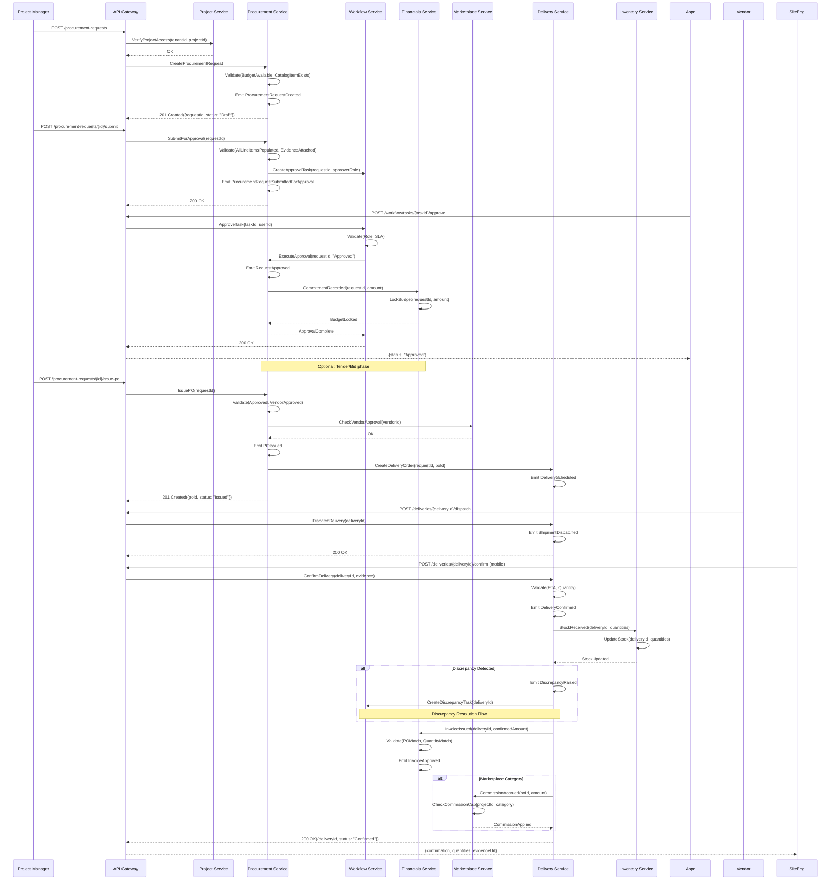

#### 7.2.2 State Machine

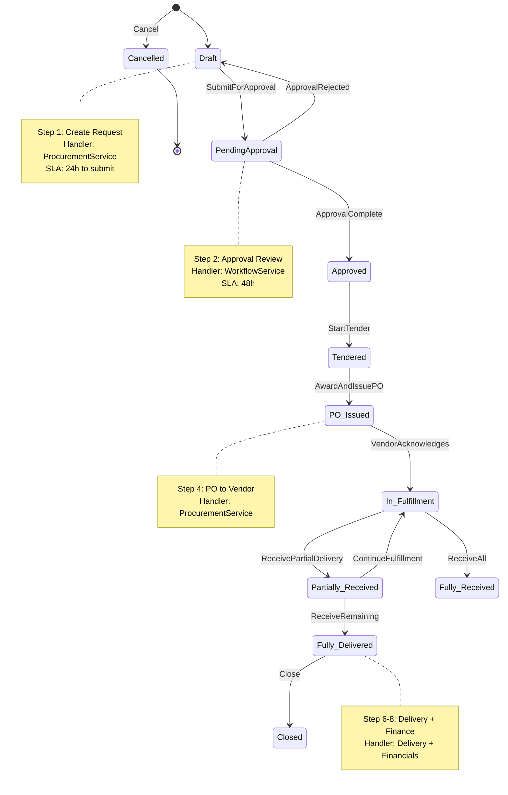

#### 7.2.3 Step-by-Step Command/Event Specification

| Step | Command                                | Handler Service     | Preconditions                                                  | Events Emitted                                              | Downstream Effects                                    |
| ---- | -------------------------------------- | ------------------- | -------------------------------------------------------------- | ----------------------------------------------------------- | ----------------------------------------------------- |
| 1    | `ProcurementRequest.Create`            | Procurement Service | Project exists, budget available, materials in catalog         | `ProcurementRequestCreated`                                 | Create approval task, lock budget placeholder         |
| 2    | `ProcurementRequest.SubmitForApproval` | Procurement Service | All line items populated, evidence attached                    | `ProcurementRequestSubmittedForApproval`                    | Create approval workflow task                         |
| 3    | `ApprovalTask.Approve` / `Reject`      | Workflow Service    | User has Approval role, SLA not breached                       | `RequestApproved` / `RequestRejected`                       | Release/rollback budget lock, create commitment       |
| 4    | `ProcurementRequest.StartTender`       | Procurement Service | Request is Approved, materials require competitive bidding     | `TenderOpened`                                              | Create tender in Marketplace Service                  |
| 5    | `Tender.Award`                         | Procurement Service | Tender is Under_Evaluation, award decision made                | `TenderAwarded`, `AwardedBidLinked`                         | Link selected bid to request                          |
| 6    | `PurchaseOrder.Issue`                  | Procurement Service | Request is Approved or Tendered, vendor is approved            | `POIssued`                                                  | Create delivery order, emit commitment recorded       |
| 7    | `Delivery.Prepare` / `Dispatch`        | Delivery Service    | PO exists, vendor acknowledges                                 | `DeliveryScheduled`, `ShipmentDispatched`, `ASNCreated`     | Notify site engineer of ETA                           |
| 8    | `Delivery.Confirm` (mobile)            | Delivery Service    | Delivery is Scheduled or In_Transit, evidence provided         | `DeliveryConfirmed`, `DiscrepancyRaised` (if any)           | Update inventory, notify financials                   |
| 9    | `Financials.ValidateInvoice`           | Financials Service  | DeliveryConfirmed exists, PO exists                            | `InvoiceValidated`, `InvoiceApproved`                       | Release commitment to actual, update budget vs actual |
| 10   | `Marketplace.AccrueCommission`         | Marketplace Service | DeliveryConfirmed, PO is marketplace category, cap not reached | `CommissionAccrued`, `CommissionCapReached` (if applicable) | Update commission ledger, notify vendor account       |

#### 7.2.4 Error Scenarios and Compensation Flows

| Scenario                              | Trigger                                     | Detection                                               | Response                               | Compensation                                                           |
| ------------------------------------- | ------------------------------------------- | ------------------------------------------------------- | -------------------------------------- | ---------------------------------------------------------------------- |
| Budget exceeded                       | Command validation fails                    | BudgetService.Check() returns insufficient              | Reject with error code BUDGET_001      | None (no state change)                                                 |
| Approval timeout                      | SLA breach detected by scheduler            | WorkflowService.SLADetected()                           | Escalate to PM, notify Finance         | None (workflow remains pending)                                        |
| PO cancelled after POIssued           | `PurchaseOrder.Cancel` command              | Business rule check                                     | Emit `POCancelled`                     | Release commitment, refund credits if bidding started, cancel delivery |
| Delivery not confirmed within 48h     | Scheduler checks DeliveryScheduled + 48h    | NotificationService.SLADetected()                       | Create discrepancy task, notify vendor | None                                                                   |
| Vendor not approved at PO time        | `PurchaseOrder.Issue` validation            | MarketplaceService.CheckVendorStatus() returns inactive | Reject with VENDOR_001                 | None                                                                   |
| Invoice mismatch (PO vs delivery qty) | `Financials.ValidateInvoice`                | 3-way match fails                                       | Reject with INVOICE_MISMATCH_001       | Queue for manual resolution                                            |
| Discrepancy unresolved >5 days        | Scheduler checks DiscrepancyRaised + 5 days | WorkflowService.SLADetected()                           | Escalate to PM, freeze related payment | Create manual adjustment task                                          |

#### 7.2.5 KPI Mapping

| KPI (from Section 3)          | Measurement Formula                                                              | Workflow Steps | Target          |
| ----------------------------- | -------------------------------------------------------------------------------- | -------------- | --------------- |
| Procurement Cycle Time        | median(`POIssued.occurredAt` - `ProcurementRequestCreated.occurredAt`)           | Steps 1–6      | -40% by month 6 |
| On-time Delivery Confirmation | count(`DeliveryConfirmed` within 24h of `ShipmentDispatched.occurredAt`) / total | Steps 7–8      | +30% by month 6 |
| Approval SLA Compliance       | count(`RequestApproved` within 48h of submission) / total submissions            | Step 3         | ≥90%            |
| Invoice Match Rate            | count(auto-approved invoices) / total invoices                                   | Step 9         | ≥85%            |
| Commission Accuracy           | count(correct commission calculations) / total commissions                       | Step 10        | ≥99%            |

---

### 7.3 Material Delivery and Discrepancy Resolution Workflow

**Purpose**: Manage material delivery from scheduling through site receipt with explicit discrepancy handling.

**Actors**: Vendor (dispatches, provides ASN), Site Engineer (confirms receipt, raises discrepancies), PM (resolves disputes), Finance (handles credit notes).

**Preconditions**: PurchaseOrder exists with Issued status; DeliveryScheduled event emitted.

**Postconditions**: Inventory reflects confirmed quantities; discrepancies resolved or queued; financials updated with confirmed amounts.

**Duration**: Delivery confirmation within 24h; discrepancy resolution within 5 business days.

#### 7.3.1 Sequence Diagram

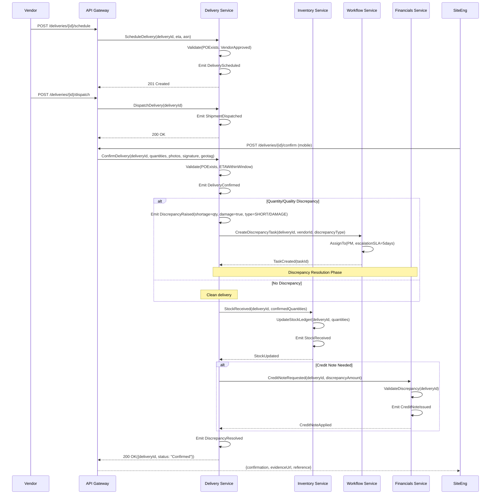

#### 7.3.2 State Machine

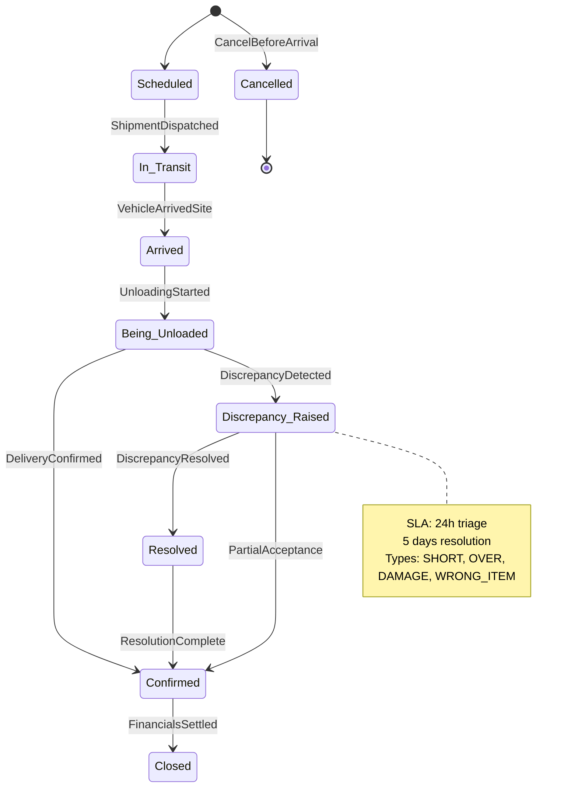

#### 7.3.3 Step Specification

| Step | Command                      | Handler Service    | Preconditions                            | Events Emitted                           | Downstream Effects                            |
| ---- | ---------------------------- | ------------------ | ---------------------------------------- | ---------------------------------------- | --------------------------------------------- |
| 1    | `Delivery.Schedule`          | Delivery Service   | PO exists, vendor approved               | `DeliveryScheduled`                      | Notify site engineer, update project timeline |
| 2    | `Delivery.Dispatch`          | Delivery Service   | Delivery is Scheduled                    | `ShipmentDispatched`, `ASNCreated`       | Track in transit, update ETA                  |
| 3    | `Delivery.Confirm` (mobile)  | Delivery Service   | Delivery is Arrived or Being_Unloaded    | `DeliveryConfirmed`, `DiscrepancyRaised` | Update inventory, notify financials           |
| 4    | `Discrepancy.Resolve`        | Delivery Service   | Discrepancy is Raised, evidence received | `DiscrepancyResolved`                    | Adjust inventory, request credit note         |
| 5    | `Financials.IssueCreditNote` | Financials Service | DiscrepancyResolved, PO reference exists | `CreditNoteIssued`                       | Reduce payable, update vendor balance         |

#### 7.3.4 Error Scenarios and Compensation Flows

| Scenario                            | Trigger                                 | Detection                                     | Response                          | Compensation                                        |
| ----------------------------------- | --------------------------------------- | --------------------------------------------- | --------------------------------- | --------------------------------------------------- |
| Delivery outside ETA window (>24h)  | `Delivery.Confirm` validation           | `arrivedAt - scheduledETA > 24h`              | Confirm with late flag, notify PM | None (delivery accepted, SLA breach logged)         |
| Evidence missing on confirmation    | `Delivery.Confirm` validation           | photos=null AND signature=null                | Reject with DELIVERY_001          | None                                                |
| Discrepancy >5 days unresolved      | Scheduler checks DiscrepancyRaised + 5d | WorkflowService.SLADetected()                 | Escalate to PM, freeze payment    | Create manual adjustment task                       |
| Vendor disputes discrepancy finding | `Discrepancy.Appeal` command            | PM review                                     | Re-open discrepancy, new review   | None                                                |
| Stock update fails after confirm    | `InventoryService.StockReceived` fails  | External service unavailable, retry exhausted | Queue for retry, alert ops        | Rollback DeliveryConfirmed → Arrived (compensation) |

#### 7.3.5 KPI Mapping

| KPI (from Section 3)          | Measurement Formula                                                       | Workflow Steps | Target           |
| ----------------------------- | ------------------------------------------------------------------------- | -------------- | ---------------- |
| On-time Delivery Confirmation | count(`DeliveryConfirmed` within 24h of ETA) / total deliveries           | Steps 1–3      | +30% by month 6  |
| Discrepancy Resolution Time   | median(`DiscrepancyResolved.occurredAt` - `DiscrepancyRaised.occurredAt`) | Steps 3–4      | <5 business days |
| First-Time Acceptance Rate    | count(DeliveryConfirmed without discrepancy) / total deliveries           | Step 3         | ≥80%             |
| Evidence Capture Completeness | count(confirmations with photos+signature) / total confirmations          | Step 3         | ≥95%             |

---

### 7.4 Marketplace Bidding Workflow

**Purpose**: Manage competitive bidding for materials and services with credit economy, commission logic, and fair evaluation.

**Actors**: Project Manager (creates tender), Vendors/Subcontractors (submit bids), PM/Evaluators (evaluate and award).

**Preconditions**: ProcurementRequest is Approved or Tendered; vendor is on approved list (for invited tenders) or meets prequalification criteria (for open tenders).

**Postconditions**: Awarded bid linked to PurchaseOrder; commission accrued upon delivery confirmation; non-awarded credits refunded.

**Duration**: Typically 7–14 business days from tender opening to award.

#### 7.4.1 Sequence Diagram

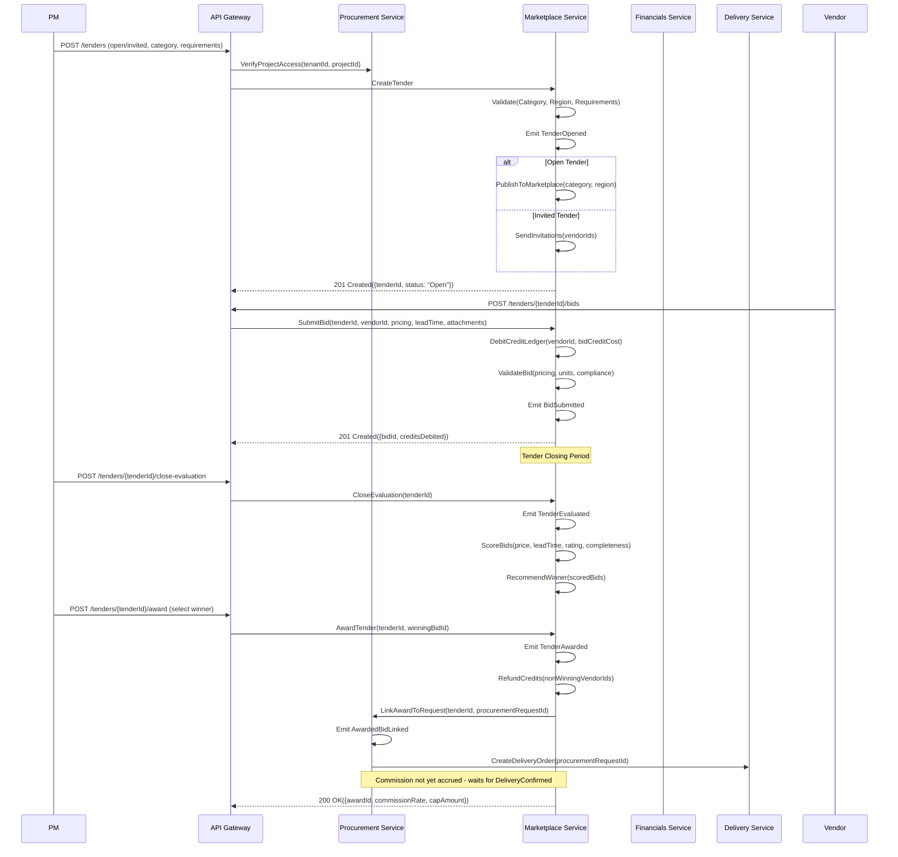

#### 7.4.2 State Machine

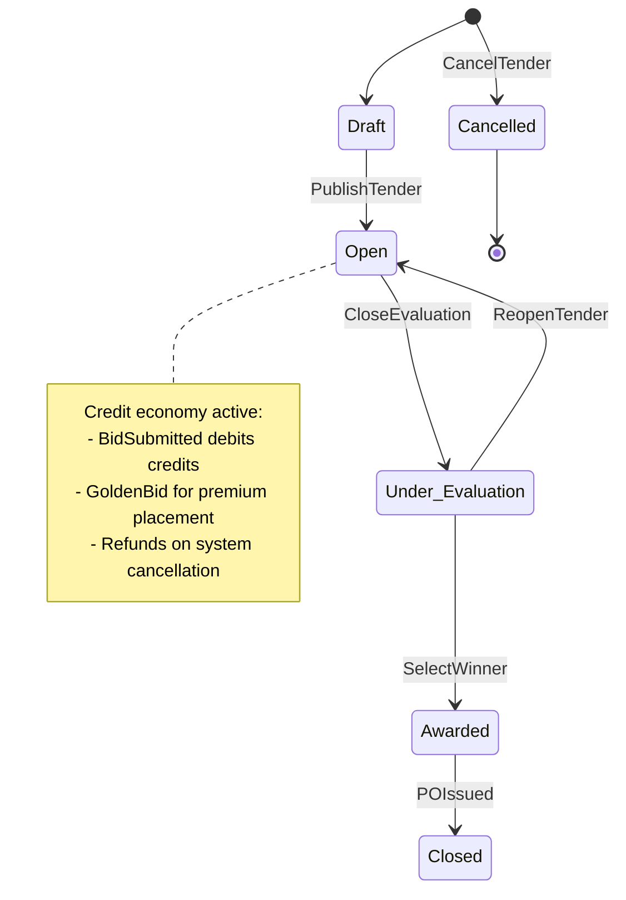

#### 7.4.3 Step Specification

| Step | Command                  | Handler Service     | Preconditions                                | Events Emitted                                 | Downstream Effects                                      |
| ---- | ------------------------ | ------------------- | -------------------------------------------- | ---------------------------------------------- | ------------------------------------------------------- |
| 1    | `Tender.Create`          | Marketplace Service | Project exists, procurement request approved | `TenderOpened`                                 | Publish to marketplace or send invitations              |
| 2    | `Bid.Submit`             | Marketplace Service | Tender is Open, vendor has credits           | `BidSubmitted`, `CreditLedgerDebited`          | Lock bid, debit credits                                 |
| 3    | `Tender.CloseEvaluation` | Marketplace Service | Tender open period elapsed                   | `TenderEvaluated`                              | Begin scoring                                           |
| 4    | `Tender.Award`           | Marketplace Service | Evaluation complete, PM selects winner       | `TenderAwarded`, `CommissionAccrued` (pending) | Refund non-winning credits, link to PO, create delivery |
| 5    | `Commission.CapCheck`    | Marketplace Service | PO issued, marketplace category              | `CommissionCapReached` (if applicable)         | Update cap counter                                      |

#### 7.4.4 Error Scenarios and Compensation Flows

| Scenario                              | Trigger                                | Detection                                     | Response                              | Compensation                          |
| ------------------------------------- | -------------------------------------- | --------------------------------------------- | ------------------------------------- | ------------------------------------- |
| Insufficient credits for bid          | `Bid.Submit` validation                | CreditLedger.Check() returns insufficient     | Reject with CREDIT_001                | None                                  |
| Tender cancelled after bids submitted | `Tender.Cancel` command                | Business rule check                           | Emit `TenderCancelled`                | Refund all bid credits to suppliers   |
| Evaluation exceeds SLA (>7 days)      | Scheduler checks TenderOpened + 7 days | WorkflowService.SLADetected()                 | Escalate to PM, auto-close evaluation | None                                  |
| Awarded vendor declines to fulfill    | `Vendor.DeclineAward` notification     | Vendor Service                                | Re-open tender, select next bid       | None                                  |
| Commission cap reached mid-project    | `Commission.CapCheck`                  | CapAmount reached for vendor/project/category | Emit `CommissionCapReached`           | Subsequent deliveries commission-free |

#### 7.4.5 KPI Mapping

| KPI (from Section 3)   | Measurement Formula                                              | Workflow Steps | Target           |
| ---------------------- | ---------------------------------------------------------------- | -------------- | ---------------- |
| Time-to-Award          | median(`TenderAwarded.occurredAt` - `TenderOpened.occurredAt`)   | Steps 1–4      | <7 business days |
| Bidders per Tender     | count(bids per tender) average                                   | Step 2         | ≥3               |
| Credit Refund Accuracy | count(correct refunds) / total refunds                           | Step 4         | ≥99%             |
| On-Platform Retention  | count(AwardedBidLinked → DeliveryConfirmed) / total awarded bids | Steps 4–5      | ≥95%             |

---

### 7.5 Subcontractor Progress → Payment Workflow

**Purpose**: Manage subcontractor progress claims from submission through verification to invoicing and payment.

**Actors**: Subcontractor PM (submits claim), Site Engineer (verifies progress), Finance (approves invoice and processes payment).

**Preconditions**: Subcontractor has active contract/work package; scope and rates defined; measurement units agreed.

**Postconditions**: Verified quantities linked to approved invoice; payment scheduled per contract terms; audit trail complete.

**Duration**: Verification within 3 business days; payment per contract terms (typically 15–30 days post-approval).

#### 7.5.1 Sequence Diagram

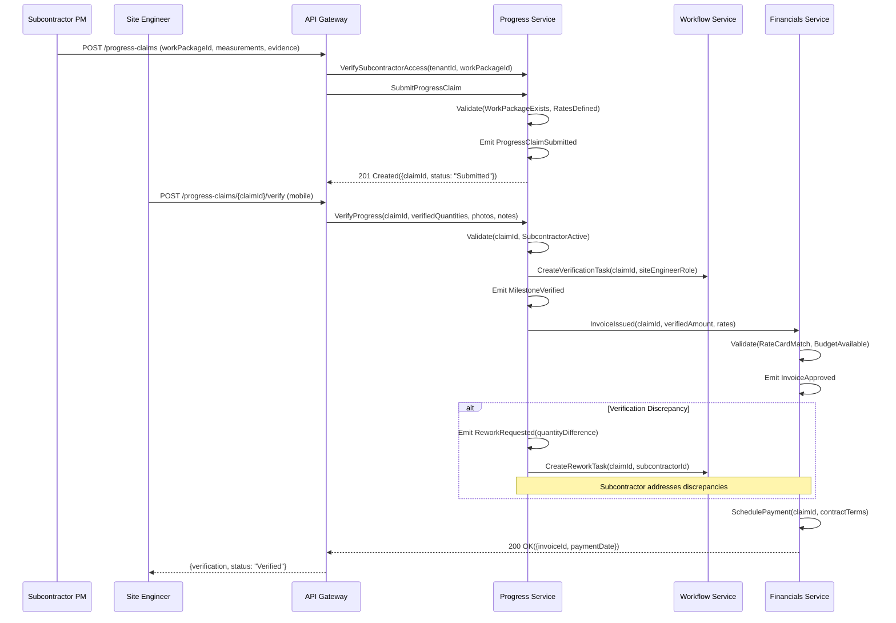

#### 7.5.2 State Machine

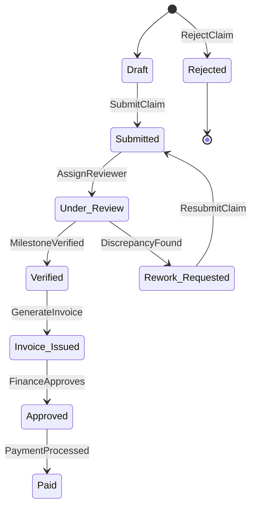

#### 7.5.3 Step Specification

| Step | Command                         | Handler Service    | Preconditions                              | Events Emitted                         | Downstream Effects                           |
| ---- | ------------------------------- | ------------------ | ------------------------------------------ | -------------------------------------- | -------------------------------------------- |
| 1    | `ProgressClaim.Submit`          | Progress Service   | Work package active, measurements complete | `ProgressClaimSubmitted`               | Create verification task                     |
| 2    | `ProgressClaim.Verify` (mobile) | Progress Service   | Claim is Under_Review, evidence received   | `MilestoneVerified`, `ReworkRequested` | Calculate verified amount, notify financials |
| 3    | `Financials.IssueInvoice`       | Financials Service | MilestoneVerified, rate card exists        | `InvoiceIssued`, `InvoiceApproved`     | Schedule payment, update commitments         |

#### 7.5.4 Error Scenarios and Compensation Flows

| Scenario                                  | Trigger                              | Detection                           | Response                          | Compensation                   |
| ----------------------------------------- | ------------------------------------ | ----------------------------------- | --------------------------------- | ------------------------------ |
| Claim submitted for inactive work package | `ProgressClaim.Submit` validation    | WorkPackageService returns inactive | Reject with WORKPACKAGE_001       | None                           |
| Verification SLA breach (>3 days)         | Scheduler checks Submitted + 3 days  | WorkflowService.SLADetected()       | Escalate to PM                    | None                           |
| Rate card mismatch                        | `Financials.IssueInvoice` validation | RateCardService returns no match    | Reject with RATE_001              | Queue for manual rate approval |
| Payment processing failure                | `Financials.ProcessPayment`          | Payment gateway unavailable         | Retry with backoff, alert finance | None                           |

#### 7.5.5 KPI Mapping

| KPI (from Section 3)     | Measurement Formula                                                          | Workflow Steps | Target           |
| ------------------------ | ---------------------------------------------------------------------------- | -------------- | ---------------- |
| Verification Lead Time   | median(`MilestoneVerified.occurredAt` - `ProgressClaimSubmitted.occurredAt`) | Steps 1–2      | <3 business days |
| First-Pass Approval Rate | count(Verified on first review) / total claims                               | Step 2         | ≥75%             |
| Payment Timeliness       | count(Paid within contract terms) / total approved invoices                  | Step 3         | ≥95%             |

---

### 7.6 User Assignment and Access Provisioning Workflow

**Purpose**: Provision user access to organizations and projects with role-based permissions.

**Actors**: Org Admin (manages organization), Project Admin (manages project team).

**Preconditions**: Organization exists; user account exists (or invitation sent).

**Postconditions**: User has assigned role with scoped permissions; auth projections updated; session tokens reflect new claims.

**Duration**: Typically immediate upon approval.

#### 7.6.1 Sequence Diagram

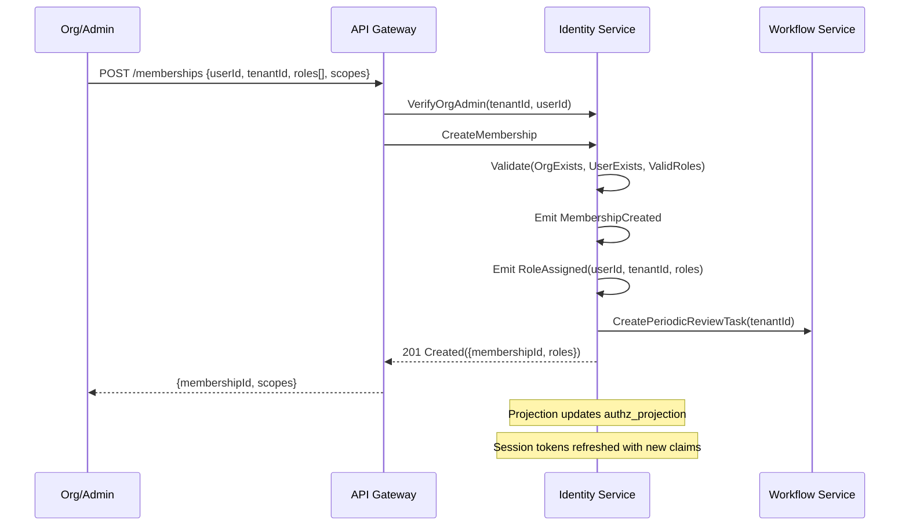

#### 7.6.2 State Machine

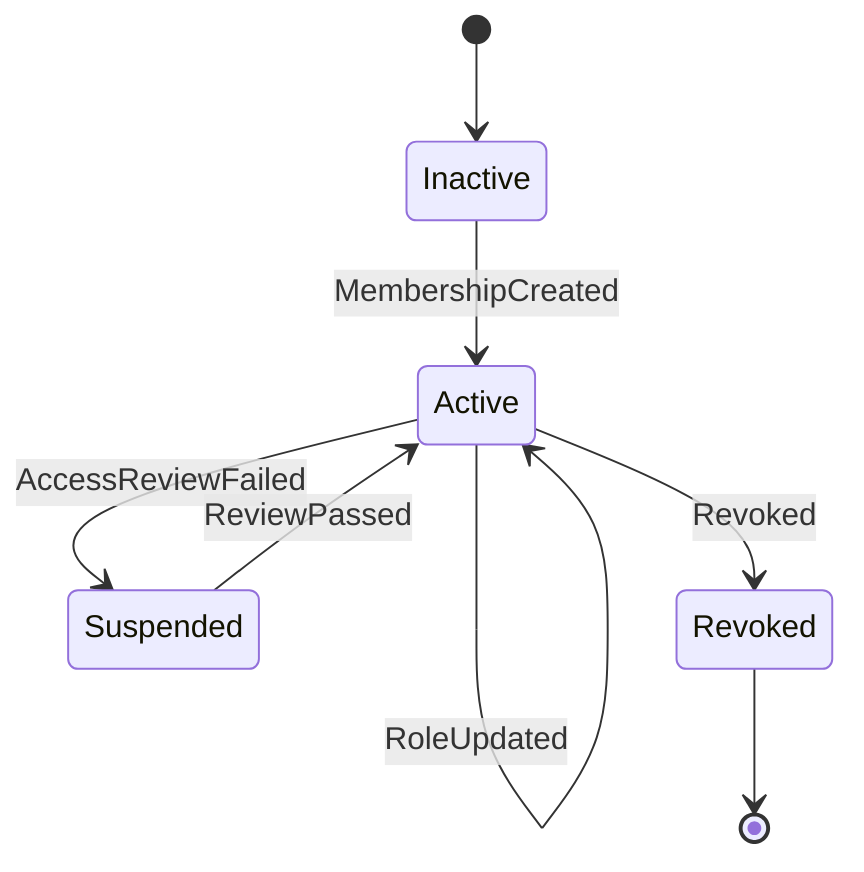

#### 7.6.3 Step Specification

| Step | Command                  | Handler Service  | Preconditions                        | Events Emitted                      | Downstream Effects                     |
| ---- | ------------------------ | ---------------- | ------------------------------------ | ----------------------------------- | -------------------------------------- |
| 1    | `Membership.Create`      | Identity Service | Org exists, user exists, valid role  | `MembershipCreated`, `RoleAssigned` | Update authz projection, notify user   |
| 2    | `Membership.UpdateRoles` | Identity Service | Membership exists, updater has admin | `RoleUpdated`                       | Update authz projection                |
| 3    | `Membership.Revoke`      | Identity Service | Membership exists, updater has admin | `RoleRevoked`, `MembershipRevoked`  | Invalidate sessions, update projection |

#### 7.6.4 Error Scenarios

| Scenario                          | Trigger                        | Detection                           | Response                      | Compensation |
| --------------------------------- | ------------------------------ | ----------------------------------- | ----------------------------- | ------------ |
| User already has membership       | `Membership.Create` validation | Duplicate check fails               | Reject with MEMBERSHIP_001    | None         |
| Invalid role for scope            | `Membership.Create` validation | Role not allowed for tenant/project | Reject with ROLE_001          | None         |
| Admin revokes self (lockout risk) | `Membership.Revoke` validation | Last admin check                    | Reject with ADMIN_LOCKOUT_001 | None         |

---

### 7.7 Document Lifecycle Workflow

**Purpose**: Manage document upload, review, approval, and retention with full traceability.

**Actors**: Any authenticated role (uploads), designated Reviewers (approve/reject), System (retention enforcement).

**Preconditions**: Document store (S3) available; tenant/project context established.

**Postconditions**: Document stored with metadata; review status recorded; linkage to related entities; retention policy applied.

**Duration**: Upload immediate; review within configurable window (typically 3–7 days); retention per policy (typically 5–7 years).

#### 7.7.1 Sequence Diagram

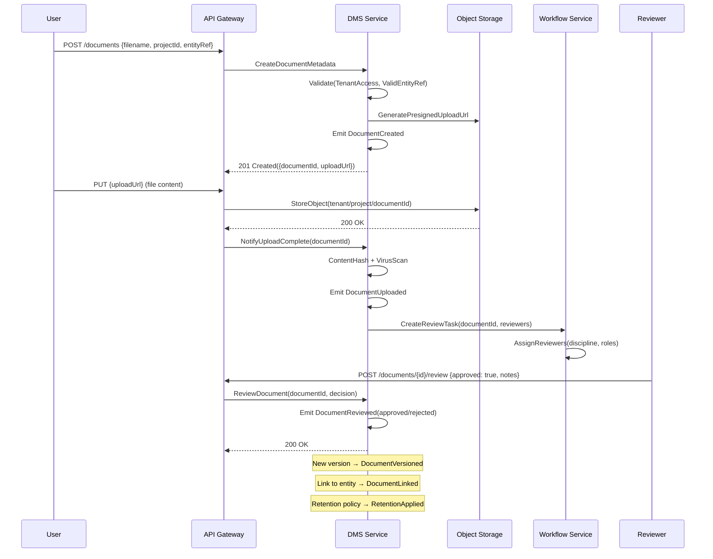

#### 7.7.2 State Machine

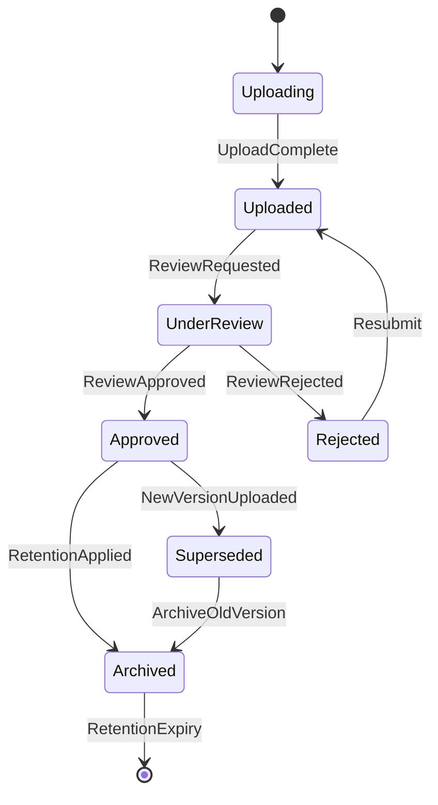

#### 7.7.3 Step Specification

| Step | Command                   | Handler Service | Preconditions                             | Events Emitted      | Downstream Effects                       |
| ---- | ------------------------- | --------------- | ----------------------------------------- | ------------------- | ---------------------------------------- |
| 1    | `Document.CreateMetadata` | DMS Service     | Tenant access, valid project/entity ref   | `DocumentCreated`   | Create storage slot, generate upload URL |
| 2    | `Document.CompleteUpload` | DMS Service     | Upload URL valid, content verified        | `DocumentUploaded`  | Content hash, virus scan, create review  |
| 3    | `Document.Review`         | DMS Service     | Document is UnderReview                   | `DocumentReviewed`  | Update status, notify requester          |
| 4    | `Document.LinkToEntity`   | DMS Service     | Document exists                           | `DocumentLinked`    | Update document index                    |
| 5    | `Document.NewVersion`     | DMS Service     | Document exists, uploader has write       | `DocumentVersioned` | Archive old version, trigger new review  |
| 6    | `Retention.Apply`         | DMS Service     | Document Approved, retention date reached | `RetentionApplied`  | Archive or delete per policy             |

#### 7.7.4 Error Scenarios

| Scenario                  | Trigger                              | Detection                         | Response                        | Compensation            |
| ------------------------- | ------------------------------------ | --------------------------------- | ------------------------------- | ----------------------- |
| Upload exceeds size limit | `Document.CreateMetadata` validation | File size > configured max        | Reject with DOCUMENT_001        | None                    |
| Virus detected            | Virus scan on upload complete        | Security scanner positive         | Quarantine file, alert security | Delete quarantined file |
| Review SLA breach         | Scheduler checks UnderReview + SLA   | WorkflowService.SLADetected()     | Escalate to doc owner           | None                    |
| Duplicate file detected   | Content hash on upload               | Hash match with existing document | Alert uploader, allow override  | None                    |

---

### 7.8 Additional Workflows (Phase 2+)

These workflows are documented at a higher level since they are not Phase 1 priorities. They follow the same detailed template as 7.2–7.7 but with less implementation detail.

#### 7.8.1 Vendor Onboarding → Approval → Marketplace Activation

**Flow**:

```
Vendor Registration → KYC/KYB Review → Compliance Check → Admin Approval → Vendor Approved → Marketplace Invited → First Bid Submitted
```

**Key events**: `VendorRegistered`, `KYCSubmitted`, `VendorApproved`, `VendorRejected`, `MarketplaceActivated`, `FirstBidSubmitted`

**Services**: Vendor Service, Identity Service, Marketplace Service

**Duration**: Typically 5–10 business days from registration to first bid.

#### 7.8.2 Dispute Resolution Workflow

**Flow**:

```
DisputeRaised → EvidenceAttached → Mediation → Resolution → Close
```

**Key events**: `DisputeRaised`, `EvidenceAttached`, `MediationScheduled`, `DisputeResolved`, `CreditNoteIssued`

**Services**: Delivery Service (source), Dispute Service (new), Financials Service

**Duration**: Typically 10–30 business days from dispute to resolution.

#### 7.8.3 Financial Close Process

**Flow**:

```
PeriodStart → AccrualsRecorded → CommitmentsReviewed → InvoicesMatched → Reconciliation → Close
```

**Key events**: `PeriodStarted`, `AccrualRecorded`, `CommitmentReviewed`, `InvoiceMatched`, `ReconciliationComplete`, `PeriodClosed`

**Services**: Financials Service, ERP Integration

**Duration**: Typically 5 business days per close period.

#### 7.8.4 Material Request → Catalog Search → Quotation → PO

**Flow**:

```
MaterialRequestCreated → CatalogSearch → QuotationRequested → QuotationReceived → Comparison → POIssued
```

**Key events**: `MaterialRequestCreated`, `CatalogItemFound`, `QuotationRequested`, `QuotationReceived`, `POIssued`

**Services**: Procurement Service, Catalog Service, Vendor Service

**Duration**: Typically 2–5 business days for standard materials.

---

### 7.9 Workflow Configuration Model

#### 7.9.1 Template Structure

Workflows are configurable per tenant/project through template definitions:

```json
{
  "templateId": "uuid",
  "code": "PROCUREMENT_STANDARD",
  "name": "Standard Procurement Workflow",
  "description": "Default procurement flow for standard materials",
  "version": 1,
  "status": "Active",
  "steps": [
    {
      "stepId": "uuid",
      "order": 1,
      "code": "CREATE_REQUEST",
      "name": "Create Procurement Request",
      "type": "task",
      "assigneeRole": "Project Manager",
      "requiredFields": ["projectId", "materialId", "quantity", "justification"],
      "requiredEvidence": ["cost_justification"],
      "slaHours": 24,
      "nextSteps": ["SUBMIT_FOR_APPROVAL"]
    },
    {
      "stepId": "uuid",
      "order": 2,
      "code": "SUBMIT_FOR_APPROVAL",
      "name": "Submit for Approval",
      "type": "task",
      "assigneeRole": "Project Manager",
      "autoForward": true,
      "nextSteps": ["APPROVAL_REVIEW"]
    },
    {
      "stepId": "uuid",
      "order": 3,
      "code": "APPROVAL_REVIEW",
      "name": "Budget Approval Review",
      "type": "approval",
      "assigneeRole": "Finance Approver",
      "requiredFields": ["budgetCode", "costCenter"],
      "slaHours": 48,
      "onApprove": ["APPROVED", "CREATE_COMMITMENT"],
      "onReject": ["REJECTED", "RETURN_TO_REQUESTER"],
      "nextSteps": ["APPROVED", "REJECTED"]
    }
  ],
  "conditions": [
    {
      "name": "high_value_approval",
      "expression": "totalAmount > 50000",
      "then": "require_executive_approval",
      "else": "pm_approval_only"
    }
  ],
  "metadata": {
    "createdBy": "uuid",
    "createdAt": "2026-01-15T00:00:00Z",
    "updatedAt": "2026-01-15T00:00:00Z",
    "applicableCategories": ["steel", "concrete", "electrical"],
    "applicableRegions": ["EMEA", "APAC"]
  }
}
```

#### 7.9.2 Dynamic Step Insertion

- **Admin override**: PM or higher can insert steps at runtime (e.g., "Legal Review" for contracts >$100k)
- **Event-triggered**: System auto-inserts steps based on conditions (e.g., if `totalAmount > 100000`, insert `ExecutiveApproval` step)
- **Audit trail**: All insertions/deletions logged as `WorkflowStepInserted` / `WorkflowStepRemoved` events

#### 7.9.3 Role-Based Assignment

- Steps can target **roles** (not specific users) → Workflow Service resolves to active users at execution time
- **Delegation**: Role holder can delegate to another user (delegation logged)
- **Fallback**: If no user available within SLA, escalate to next role in hierarchy

#### 7.9.4 Conditional Branching

Conditions expressed as JSON path expressions:

```json
{
  "condition": "totalAmount > 50000 AND category == 'steel'",
  "then": ["ExecutiveApproval", "LegalReview"],
  "else": ["PMApproval"]
}
```

Evaluated at runtime by Workflow Service using a lightweight expression engine (e.g., Aviator, MVEL).

## 8. Domain-Driven Design Overview

What

- A domain-centric architecture that divides the platform into bounded contexts owned by autonomous teams. Each context defines its model, invariants, and language, exposing APIs and events.

Why

- Manages complexity, preserves model integrity, and enables independent evolution and scaling. Prevents concept drift and tight coupling that slow delivery and increase risk.

How

- Bounded Contexts and Ownership
  - Identity & Access: Authentication, RBAC, tenancy. Owner: Platform team.
  - Organization & Project Management: Org/Project/SubProject lifecycle. Owner: Core PM team.
  - Supply Chain: Vendors, Materials, Procurement, Delivery. Owner: Supply team.
  - Financials: Budgets, commitments, invoices. Owner: Finance team.
  - Collaboration: Workflow, Notifications, DMS. Owner: Collaboration team.
  - Execution: Subcontractors, Progress, Reviews. Owner: Execution team.
  - Marketplace & Bidding: Tenders, credits, commissions. Owner: Marketplace team.
  - Reporting & Analytics: Projections, reports, data products. Owner: Data team.

- Aggregate Design (examples and rules)
  - Examples: Organization, Project, SubProject, Membership, User, Role, Permission, Material, InventoryItem, ProcurementRequest, PurchaseOrder, Delivery, Tender, Bid, ProgressClaim, Invoice, Document.
  - Rules: Keep aggregates small with clear invariants; commands validate and emit events; version events for evolution; prefer eventual consistency across contexts.

- Consistency and Coordination
  - Within aggregate: strong consistency via command handlers and invariants.
  - Across aggregates/contexts: sagas/process managers and the transactional outbox pattern; retries/idempotency to handle at-least-once delivery.
  - Read models: purpose-built projections per tenant/project for low-latency queries; replayable from Kafka with schema registry.

- Event Sourcing and CQRS Strategy
  - Apply Event Sourcing in high-audit domains (Procurement, Delivery, Financials, Marketplace); use CRUD with outbox in simpler contexts (e.g., Identity, basic catalogs) to reduce complexity.
  - Commands, Events, and Projections form the contract; queries hit denormalized stores for performance.

- Integration and Boundaries
  - Anti-Corruption Layer (ACL) for ERP/BIM/logistics integrations to protect core models; mapping objects and translation layers at the boundary.
  - API styles: REST for commands/queries; async events for state changes; webhooks for external consumers.

- Ubiquitous Language and Governance
  - Maintain a living glossary per context; ensure naming consistency across APIs, events, and UI.
  - Change management: proposal → review → versioning → migration guides; backward compatibility for events and APIs.

- Multi-Tenancy in the Domain
  - Tenant context carried in commands and events; data isolation enforced in write models and projections; document storage partitioned per tenant and project.

Context mapping and boundaries

- Relationships: conformist (Reporting consumes domains), anti-corruption layers to ERPs, customer/supplier separate bounded contexts.
- Examples: Procurement (core) integrates with ERP via ACL for invoices; Marketplace remains separate from Procurement write model and links via events.
- Deprecation: versioned commands/events with sunset policies; compatibility shims during migrations.

## 9. Software Architecture

What

- A domain-aligned, event-driven microservices architecture that balances auditability, performance, and operability. It uses DDD with CQRS and targeted Event Sourcing, Kafka for event distribution, and purpose-built read models for low-latency queries.

Why

- Ensures strong audit trails and traceability for disputes and compliance, scales independently per capability, supports multi-tenancy with isolation, and provides resilient, observable operations across office and field use cases.

How

- Logical Components
  - API Gateway/BFF: Single ingress with auth, rate limiting, request shaping; optional BFFs per client (web/mobile) to reduce chatty calls.
  - Microservices per Bounded Context: Independent deployables for Identity & Access, Project Management, Supply Chain (Vendors, Materials, Procurement, Delivery), Financials, Collaboration, Execution, Marketplace, Reporting.
  - Event Backbone: Apache Kafka with topics per aggregate type; partition keys chosen for ordering (e.g., aggregateId). Schema Registry (Avro/JSON Schema) for evolution.
  - Read Models/Projections: Services consume events to build denormalized stores for queries and dashboards; fully replayable for rebuilds.
  - Data Stores: PostgreSQL for OLTP write models; S3-compatible object storage for documents; Elasticsearch optional for search; Redis for caching and ephemeral coordination.
  - Identity: Keycloak for OAuth2/OIDC, SSO; JWT includes tenant, roles, and scopes; service-to-service uses mTLS and short-lived tokens.
  - Observability: OpenTelemetry traces, centralized logs, Prometheus metrics, alerting; audit from event store and secured logs.
  - Delivery Infrastructure: Kubernetes for orchestration; GitOps for deployments; feature flags and canary/blue-green rollouts.

- Data and Event Design
  - Events are immutable facts with IDs, timestamps, tenant, correlation/causation IDs, and version. Backward-compatible schemas; deprecate via additive changes.
  - Idempotency: Deduplication keys on consumers; idempotent producers; outbox/inbox pattern for exactly-once effects in write paths.
  - Dead Letter and Retry: Per-consumer retry with exponential backoff; DLQ topics for poisoning messages; operational playbooks for reprocessing.
  - Projections: Built with at-least-once consumption and idempotent upserts; can be dropped and replayed; snapshotting where rebuild time is long.
  - Event Retention: Long-lived or tiered storage (e.g., Kafka tiered storage/object storage sinks) to enable history replay and audits.

- Consistency and Coordination
  - Within an aggregate: Strong consistency via command handlers enforcing invariants.
  - Across services: Sagas/process managers; transactional outbox for publishing domain events atomically with state changes (CDC optional).
  - Example Saga: Procurement → PO → Delivery → Inventory → Financials; compensations handle cancellations, returns, and discrepancies.

- Multi-Tenancy and Isolation
  - Tenant carried in all commands/events and enforced in read/write models.
  - Isolation choices: schema-per-tenant for stricter isolation at lower tenant counts; RLS for high tenant density; storage partitioning per tenant/project; per-tenant encryption keys (optional) for documents.
  - Rate limiting and quotas per tenant; noisy-neighbor protections in cache and read models.

- Security-by-Design
  - AuthN/Z: OAuth2/OIDC via Keycloak; RBAC with project/subproject scoping; service accounts with least privilege; mTLS within cluster; network policies/ingress WAF.
  - Data Protection: TLS in transit; encryption at rest for DB, Kafka, and object storage; secret management via KMS/Vault; key rotation.
  - Auditing: Every state change emits an event; append-only audit log secured and tamper-evident.

- Reliability and Resilience
  - Patterns: Timeouts, retries with jittered backoff, circuit breakers, bulkheads.
  - Degradation: Read models remain available if some writers lag; graceful feature degradation under load.
  - Backups/DR: Regular DB backups; event log retention and snapshots; RPO ≤ 5 min via log-based recovery; multi-AZ by default, optional multi-region.

- Performance and Scalability
  - Horizontal scaling of stateless services; autoscaling on CPU/RPS/lag.
  - Kafka partitions sized by throughput per aggregate; hot partition detection and sharding strategies.
  - Caching: Redis for session/inbox locks and hot entity projections; cache invalidation via events.

- Deployment and Quality
  - Environments: Dev → Staging → Pre-prod → Prod; ephemeral preview environments per PR where feasible.
  - CI/CD: Build, unit/integration tests, security scan (SAST/SCA), image signing/SBOM; CD via GitOps (Argo/Flux) with canary/blue-green and automated rollbacks.
  - Testing: Consumer-driven contract tests, testcontainers for integration, k6/Gatling for load, chaos experiments (latency/partition), game days.
  - Secrets and Config: Externalized via Vault/KMS; sealed secrets for K8s; runtime reload with config maps.
  - Versioning: Semantic versioning for services and event schemas; backward compatibility policy; migration guides for breaking changes.
  - Topology: Multi-AZ baseline; multi-region DR evaluated Phase 5; edge caching for static assets and large document downloads.

## 10. Capability-to-Service Mapping (Indicative)

What

- Clear mapping from business capabilities to independently deployable services, with stable contracts and owned event schemas.

Why

- Establishes ownership, isolates failures, enables targeted scaling, and clarifies API boundaries and data stewardship.

How

- Guiding principles: one capability → one primary service; aggregates define write models; projections are separate read stores; events are the cross-context contract.

Mappings (scope, APIs, data, events)

- Identity & Access
  - Services: User, Membership, Authorization.
  - APIs: REST (user/membership mgmt), OIDC for auth; SCIM (phase 3+) for provisioning.
  - Data: PostgreSQL (tenant, users, roles); cache for tokens/permissions.
  - Events: UserCreated, RoleAssigned, TenantCreated.
- Project Management
  - Services: Organization, Project.
  - APIs: REST for org/project CRUD and assignments.
  - Data: PostgreSQL; projections for team rosters.
  - Events: ProjectCreated, SubProjectCreated, UserAssignedToProject.
- Supply Chain
  - Services: Vendor, Materials, Procurement, Delivery.
  - APIs: REST for catalogs, RFQs/requests, POs, ASN/delivery; webhook callbacks.
  - Data: PostgreSQL write models; projections for availability and lead times.
  - Events: VendorApproved, CatalogItemUpdated, ProcurementRequestCreated, POIssued, DeliveryScheduled, DeliveryConfirmed, DiscrepancyRaised.
- Financials
  - Services: Financials (budgets, commitments, invoices).
  - APIs: REST for budgets, invoices; connectors for ERP; webhooks for approvals.
  - Data: PostgreSQL; ledger-like projections; secure export feeds.
  - Events: BudgetSet, CommitmentRecorded, InvoiceIssued, InvoiceApproved.
- Execution
  - Services: Subcontractor, Progress, Review.
  - APIs: REST for work packages and progress claims; mobile-friendly endpoints.
  - Data: PostgreSQL; projections for site dashboards.
  - Events: WorkItemCreated, ProgressClaimSubmitted, MilestoneVerified, ReviewApproved.
- Collaboration
  - Services: Workflow, Notification, DMS.
  - APIs: REST for workflow templates and tasks; upload APIs for documents; push/poll for notifications.
  - Data: PostgreSQL (workflow/tasks), S3 (documents), Redis (queues).
  - Events: TaskCreated, TaskApproved, NotificationSent, DocumentUploaded, DocumentVersioned.
- Marketplace
  - Services: Tender/Bidding, Credits, Commission.
  - APIs: REST for tenders/bids; credit purchase via payment gateway; admin rate cards.
  - Data: PostgreSQL (tenders, bids, credit ledger, commission ledger).
  - Events: TenderOpened, BidSubmitted, TenderAwarded, CreditLedgerDebited, CommissionAccrued, CommissionCapReached.
- Reporting & Analytics
  - Services: Reporting/Analytics (+ ETL/warehouse later).
  - APIs: Query/report endpoints; export jobs; data-sharing agreements.
  - Data: Projections in Postgres/Elastic; optional lake/warehouse sinks.
  - Events: ProjectionUpdated, ReportGenerated.

Operational boundaries

- Ownership: Each service owns its schema and event types; clear data stewardship and on-call rotation.
- SLOs: Per-service SLOs (availability, latency) published; error budgets tracked; golden paths defined for core workflows.
- Rate limits: Global and per-tenant throttles; adaptive backpressure to protect shared resources.
- Resilience: Circuit breakers between gateway and services; retries with jitter; bulkheads for critical components.
- Failure isolation: Crash-only design; DLQs per consumer; replay procedures and dashboards; graceful degradation for non-critical projections.
- Scaling: Stateless services autoscale; stateful components use partitioning/sharding and read replicas; hot shard detection and rebalancing.

## 11. Marketplace & Bidding Details

What

- A two-sided marketplace connecting constructors to material suppliers and service subcontractors, with structured tenders, a credit economy, and a fair commission model tied to confirmed delivery or verified milestones.

Why

- Improves price discovery and reliability, increases competition, and creates sustainable monetization that aligns with project outcomes rather than clicks or impressions.

How

- Tender Types and Participation
  - Open Bidding: Visible to all qualified suppliers in region/category; prequalification filters (certifications, capacity, SLA).
  - Invited Bidding: Restricted to a curated list by the PM; used for sensitive or specialized scopes.
  - Credit Economy: Monthly free credits per supplier; additional purchase via gateway. BidSubmitted debits credits; refunds occur if tender is system-cancelled or materially altered before evaluation; no refunds for losing bids.
  - Golden Bids: Premium placement flag purchased per bid for visibility; limited per tender to avoid crowding.

- Bid Structure and Evaluation
  - Materials: Price/unit, lead time, incoterms, min order qty, warranty, validity period, attachments (specs).
  - Services: Pricing unit (sqm, m3, per-point, lump-sum), crew size, availability window, method statement, portfolio links.
  - Scoring: Weighted score combining price, lead time, supplier rating, on-time delivery history, and bid completeness. Weights configurable per category.
  - Q&A and Revisions: Clarification forum; revision windows logged with versioned bids; audit-preserved.

- Commission Model and Caps
  - Accrual: CommissionAccrued only after DeliveryConfirmed (materials) or MilestoneVerified (services).
  - Rate Cards: Tiered, category-specific rates reflecting margin structures (e.g., lower tonnage-based for steel, higher percentage for finishes).
  - Project-Based Cap: Per project and category, once CommissionLedger reaches CapAmount, further sales in that project/category are commission-free for that supplier. CommissionCapReached event emitted.
  - Leakage Prevention: Cap incentives, on-platform invoicing, and confirmation linkage reduce off-platform moves.

- Logistics and Financial Integration
  - Correlation: AwardedBidLinked to PO, which links to Delivery and Invoice for end-to-end traceability.
  - Discrepancies: If DiscrepancyRaised leads to partial returns, commission is pro-rated on accepted quantities only.
  - Payments: Optional escrow or milestone-based release; invoices auto-generated from verified quantities and rates.

- Fairness, Safety, and Anti-Abuse
  - Verification: KYC/KYB for suppliers; duplicate-account detection; rate limiting; anomaly detection for collusion (suspicious bidding patterns).
  - Privacy: Sealed bids until closing; optional two-stage auctions for services.
  - Policy: Clear terms for cancellations, SLA breaches, and dispute windows; automatic credit refunds on constructor-initiated cancellation post-bidding.

- Compliance and Tax
  - Tax Handling: VAT/GST configured by jurisdiction; tax IDs stored per supplier; compliant invoicing fields.
  - Recordkeeping: Immutable event log for tenders/bids/awards; retention policies by region.

- Notifications and UX
  - Alerts: Invite received, bid outbid (if permitted), Q&A responses, award decision, delivery confirmation required.
  - Mobile-first participation for suppliers; offline draft/save; localized units and currency.

- KPIs and SLAs
  - KPIs: Tender fill rate, average bidders per tender, time-to-award, price delta vs. baseline, on-platform retention post-award, dispute rate.
  - SLAs: Tender open window (configurable), evaluation target <7 days, credit refunds processed within 24h of cancellation, delivery confirmation within 24h of ETA.

Disputes and governance

- Dispute workflow: DisputeRaised → EvidenceAttached (photos, ASN, signatures) → Mediation → Resolution (credit note/partial payment) with auditable trail.
- Privacy modes: Sealed-bid (default) with reveal on closure; optional two-stage (prequal → price) for services; anonymized bidder identities until award.
- Supplier verification levels: Basic (KYC/KYB), Verified (references + performance history), Premium (audited capacity), impacting ranking and bid visibility.
- Fee transparency: Rate card displayed per category; example—steel (tonnage-based low fee), finishes (higher %); commission shown at award and on confirmed delivery.

## 12. Security and Compliance

What

- A security-by-design and compliance-first approach covering identity, authorization, data protection, operations, and regulatory obligations across multi-tenant workloads.

Why

- Protects sensitive project, financial, and personal data; meets customer and regulatory requirements; reduces legal, operational, and reputational risk while enabling enterprise adoption.

How

- Identity and Authentication
  - OAuth2/OIDC via Keycloak; SSO (SAML/OIDC) with enterprise IdPs; PKCE for public clients.
  - MFA/2FA and step-up authentication for sensitive actions (e.g., PO approval, payment release, rate card changes).
  - Short-lived access tokens, rotating refresh tokens; device binding optional for mobile apps.
- Authorization
  - RBAC as default with optional ABAC constraints (tenant, project, subproject, role, geography).
  - Deny-by-default policies; policy enforcement at gateway and service layers; least-privilege service accounts.
- Tenant Isolation
  - App-layer checks + DB isolation (schema-per-tenant or RLS) + S3 partitioning (bucket/prefix) + Kafka ACLs by service.
  - Optional per-tenant encryption contexts for documents; cross-tenant leakage tests embedded in CI.
- Data Protection
  - TLS 1.2+ in transit; encryption at rest for DB/Kafka/object storage; key management via Vault or HSM/KMS (cloud-neutral); periodic rotation.
  - Envelope encryption for documents; content hashing and integrity checks for evidence files.
  - PII classification and field tagging; log redaction/masking; DLP checks for exports.
- Event and Log Security
  - Tamper-evident, append-only audit logs with actor, tenant, correlation IDs, IP/agent.
  - Restricted log access, time-bound retention, and secure archives; privacy-by-default logging.
- Application Security (SSDLC)
  - SAST/DAST/SCA, dependency pinning, SBOM generation; container/image signing (Sigstore/Cosign) and provenance.
  - IaC scanning, secrets scanning, pre-commit hooks; threat modeling per epic; periodic pen tests.
  - Vulnerability management with severity-based SLAs; emergency patch process.
- Network and Runtime
  - mTLS between services; network policies; WAF/IDS/IPS at ingress; rate limiting and bot detection.
  - Isolation of build vs. runtime; hardened base images; least capabilities.
- Compliance Program
  - SOC 2 (Security, Availability, Confidentiality): change management, access reviews, backups/DR, incident response, vendor risk.
  - GDPR/UK GDPR: lawful basis, consent where applicable, DSAR workflows, data minimization, retention/deletion; DPIAs for high-risk features.
  - Data residency options by region; subprocessors transparency; contractual clauses (SCCs/DTAs) as required.
- Incident Response
  - On-call rotation, detection rules (DLQ spikes, anomaly auth), runbooks, forensics, and postmortems with customer comms SLAs.
- Customer Controls
  - Admin audit trails, configurable retention windows, IP allowlists, SSO enforcement, export controls, and API scopes.
  - Evidence for audits: event logs, access reviews, change tickets, DR test reports, vulnerability scan results.
  - Vendor Risk Management (VRM): documented subprocessors, security questionnaires support, SIG/CAIQ responses on request.

## 13. Data Model and Storage Notes

What

- Principles, conventions, and artifacts for modeling write models, events, and projections safely in a multi-tenant, event-driven system.

Why

- Preserves data integrity and auditability, supports performance and evolution, and prevents coupling and cross-tenant leakage.

How

- Modeling and Naming
  - ERDs per bounded context with normalized write models per aggregate; avoid cross-context foreign keys.
  - Keys: ULIDs/UUIDv7 for time-sortable IDs; human-readable business codes (e.g., PO-YYYY-XXXX) for documents.
  - Conventions: snake_case for storage, camelCase for APIs; consistent units and currency fields.
- Event Catalog
  - Envelope: id, type, version, occurredAt, tenantId, aggregateType, aggregateId, aggregateVersion, correlationId, causationId, actor.
  - Schema governance via registry (Avro/JSON Schema); backward-compatible evolution; additive changes; deprecation policy.
  - Topics: <context>.<aggregate>.<event>; partition by aggregateId for order; compaction where appropriate; retention/tiering to object storage.
- Projections (Read Models)
  - Idempotent consumers with deterministic upserts; track checkpoints per consumer group.
  - Replay support for rebuilds and schema changes; blue/green projection deployment; backfill scripts for historical data.
  - Per-tenant/project scoping; cache invalidation via events; SLA for projection lag P95 <30s.
- Storage Design
  - PostgreSQL for OLTP; RLS or schema-per-tenant; indexes by common filters (tenantId, projectId, status); table partitioning for hot entities.
  - Object Storage (S3-compatible or native): path layout tenant/project/module/objectId; integrity via content hashes; lifecycle policies (archive/delete) per retention rules.
  - Search (Elasticsearch optional): index pipelines from projections; PII redaction; index templates and versioning.
- Data Quality and Governance
  - Constraints and invariants at both command validation and storage (check constraints, unique indexes).
  - Reference data domains with versioned code lists; deduplication jobs; anomaly detection on events (e.g., negative stock).
  - Migrations managed via Flyway/Liquibase; online, backward-compatible patterns (expand/contract); dual writes and shadow reads during cutovers.
- Lifecycle, Retention, and Residency
  - Retention policies per artifact type; RetentionApplied and DataDeleted events; DSAR export/delete flows.
  - Encrypted backups with PITR; periodic restore drills; regional sharding/residency to meet locality requirements.

Data catalog and analytics

- Catalog: Data dictionary per projection and write model; lineage tracked via OpenLineage/Marquez (Phase 4+).
- Warehouse/BI: Optional ETL from projections to a tenant-scoped warehouse or lakehouse; dbt models for standard KPIs; export contracts documented.
- PII inventory: Fields classified by sensitivity; minimization rules; tokenization where feasible for analytics.

## 14. Non-Functional Requirements (Targets)

What

- Service-level objectives and engineering constraints for performance, availability, reliability, security, usability, and cost. These define acceptance criteria for releases and guide capacity and incident management.

Why

- Ensures consistent user experience across office and field; meets enterprise procurement and compliance requirements; prevents uncontrolled cost growth; enables contractual SLAs.

How

- SLIs collected via APM, traces, logs, and synthetic checks; SLOs reviewed quarterly. Error budgets drive release cadence and hardening cycles. Auto-scaling and rate limits protect SLOs. Chaos and load testing validate resilience.

Targets (initial)

- Availability
  - Service availability ≥99.9% Phase 2; target 99.95% Phase 3+ (per critical service and gateway).
  - Mobile offline tolerance: core receipt and claim flows function offline with auto-sync; sync lag P95 <60s after connectivity returns.
- Performance
  - Reads P95 <300 ms; Writes P95 <500 ms for typical commands; cold start P95 <1.5s for web, <2.5s for mobile app relaunch.
  - Projection lag P95 <30s; search queries P95 <800 ms when Elastic enabled.
- Scalability
  - Horizontal scale of stateless services; load-tested to 5x Phase 2 baseline. Kafka partitions provisioned to keep consumer lag <30s P95.
  - Multi-tenant quotas and backpressure to isolate noisy neighbors.
- Reliability and Consistency
  - Exactly-once semantics for critical projections (financials, inventory) or compensating logic with at-least-once + idempotency.
  - Data loss budget: 0 for committed writes; RTO ≤ 2 hours; RPO ≤ 5 minutes via event/log-based restore.
- Security and Privacy
  - Security incident SLO: P1 triage <15 min, containment <4h, customer notice per policy. Secrets rotation ≥90 days.
  - Privacy: DSAR fulfillment <30 days; data deletion SLA <7 days after approval.
- Usability and Accessibility
  - WCAG 2.1 AA for web UI; mobile gesture and large touch targets for field users; localization for currency/units/timezones.
- Interoperability
  - API availability ≥99.9%; backward-compatible changes with ≥2 minor versions supported; deprecation notices ≥90 days.
- Cost and Sustainability
  - Cloud cost budget per tenant/project; scale tests include cost modeling; storage lifecycle policies to manage S3 footprint.

Measurement and Enforcement

- Golden signals and dashboards per service; synthetic journeys for procurement/delivery confirmation; monthly error budget reviews.
- Load tests before major releases; disaster recovery drills semi-annually; chaos experiments quarterly.
- Mobile/offline specifics: local queue for commands with conflict resolution on sync; user prompts on stale data; bandwidth-aware media uploads.
- Internationalization: locale/units/currency per project and user; timezones normalized to UTC in storage with tz-aware display.

## 15. Technology Stack

What

- A pragmatic, enterprise-grade stack optimized for event-driven microservices, strong auth, and multi-tenant SaaS operations.

Why

- Maximizes developer productivity and ecosystem leverage; balances performance, reliability, and cost; aligns with industry-standard tooling to ease hiring and integrations.

How (choices and rationale)

- Frontend: React + TypeScript
  - Rationale: Strong ecosystem, type safety, component reuse; supports responsive web for office and PWA patterns for field.
  - Notes: State management with Redux/RTK Query or React Query; design system and accessibility built-in.
- Backend: Java + Spring Boot
  - Rationale: Mature DI, observability, security, and data libraries; wide enterprise adoption.
  - Notes: Spring Cloud for config/feature-flags; WebFlux for async IO where needed.
- Messaging: Apache Kafka + Schema Registry (Avro/JSON Schema)
  - Rationale: High-throughput, ordered streams per aggregate; replayable history; decoupled services.
  - Notes: Tiered storage or sinks to object storage for long-term retention; RBAC/ACLs on topics.
- Database: PostgreSQL
  - Rationale: Reliable OLTP, strong indexing and JSONB support, RLS for multi-tenancy.
  - Notes: Partitioning for hot tables; read replicas for reporting; prefer cloud-neutral Postgres operators (CloudNativePG/Crunchy) or VM-based clusters; no dependency on AWS/Azure PaaS.
- Search/Cache: Elasticsearch (optional) + Redis
  - Rationale: Full-text and aggregations when needed; low-latency caching and coordination primitives.
  - Notes: Build indices from projections; cache invalidation via events.
- Storage: S3-compatible Object Storage
  - Rationale: Durable, cost-effective document storage and evidence handling.
  - Notes: Lifecycle and retention policies; encryption; presigned URLs for uploads; no dependency on AWS/Azure—supports MinIO, Ceph RGW, and other native object stores.
- AuthN/Z: Keycloak (OAuth2/OIDC, JWT)
  - Rationale: Standards-based identity, SSO, policy enforcement, and admin console.
  - Notes: Multi-realm or tenant-aware config; MFA; group/role mappings; SCIM roadmap.
- Deployment: Docker + Kubernetes with GitOps
  - Rationale: Predictable deployments, autoscaling, isolation; declarative ops.
  - Notes: Argo/Flux for GitOps; Helm/Kustomize; blue-green/canary; HPA/VPA.
- Observability: OpenTelemetry + Prometheus/Grafana + Centralized Logging
  - Rationale: End-to-end tracing, metrics, alerting; rapid incident triage.
  - Notes: Trace context propagation in events; logs with correlation IDs; SLO dashboards.

Extensibility and Integrations

- API styles: REST for commands/queries; async events; webhooks for external consumers.
- Integrations: ERP (SAP/Oracle), BIM, logistics; adapters via anti-corruption layer.
- SDKs and Client Libraries: TypeScript and Java first; others based on demand.

Versioning and Lifecycle

- Semantic versioning for services/APIs/events; compatibility windows; deprecations with ≥90-day notice.
- Security patches tracked via SBOM; image signing and provenance; automated dependency updates with review gates.

Tooling and testing

- Build: Gradle/Maven for backend; pnpm/yarn for frontend.
- Testing: JUnit/Testcontainers, WireMock/PACT for contracts; Cypress/Playwright for E2E; k6 for load; OWASP ZAP for DAST.
- Lint/format: ESLint/Prettier; Checkstyle/SpotBugs; conventional commits and commitlint.

Local development and parity

- Orchestration: Docker Compose for core stack (PostgreSQL, Kafka/ZooKeeper/Schema Registry, Keycloak, MinIO); make targets for up/down/seed.
- Local Kubernetes: kind/k3d/minikube with Helm charts/Kustomize overlays; dev profiles and sample tenants/projects.
- Secrets/config: Dev secrets stored in .env/.secrets (local-only); Vault dev server optional; seeded test data and fixtures.
- Developer UX: one-command bootstrap script; hot reload for services; local mail catcher and mock ERP/logistics webhooks.
- Parity: Same images as prod with dev config; feature flags to toggle integrations; migration/rollback tested locally first.

## 16. Roadmap (Phased)

What

- A staged delivery plan that sequences capabilities to maximize early customer value, de-risk technical decisions, and build marketplace liquidity.

Why

- Phasing reduces complexity, accelerates learning, and ensures each release strengthens core workflows (procure→deliver→pay) before adding advanced features.

How

- Release trains every 6–8 weeks; alpha/beta programs with pilot tenants; exit criteria defined per phase with measurable outcomes from Section 3.

Phases (goals, key deliverables, exit criteria)

- Phase 1 (MVP)
  - Goals: Establish tenant, project, and identity foundations; deliver first end-to-end read/write path; prove projections and observability.
  - Deliverables: Identity & Access, Organizations, Projects, basic DMS, initial projections, core observability, API gateway, audit baseline.
  - Exit Criteria: 3 pilot tenants live; P95 reads <400 ms; projection lag P95 <60s; first procurement request lifecycle demo end-to-end.
- Phase 2
  - Goals: Enable real procurement and inventory flows; seed early marketplace participation.
  - Deliverables: Vendors, Materials, Procurement, Inventory; mobile delivery receipt; marketplace foundations (credits, tenders).
  - Exit Criteria: -30% procurement cycle time in pilots; 50+ tenders created; 70% mobile receipt adoption on pilot sites.
- Phase 3
  - Goals: Close procure-deliver-pay loop; enforce governance; monetize marketplace transactions.
  - Deliverables: Deliveries, Financials (budgets/commitments), Workflow & Approvals, commission logic, subcontractor progress.
  - Exit Criteria: On-time delivery confirmations +25%; first commissions accrued; progress-to-invoice flow live; DAU/MAU >0.35.
- Phase 4
  - Goals: Insight and automation; reduce admin effort; unlock data exports.
  - Deliverables: Reporting & Analytics, AI Document Analysis (OCR), AI Material Estimator v1; export APIs and warehouse sink (optional).
  - Exit Criteria: Document handling time -40%; estimator adoption on ≥30% new projects; 5 standard dashboards used weekly.
- Phase 5
  - Goals: Scale marketplace and intelligence; deepen ecosystem integrations; mobile GA.
  - Deliverables: Advanced Marketplace (Golden Bids, reputation), AI Planning, mobile apps GA, ERP integrations (SAP/Oracle connectors).
  - Exit Criteria: On-platform retention ≥95%; ≥200 paying tenants; GMV and take-rate targets achieved; SOC 2 Type I readiness.

Enablers

- Platform: CI/CD, IaC, cost reporting, feature flags, canary releases; infra as code (Terraform/Pulumi), cluster baselines, cost dashboards.
- Data: Schema registry, event catalog, governance council, data contracts; seeded sample datasets and replay tooling for demos.
- Security: SSO, MFA, audit scopes, incident response playbooks; pen test cadence; secure coding training.

Pilot selection and feedback loops

- Criteria: Active projects, committed sponsor, at least 2 suppliers onboarded, baseline metrics collected.
- Feedback: Weekly steering with pilots; in-product NPS/CSAT; structured discovery and roadmap reviews per phase.
- Risks per phase: MVP scope creep (control via strict exit criteria); Phase 2 liquidity (supplier incentives); Phase 3 finance integration risk (sandbox first).

## 17. Business Model and Pricing

What

- A hybrid SaaS + marketplace monetization model aligned to delivered outcomes: recurring subscriptions for software value and variable fees for transacted value, with caps to encourage loyalty and reduce leakage.

Why

- Aligns incentives across constructors and suppliers; scales with usage and GMV; supports entry-level adoption while monetizing power users and high-volume categories.

How

- Customers and Segments
  - Primary: Constructors/GCs (buyers/operators). Secondary: Suppliers and service subcontractors (sellers).
  - Procurement-led land, marketplace-led expand; partner channel for integrations.

- Revenue Streams
  1. Transaction Commissions (Marketplace)
     - Rates: Tiered, category-specific (e.g., steel tonnage-based low fee; finishes higher %). Regional variations supported.
     - Accrual: Only after DeliveryConfirmed (materials) or MilestoneVerified (services). Pro-rated for partial acceptances.
     - Project-Based Cap: Per project and category, once CapAmount reached for a supplier, subsequent sales in that project/category are commission-free. Events: CommissionAccrued, CommissionCapReached.
     - Controls: On-platform invoicing; escrow/milestone options; anti-collusion monitoring.
  2. Bidding Credits
     - Model: Monthly free credits; paid packages (volume discounts). BidSubmitted debits credits. Refunds if constructor cancels after bids; no refunds for losing bids.
     - Premium: Golden Bids for placement; limited per tender to preserve fairness.
  3. Premium Listings/Promotions
     - Featured suppliers/categories; seasonal campaigns; sponsored tenders in discovery feeds.
  4. SaaS Subscriptions (Constructors)
     - Tiers: Starter, Professional, Enterprise.
       - Starter: Limited projects/users, base workflows, standard support.
       - Professional: Multi-project/portfolio, advanced approvals, reporting, marketplace analytics.
       - Enterprise: SSO/SCIM, data residency options, custom retention, premium support, ERP integrations, AI quotas.
     - Metered Add-ons: OCR pages, AI estimator runs, API call bundles.

- Pricing and Billing
  - Billing cadence monthly/annual; usage-based meters for credits/OCR/AI; overage alerts; invoices with tax compliance per region.
  - Payment methods: Cards, bank transfer; marketplace payouts to suppliers via supported rails; escrow fees if used.

- KPIs and Unit Economics
  - SaaS: ARPA/ARPU, churn, net revenue retention, LTV/CAC.
  - Marketplace: GMV, take rate, active tenders, bidders/tender, win rate, on-platform retention post-award, dispute rate.
  - Targets: Commission share of revenue ≥30% by Phase 4; SaaS gross margin ≥80%; blended gross margin ≥60%.

- Governance and Policies
  - Transparent rate cards; change notices; category councils for rate updates; regional compliance checks (tax, data).
  - Anti-Disintermediation: Commission caps, logistics linkage, and in-app invoicing keep transactions on-platform without punitive fees.

Commercial terms (indicative)

- Examples: Starter $X/user/mo (min Y users), Professional $A/project/mo, Enterprise custom with annual commit; marketplace commission ranges 0.2–5% depending on category/region.
- Discounts: Annual prepay, volume credits for suppliers, founder/pilot discounts Phase 1–2 with sunset dates.
- SLAs and support: Tiered support SLAs by plan; uptime credits for breaches; onboarding packages and training add-ons.
- Enterprise: MSAs, DPAs, security addenda, custom data residency and retention (surcharges may apply).

## 18. Risks and Mitigations

What

- A living register of product, market, and technical risks with owners, early warning indicators, and mitigation plans. Reviewed at each phase gate and quarterly thereafter.

Why

- Proactively reduces the likelihood and impact of adverse events, protects timelines and budgets, and supports enterprise risk assessments (e.g., vendor due diligence, SOC 2).

How

- Process: Identify → Assess (likelihood/impact) → Mitigate → Monitor → Escalate. Map risks to Section 3 objectives and Section 16 phase exits. Track KRIs and playbooks.

Key risks (examples with KRIs and mitigations)

- Adoption and Change Management
  - Risk: Low adoption due to workflow change and integration friction.
  - KRIs: Low DAU/MAU (<0.2), stalled tenders, low mobile receipt usage (<50%).
  - Mitigations: Role-based onboarding, templates, in-app guidance, pilot champions, integration connectors, success plans.
  - Owner: Product + Customer Success.
- Data Quality and Integrity
  - Risk: Inaccurate catalogs/quantities causing stockouts/rework.
  - KRIs: High discrepancy rate (>5%), frequent manual adjustments, negative stock events.
  - Mitigations: Validation rules, required fields, guided forms, anomaly detection, periodic cycle counts, reconciliation tasks.
  - Owner: Supply Chain PM + Eng.
- Marketplace Liquidity
  - Risk: Too few bidders or tenders reduce value and price discovery.
  - KRIs: Bidders/tender <3, tender fill rate <70%.
  - Mitigations: Supply seeding in key categories/regions, credit promos, featured listings, outreach; constructor incentives for open tenders.
  - Owner: Marketplace Lead.
- Technical Complexity (ES/CQRS)
  - Risk: Overuse of ES increases delivery time and operational toil.
  - KRIs: Projection lag >60s P95, frequent consumer DLQs, high incident count.
  - Mitigations: Apply ES selectively; outbox for CRUD domains; reference architectures; platform tooling for projections; chaos and load tests.
  - Owner: Architecture Guild.
- Security and Privacy
  - Risk: Breach or PII leakage; non-compliance with GDPR/SOC 2.
  - KRIs: Unusual auth patterns, failed MFA spikes, data exfil alerts, overdue patches.
  - Mitigations: SSDLC, least privilege, MFA, encryption, monitoring, incident runbooks, regular audits, pen tests.
  - Owner: Security Lead.
- Availability and Performance
  - Risk: SLA/SLO breaches under load or due to hot partitions.
  - KRIs: SLO error budget burn, Kafka lag >30s P95, API P95 >500 ms.
  - Mitigations: Autoscaling, partition/shard planning, backpressure, caching, perf tests, feature flags for graceful degradation.
  - Owner: SRE Lead.
- Regulatory and Tax Complexity
  - Risk: Incorrect tax handling or regional data rules.
  - KRIs: Invoice rejections, audit findings, customer escalations.
  - Mitigations: Tax engine integration, jurisdiction configs, legal review, data residency options.
  - Owner: Finance/Compliance.
- Vendor Lock-in and Cost Overruns
  - Risk: Cloud/messaging costs spike; difficult to migrate.
  - KRIs: COGS/tenant rising >20% QoQ, storage growth without retention controls.
  - Mitigations: Cost dashboards, lifecycle policies, tiered storage, reserved capacity, abstraction layers where prudent.
  - Owner: Eng Ops.

Escalation and Communication

- Severity matrix for incidents; stakeholder comms SLAs; customer advisory board for roadmap risks; postmortems with action tracking.

Residual risk and reporting

- Heatmap per risk with residual ratings after mitigations; quarterly risk reviews with leadership.
- RACI for major risks (e.g., security, liquidity, data quality); backup owners assigned.
- External reporting: SOC 2 readiness status, uptime reports, and privacy transparency updates shared with enterprise customers.

## 19. Diagrams and Artifacts (To Be Added)

What

- A curated, versioned set of engineering and product artifacts that codify the system’s design, behavior, and language. Stored in-repo, linked from the document, and updated via PRs.

Why

- Improves shared understanding, onboarding, and auditability; reduces miscommunication across teams; supports compliance and customer diligence.

How

- Tooling: PlantUML/Mermaid for diagrams in code; dbdocs/DBML for ERDs; AsyncAPI/OpenAPI for APIs; ADR templates for decisions.
- Governance: Docs-as-code with CI linting; owners per context; review checklist includes diagram updates; version tags per phase.

Artifacts

- UML/Mermaid Diagrams
  - Use Case: Key actor-goal interactions (procure→deliver→pay, bidding, progress→payment, document review).
  - Component: Services, gateways, data stores, and external systems; trust boundaries and network flows.
  - Sequence: Critical workflows (procurement approval, delivery confirmation with discrepancy, award→PO→commission accrual, progress claim→invoice).
  - Class/Domain: Aggregates and relationships within contexts (read-only depiction to avoid cross-context coupling).
- ERDs
  - Per bounded context (Identity, Project, Supply Chain, Financials, Collaboration, Execution, Marketplace). Include keys, constraints, and RLS/schema notes.
- Event Catalog
  - Canonical event list with envelopes, schemas, sample payloads, and version history; topic naming and partitioning guidance; retention/compaction notes.
- API Specifications
  - OpenAPI for REST commands/queries; AsyncAPI for events; auth scopes and examples; error models and pagination.
- Architecture Decision Records (ADRs)
  - Decisions on ES scope, tenant isolation model, commission cap algorithm, search usage, and warehouse strategy; status (proposed/accepted/deprecated).
- Security and Privacy Artifacts
  - Threat models (STRIDE/LINDDUN), data flow diagrams, DPIAs, pen test reports (summaries), and incident response runbooks.
- Operations Playbooks
  - On-call runbooks, DLQ handling, replay procedures, backup/restore steps, capacity and cost management guides.
- Glossary
  - Ubiquitous language per context; cross-references; aliases and deprecated terms.

Maintenance

- Quarterly doc days; CI checks for stale diagrams vs. code; template PRs for context changes; changelog entries when artifacts evolve.
- Storage/location: docs/architecture for diagrams, docs/api for OpenAPI/AsyncAPI, docs/adr for decisions, docs/glossary for language.
- Review cadence: Architecture guild reviews monthly; context owners update artifacts with each significant change; DRI list maintained in repo.
- Coverage targets: 100% of services with component diagrams, 100% of public APIs with OpenAPI, 100% of events with schema and samples by Phase 3.

## 20. Open Questions

- Tenant isolation model final choice (schema-per-tenant vs RLS) per scale and ops constraints.
- Degree of Event Sourcing vs CRUD per context.
- Commission/rate card governance and regional variations.
- ERP integrations priority (SAP, Oracle, others).

## 21. Phase 1 Implementation – Separated Services

Overview

- Goal: Deliver Phase 1 (MVP) by standing up a small set of independently deployable services that establish multi-tenancy, identity/access, organizations and projects, a basic DMS, initial projections, API gateway, and audit baseline.
- Principle: Each capability is its own service with clear contracts (REST commands/queries, domain events). Read models are built as separate projections consuming events over Kafka. Identity for auth is delegated to Keycloak; our Identity service owns tenant/user/membership domain data and emits canonical events.

Phase 1 services (independently deployable)

1. API Gateway/BFF (edge)

- Scope (Phase 1): Single ingress for all clients; OIDC authentication via Keycloak; JWT validation; tenant scoping and header propagation; simple route mapping to backend services; basic rate limiting.
- Interfaces:
  - Routes: /identity/* → Identity Service; /orgs/* → Organization Service; /projects/* → Project Service; /documents/* → DMS; /reports/* → Projections; /audit/* → Audit.
  - Security: OAuth2/OIDC; mTLS for service-to-service; correlation IDs injected (x-correlation-id).
- Dependencies: Keycloak, backend services.
- SLO (Phase 1): P95 latency < 150 ms passthrough; availability ≥ 99.9% (non-strict in MVP, monitor only).

2. Identity & Access Service

- Purpose/Scope: Tenant (organization) identity boundary, users and memberships registry, role assignments. Delegates authentication to Keycloak. Emits canonical identity events.
- Commands/Queries (REST):
  - POST /tenants {name, legalName, region, ...} → 201 TenantCreated
  - POST /users {email, name, ...} → 201 UserCreated
  - POST /memberships {tenantId, userId, roles[], scopes} → 201 RoleAssigned
  - GET /tenants/:id, GET /users/:id, GET /memberships?tenantId=...
- Domain Events (Kafka topics):
  - identity.tenant.v1: TenantCreated, TenantUpdated
  - identity.user.v1: UserCreated, UserUpdated, UserDeactivated
  - identity.membership.v1: RoleAssigned, RoleRevoked
- Write Model (PostgreSQL; RLS default):
  - tenants(id, name, region, created_at, updated_at)
  - users(id, email, name, status, created_at, updated_at)
  - memberships(id, tenant_id, user_id, roles jsonb, scopes jsonb, created_at)
  - RLS policy: tenant_id on memberships; tenant_id scoped queries enforced at service.
- Projections (Phase 1):
  - authz_projection: flattens memberships to per-tenant role claims for fast authorization checks.
- Notes: Sync minimal user info with Keycloak on user creation (via admin API); keep Keycloak as source of authentication, service as SoR for memberships and tenant scoping.

**Resource-Level Access Control (Phase 1.5 Enhancement)**

To address the problem where users with tenant membership (e.g., Vendor role) could see all resources belonging to that tenant — including projects and construction sites they should not access — a resource-level access control model has been implemented alongside the existing tenant-level membership model.

| **Purpose**             | Enable fine-grained, resource-specific access control for Projects and Construction Sites. Users are assigned to individual resources (not just tenants) with granular read/write/delete/assign permissions, decoupling access to specific resources from tenant-wide membership.                                                                                                                                                                                                                                                                                                                                                              |
| ----------------------- | ---------------------------------------------------------------------------------------------------------------------------------------------------------------------------------------------------------------------------------------------------------------------------------------------------------------------------------------------------------------------------------------------------------------------------------------------------------------------------------------------------------------------------------------------------------------------------------------------------------------------------------------------- |
| ----                    |
| │ - **Aggregate roots** | `Identity` (the credential - email, password hash, status); `Membership` (a separate aggregate, not a child of `Identity` - granting one `Identity` a role inside one context, so granting/revoking access at one tenant never has to lock or reason about that identity's unrelated memberships elsewhere); `Invitation` (its own pending/accepted/expired/revoked lifecycle, since it can target an email with no `Identity` yet); **`ResourceMembership`** (new - granting one `Identity` a role with specific permissions inside one specific resource, e.g., a project or construction site, independent of the user's tenant membership) |
| │----                   |
| │                       | **Entities & value objects**                                                                                                                                                                                                                                                                                                                                                                                                                                                                                                                                                                                                                   | `ProjectAssignment` (entity, child of `Membership` - scopes a role to one specific project _within_ that membership's context, so its own invariant - "this assignment's project must belong to this membership's tenant" - is enforced by the aggregate boundary); `MembershipContext` (value object: `type` of `tenant` \| `party` \| `generic`, plus the referenced `contextId` - a tenant, or a Party Registry record, or unset for generic); `Role` (value object, e.g. Owner/Admin/Staff at the org level, PM/Finance/Investor/Contractor/Viewer at the project level); **`ResourceType`** (value object: `PROJECT` or `CONSTRUCTION_SITE`); **`PermissionSet`** (value object - JSONB: read, write, delete, assign booleans per resource membership)                                                                                                                                                                                                           |
| │----                   |
| │                       | **Domain events**                                                                                                                                                                                                                                                                                                                                                                                                                                                                                                                                                                                                                              | `IdentityRegistered`, `MembershipGranted`, `MembershipRevoked`, `ProjectAssignmentGranted`, `ProjectAssignmentRevoked`, `InvitationSent`, `InvitationAccepted`, `InvitationExpired`, `InvitationRevoked`, **`ResourceAccessGranted`**, **`ResourceAccessRevoked`**, **`ResourcePermissionUpdated`**                                                                                                                                                                                                                                                                                                                                                                                                                                                                                                                                                                                                                                                                   |
| │----                   |
| │                       | **Inbound ports**                                                                                                                                                                                                                                                                                                                                                                                                                                                                                                                                                                                                                              | `AuthenticateIdentityPort` (email + password → the list of that identity's memberships, not yet a tenant-scoped session); `SelectMembershipPort` (choose one membership from that list → issues the actual scoped session/token for that context - this is the "switch" action, and it never requires re-entering a password); `InviteUserPort` (new email, no `Identity` yet → creates a pending `Invitation`); `AcceptInvitationPort` (creates the `Identity` if needed, plus the `Membership` and any `ProjectAssignment`s the invitation specified); `AssignUserToProjectPort` (for an identity that already has a `Membership` - directly creates a new `ProjectAssignment`, no invitation step); **`GrantResourceAccessPort`** (grants a user specific permissions on a specific resource - project/construction site, independent of tenant membership); **`CheckResourcePermissionPort`** (checks if a user has a specific permission on a specific resource) |
| │----                   |

2. Identity & Access Service (Phase 1)

- Purpose/Scope: Tenant (organization) identity boundary, users and memberships registry, role assignments. Delegates authentication to Keycloak. Emits canonical identity events. Also owns resource-level access control (ResourceMembership) for Projects and Construction Sites.

- Commands/Queries (REST):
  - POST /tenants {name, legalName, region, ...} → 201 TenantCreated
  - POST /users {email, name, ...} → 201 UserCreated
  - POST /memberships {tenantId, userId, roles[], scopes} → 201 RoleAssigned
  - GET /tenants/:id, GET /users/:id, GET /memberships?tenantId=...

* POST /resources/{resourceType}/{resourceId}/members {userId, roles[], permissions} → 201 ResourceAccessGranted
* GET /resources/{resourceType}/{resourceId}/members → 200 List of members with permissions
* PATCH /resources/memberships/{membershipId} → 200 ResourcePermissionUpdated
* DELETE /resources/memberships/{membershipId} → 204 ResourceAccessRevoked

- Domain Events (Kafka topics):
  - identity.tenant.v1: TenantCreated, TenantUpdated
  - identity.user.v1: UserCreated, UserUpdated, UserDeactivated
  - identity.membership.v1: RoleAssigned, RoleRevoked

* identity.resource_access.v1: ResourceAccessGranted, ResourceAccessRevoked, ResourcePermissionUpdated

- Write Model (PostgreSQL; RLS default):
  - tenants(id, name, region, created_at, updated_at)
  - users(id, email, name, status, created_at, updated_at)
  - memberships(id, tenant_id, user_id, roles jsonb, scopes jsonb, created_at)
  - RLS policy: tenant_id on memberships; tenant_id scoped queries enforced at service.

* resource_members(
* id UUID PRIMARY KEY,
* resource_type varchar(50) NOT NULL, -- 'PROJECT' or 'CONSTRUCTION_SITE'
* resource_id UUID NOT NULL,
* user_id UUID NOT NULL REFERENCES users(id),
* roles jsonb NOT NULL, -- e.g., ['viewer'], ['member', 'editor']
* permissions jsonb NOT NULL, -- {read: true, write: false, delete: false, assign: false}
* invited_by UUID REFERENCES users(id),
* created_at timestamptz DEFAULT now(),
* updated_at timestamptz DEFAULT now()
* )
* Indexes: idx_resource_members_user (user_id), idx_resource_members_resource (resource_type, resource_id)

- Projections (Phase 1):
  - authz_projection: flattens memberships to per-tenant role claims for fast authorization checks.

* resource_access_projection: flattens resource_members for fast permission checks at resource level.
* login_access_projection: merges memberships + resource_members into login response (accessibleResources).

- Notes:
  - Sync minimal user info with Keycloak on user creation (via admin API); keep Keycloak as source of authentication, service as SoR for memberships and tenant scoping.
  - **Tenant Admin/Manager Inheritance**: Users with `admin` or `manager` roles at the tenant level automatically inherit full access (read/write/delete/assign) to ALL resources (projects, construction sites) within that tenant.
  - **Resource-Level Isolation**: Users with only `vendor`, `contractor`, or `viewer` tenant roles see ONLY the resources where they have been explicitly granted direct access via `resource_members` table. They are automatically filtered from all other resources belonging to the tenant.
  - **Login Response**: The auth/login endpoint now returns `accessibleResources` - a list of all resource IDs the user has direct access to, enabling the frontend to filter navigation and API calls accordingly.
  - **Permission Hierarchy**: Tenant Admin/Manager > Resource Owner > Resource Manager > Resource Member > Resource Viewer

3. Organization Service

- Purpose/Scope: Business organization profile (distinct from tenant auth construct) and org metadata required by downstream services; links to tenant id.
- Commands/Queries (REST):
  - POST /orgs {tenantId, displayName, taxIds[], addresses[], contacts[]} → OrganizationCreated
  - PATCH /orgs/:id {...} → OrganizationUpdated
  - GET /orgs/:id, GET /orgs?tenantId=...
- Domain Events (Kafka topics):
  - projectmgmt.organization.v1: OrganizationCreated, OrganizationUpdated
- Write Model:
  - organizations(id, tenant_id, display_name, tax_profile jsonb, meta jsonb, created_at, updated_at)
- Projections:
  - org_directory (by tenant): id, display_name, contact summaries.
- Dependencies: Identity (tenant existence, membership for authorization).

4. Project Service

- Purpose/Scope: Projects and SubProjects lifecycle, team assignments (by user and role) and scoping information for downstream modules.
- Commands/Queries (REST):
  - POST /projects {tenantId, name, code, startDate, ...} → ProjectCreated
  - POST /projects/:id/subprojects {name, code} → SubProjectCreated
  - POST /projects/:id/assignments {userId, role, scope(subprojectId?)} → UserAssignedToProject
  - GET /projects/:id, GET /projects?tenantId=..., GET /projects/:id/assignments
- Domain Events (Kafka topics):
  - projectmgmt.project.v1: ProjectCreated, ProjectUpdated, SubProjectCreated
  - projectmgmt.assignment.v1: UserAssignedToProject, AssignmentRevoked
- Write Model:
  - projects(id, tenant_id, name, code, status, dates, meta)
  - subprojects(id, project_id, name, code, status)
  - project_assignments(id, project_id, user_id, role, subproject_id?, created_at)
- Projections:
  - project_roster: denormalized roster with user names and roles
  - project_list: list with status/counters per tenant
- Dependencies: Identity (user exists), Organization (optional link to legal entity).

5. Document Management Service (DMS – Basic)

- Purpose/Scope: Minimal document storage with versioning metadata; presigned URLs for upload/download; links to entities (org/project).
- Commands/Queries (REST):
  - POST /documents {tenantId, projectId?, entityRef?, filename, contentType, size} → returns {documentId, uploadUrl}
  - POST /documents/:id/complete {hash, versionNote?} → DocumentUploaded
  - GET /documents/:id (metadata), GET /documents?entityRef=...
  - POST /documents/:id/link {entityRef} → DocumentLinked
- Domain Events (Kafka topics):
  - collaboration.document.v1: DocumentUploaded, DocumentVersioned, DocumentLinked
- Write Model:
  - documents(id, tenant_id, project_id?, entity_ref?, filename, content_type, size, hash, version, storage_uri, created_at)
- Storage: S3-compatible (MinIO) with tenant/project prefixing and server-side encryption; presigned URLs.
- Projections:
  - document_index: queryable metadata by entityRef and project for UI lists.
- Dependencies: API Gateway for auth; Identity for authorization context.

6. Audit/Event Catalog Service

- Purpose/Scope: Centralized append-only audit log for all domain events (envelope + payload), queriable by aggregate; governs event catalog and schemas; emits AuditRecorded for observability.
- Commands/Queries (REST):
  - GET /audit/:aggregateType/:aggregateId → event stream (paged)
  - GET /audit/search?tenantId=...&type=... → search by envelope fields
- Event Processing:
  - Subscribes to all domain topics via Kafka consumer group; persists envelopes/payloads idempotently (outbox schema for internal write paths).
- Write Model:
  - audit_log(id, tenant_id, aggregate_type, aggregate_id, event_type, version, occurred_at, correlation_id, causation_id, actor, payload jsonb, topic, partition, offset)
  - Indexes on (tenant_id, aggregate_type, aggregate_id, occurred_at), (event_type)
- Notes: DLQ and replay procedures established; envelope schema stored in Schema Registry (JSON Schema).

7. Projections/Reporting Service (Initial)

- Purpose/Scope: Build and serve initial read models for dashboards (tenants, users, projects, assignments, documents). Exposes simple GET endpoints for UI.
- Queries (REST):
  - GET /reports/tenants/:tenantId/overview → {users, projects, documents, latestEvents}
  - GET /reports/projects/:projectId/overview → {teamCount, docsCount, createdAt, status}
- Consumption:
  - Subscribes to `identity.*`, `projectmgmt.*`, `collaboration.document.v1` topics; idempotent upserts.
- Read Models:
  - tenant_overview(tenant_id, users_count, projects_count, documents_count, last_event_at)
  - project_overview(project_id, team_count, documents_count, created_at, last_event_at)
- SLA (Phase 1): Projection lag P95 < 60s.

Cross-cutting: Observability and Platform (Phase 1)

- Keycloak (Identity Provider): OIDC/OAuth2; realms configured per environment; short-lived access tokens; MFA optional in MVP.
- Kafka + Schema Registry: Topics per context as listed; additive schema evolution; DLQ topics configured per consumer; partition by aggregateId.
- PostgreSQL: Single cluster with RLS-based isolation in Phase 1 (schema-per-tenant option evaluated later). Row policies enforced on multi-tenant tables keyed by tenant_id.
- Object Storage: MinIO for S3-compatible storage; per-tenant/project prefixes; lifecycle rules not enforced in MVP (documented).
- Observability: OpenTelemetry SDK/auto-instrumentation on all services; OTel Collector; Prometheus metrics; Grafana dashboards; structured logs with correlationId/tenantId (PII safe).
- Security Baseline: mTLS between services; network policies at cluster level; no PII in logs; secrets via dev-safe mechanisms (local .env) with rotation documented.

Event Catalog (Phase 1 scope)

- Envelope (v1): id, type, version, occurredAt, tenantId, aggregateType, aggregateId, aggregateVersion, correlationId, causationId, actor.
- Canonical Events (initial):
  - Identity: TenantCreated v1, UserCreated v1, RoleAssigned v1
  - Project Mgmt: OrganizationCreated v1, ProjectCreated v1, SubProjectCreated v1, UserAssignedToProject v1
  - DMS: DocumentUploaded v1, DocumentLinked v1
- Topic naming: <context>.<aggregate>.v1 (e.g., identity.user.v1).

Service Contracts Summary (Phase 1)

- Identity & Access:
  - Commands: createTenant, createUser, assignRole
  - Queries: getTenant, getUser, listMemberships
  - Events: TenantCreated, UserCreated, RoleAssigned
- Organization:
  - Commands: createOrganization, updateOrganization
  - Queries: getOrganization
  - Events: OrganizationCreated, OrganizationUpdated
- Project:
  - Commands: createProject, createSubProject, assignUser
  - Queries: getProject, listAssignments
  - Events: ProjectCreated, SubProjectCreated, UserAssignedToProject
- DMS:
  - Commands: createDocument (issue upload URL), completeUpload, linkDocument
  - Queries: getDocument, listDocuments
  - Events: DocumentUploaded, DocumentLinked
- Projections/Reporting:
  - Queries: tenantOverview, projectOverview
  - Events consumed: `identity.*`, `projectmgmt.*`, `collaboration.document.v1`
- Audit:
  - Queries: listAuditEventsByAggregate
  - Events consumed: all domain topics

Data Isolation (Phase 1)

- Default: RLS on multi-tenant tables with tenant_id scoping and policies bound to JWT claims; service-level guardrails (tenant in request context).
- Storage partitioning: Object storage by tenant/project prefix; Kafka topics not partitioned by tenant (partition by aggregateId); consumer enforces tenant scoping at projection time.

Exit Criteria Validation (mapped to Phase 1)

- 3 pilot tenants live: createTenant flow plus organization profile created; users and memberships assigned; JWT tokens validated end-to-end.
- First end-to-end lifecycle demo: create tenant → create project → assign users → upload/link document → projections reflect counts within 60s; audit log retrievable for all actions.
- Performance: P95 reads < 400 ms on projections and simple GETs; gateway P95 passthrough < 150 ms baseline.
- Projection lag P95 < 60s for initial read models; DLQ empty after smoke tests.

Operational Notes

- CI/CD: Independent pipelines per service; semantic versioning; image signing and SBOM included; dev/staging/prod environments with GitOps manifests (Helm/Kustomize).
- Testing: Unit + contract tests for REST; consumer-driven contracts for topics; testcontainers for Postgres/Kafka; basic E2E smoke for end-to-end flow.
- Runbooks (Phase 1): Topic replay for projections; DLQ drain; rotating keys in Keycloak; onboarding new tenant checklist.
- Backward Compatibility: Event schemas additive; services tolerate unknown fields; APIs versioned under /v1.

Service Ownership (Phase 1)

- Platform Team: API Gateway, Identity & Access, Audit/Event Catalog, Observability.
- Core PM Team: Organization Service, Project Service, Projections (initial).
- Collaboration Team: DMS (basic).

Roadmap Linkage

- Sets foundation for Phase 2 additions (Vendors, Materials, Procurement, Inventory, Marketplace primitives) without changing Phase 1 contracts. New services will subscribe to identity/project events and emit their own domains without retrofitting Phase 1 boundaries.

## 22. Vendor Registration Flow

### Overview

The vendor registration system enables external suppliers to self-register on ConstructHub as vendors. It uses an **event-driven architecture** where vendor-service and identity-service communicate via Kafka events. The registration creates a tenant, user account, membership with vendor role, and vendor record with business details.

### Architecture

```
┌──────────────┐     ┌──────────────────────┐     ┌──────────────────────┐     ┌──────────────────────┐
│   Frontend   │     │   vendor-service     │     │   Kafka Broker       │     │  identity-service    │
│              │     │                      │     │                      │     │                      │
│ Vendor Form  │────►│  VendorController    │────►│ vendor.registered.v1 │────►│ VendorRegistration   │
│              │     │  VendorService       │     │                      │     │  Consumer            │
│              │     │  VendorRepository    │     │                      │     │                      │
└──────────────┘     │  (status: pending)   │     │                      │     │ ┌──────────────────┐ │
                     │                      │     │                      │     │ │  TenantService   │ │
                     └──────────────────────┘     │                      │     │ ├──────────────────┤ │
                                                    │                      │     │ │ create(tenant)   │ │
                     identity.vendor.v1 ◄──────────┘                      │     │ │ createUser()     │ │
                     (link tenantId/userId)                                │     │ │ assign(vendor) │ │
                     ┌──────────────────────┐     └──────────────────────┘     │ └────────┬─────────┘ │
                     │  VendorService       │◄─────────────────────────────────┘              │         │
                     │  linkIdentity()      │     ┌──────────────────────┐                    ▼         │
                     │  (update vendor)     │     │   Identity Service   │     ┌──────────────────┐ │
                     └──────────┬───────────┘     │                      │     │  Tenant Entity   │ │
                                │                 │  Tenant              │     │  UserAccount     │ │
                     ┌──────────▼───────────┐     │                      │     │  Membership      │ │
                     │   supply.vendors     │     └──────────────────────┘     │  (roles: vendor) │ │
                     │   tenant_id          │                                    └──────────────────┘ │
                     │   user_id            │
                     │   legal_name, ...    │
                     └──────────────────────┘
```

### Event-Driven Registration Flow

```
┌─────────┐     ┌──────────────┐     ┌──────────────┐     ┌──────────────┐     ┌──────────────┐
│  Front  │     │ vendor-svc   │     │   Kafka      │     │ identity-svc │     │  Databases   │
│  End   │     │              │     │              │     │              │     │              │
└────┬────┘     └──────┬───────┘     └──────┬───────┘     └──────┬───────┘     └──────┬───────┘
     │                 │                    │                     │                     │
     │ POST /vendors   │                    │                     │                     │
     │ {email,pass,...}│                    │                     │                     │
     │────────────────►│                    │                     │                     │
     │                 │                    │                     │                     │
     │                 │ 1. Save Vendor     │                     │                     │
     │                 │    (status=pending)│                     │                     │
     │                 │ 2. Publish Event   │                     │                     │
     │                 │───────────────────►│                     │                     │
     │                 │                    │                     │                     │
     │                 │                    │ vendor.registered.v1│                     │
     │                 │                    │────────────────────►│                     │
     │                 │                    │                     │                     │
     │                 │                    │                     │ 3. Create Tenant    │
     │                 │                    │                     │────────────────────►│
     │                 │                    │                     │ 4. Create User      │
     │                 │                    │                     │────────────────────►│
     │                 │                    │                     │ 5. Create Membership│
     │                 │                    │                     │ 6. assign(vendor)   │
     │                 │                    │                     │────────────────────►│
     │                 │                    │                     │                     │
     │                 │                    │  identity.vendor.v1 │                     │
     │                 │                    │────────────────────►│                     │
     │                 │                    │                     │                     │
     │                 │ 7. linkIdentity()  │                     │                     │
     │                 │────────────────────│                     │                     │
     │                 │                    │                     │                     │
     │ 201 Created     │                    │                     │                     │
     │ ◄──────────────│                     │                     │                     │
```

### Step-by-Step Flow

#### 1. Frontend sends registration request to vendor-service

**Endpoint:** `POST /vendors` (vendor-service, port 8085)

The request body includes:

- `email`, `password` → for login credentials
- `legalName`, `contactName`, `phone`, `categories` → vendor info
- `tenantName`, `region`, `address`, `city`, `country` → tenant/context info

#### 2. vendor-service saves vendor record (status: "pending")

**File:** `services/vendor-service-java/src/main/java/io/cerp/vendor/service/VendorService.java`

```java
// Vendor is saved FIRST without tenantId/userId
Vendor vendor = vendorRepository.save(vendor);
```

#### 3. vendor-service publishes Kafka event to create identity

**Topic:** `vendor.registered.v1`

The event contains all registration data including email, password, tenant info.

#### 4. identity-service consumes the event

**File:** `services/identity-service-java/src/main/java/io/cerp/identity/events/VendorRegistrationConsumer.java`

Creates 3 records in order:

1. **Tenant** → saved to `tenants` table
2. **UserAccount** → saved to `user_accounts` table (login credentials)
3. **Membership** → saved to `memberships` table with roles=["vendor"]

```java
Tenant tenant = tenantService.create(event.getTenantName(), event.getRegion());
UserAccount user = userService.create(event.getEmail(), event.getLegalName());
membershipService.assign(tenant.getId(), user.getId(), List.of("vendor"), scopes);
```

#### 5. identity-service publishes "identity created" event

**Topic:** `identity.vendor.v1`

```json
{
  "type": "identity.vendor.identity_created",
  "data": {
    "vendorId": "uuid-of-vendor",
    "tenantId": "uuid-of-created-tenant",
    "userId": "uuid-of-created-user"
  }
}
```

#### 6. vendor-service consumes the event and links identity

**File:** `services/vendor-service-java/src/main/java/io/cerp/vendor/events/VendorIdentityCreatedConsumer.java`

Updates the vendor record with the new tenantId and userId:

```java
vendorService.linkIdentity(vendorId, tenantId, userId);
```

### a- Where does login information get saved?

Login credentials are saved in the **identity-service** database, specifically in four interconnected tables:

| Entity        | Table         | Schema     | What's Stored                                                     |
| ------------- | ------------- | ---------- | ----------------------------------------------------------------- |
| `UserAccount` | `users`       | `identity` | email, name, status, password_hash (BCrypt), createdAt, updatedAt |
| `Tenant`      | `tenants`     | `identity` | company/organization name, region, createdAt                      |
| `Membership`  | `memberships` | `identity` | links user → tenant with roles & scopes (JSON)                    |

Additionally, vendor-specific business data (legalName, phone, address, categories, etc.) is stored in the **vendor-service** database:

| Entity   | Table     | Schema   | What's Stored                                                                                  |
| -------- | --------- | -------- | ---------------------------------------------------------------------------------------------- |
| `Vendor` | `vendors` | `supply` | legalName, contactName, phone, website, address, city, country, status, taxProfile, categories |

**Authentication flow:**

The system supports username-based login via the `POST /auth/login` endpoint. Authentication works as follows:

1. Client sends `username` (or email) and `password` to the login endpoint
2. The identity-service looks up the user by name (username) first, then by email as fallback
3. Password is verified against the BCrypt-hashed `password_hash` stored in the users table
4. On success, a JWT token is returned containing user id, email, and roles

**Development seed data:**

For local development and testing, the identity-service automatically seeds a demo vendor account on startup:

| Field    | Value                  |
| -------- | ---------------------- |
| Username | `Metal`                |
| Email    | `metal@cerp.dev`       |
| Password | `secret`               |
| Role     | `vendor`               |
| Tenant   | `MTRD` (Metal Trading) |

Seed data is configured in `SeedDataConfig.java` and creates the tenant, user, and membership records if they don't already exist.

**Key files for login/identity storage and authentication:**

- `services/identity-service-java/.../domain/UserAccount.java`
- `services/identity-service-java/.../domain/Tenant.java`
- `services/identity-service-java/.../domain/Membership.java`
- `services/identity-service-java/.../service/UserService.java`
- `services/identity-service-java/.../service/TenantService.java`
- `services/identity-service-java/.../service/MembershipService.java`
- `services/identity-service-java/.../api/AuthController.java` — login endpoint implementation
- `services/identity-service-java/.../config/SeedDataConfig.java` — development seed data
- `services/identity-service-java/.../config/SecurityConfig.java` — BCrypt password encoder + security rules

### b- How does the system recognize if it is a vendor account?

Vendor accounts are identified through **two mechanisms**:

#### 1. Membership Roles (Primary)

The `memberships` table has a `roles` column (text[]) that stores an array like `["vendor"]`. When a user is assigned this role, the system knows they're a vendor.

```json
// Membership record example
{
  "tenantId": "uuid-of-tenant",
  "userId": "uuid-of-user",
  "roles": ["vendor"],
  "scopes": { "vendorId": "uuid-of-vendor-record", "selfService": true }
}
```

Role is set in `VendorRegistrationConsumer.java`:

```java
List<String> roles = List.of("vendor");
membershipService.assign(tenant.getId(), user.getId(), roles, scopes);
```

#### 2. Vendor Record (Business Context)

The `vendors` table in the `supply` schema has a direct link to the user via `user_id` and `tenant_id` columns. This is the authoritative source for vendor-specific business data and enables vendor-specific workflows (marketplace participation, invoicing, etc.).

### Registration Flow (Direct - Legacy Alternative)

For environments without Kafka/events enabled, a synchronous flow is also supported:

```
Client → register/vendor/page.tsx (form)
    │
    ├─► POST /api/auth/register-vendor (Next.js API route)
    │   │
    │   ├─► POST /api/identity/tenants  → creates Tenant
    │   ├─► POST /api/identity/users    → creates UserAccount
    │   ├─► POST /api/identity/memberships  → assigns role=["vendor"]
    │   └─► POST /api/vendors           → creates Vendor record
    │
    └─► Redirect to /register/vendor/success
```

### API Endpoints

| Method | Endpoint                    | Service          | Description                        |
| ------ | --------------------------- | ---------------- | ---------------------------------- |
| POST   | `/vendors`                  | vendor-service   | Register new vendor (event-driven) |
| POST   | `/api/identity/tenants`     | identity-service | Creates tenant/organization        |
| POST   | `/api/identity/users`       | identity-service | Creates user account               |
| POST   | `/api/identity/memberships` | identity-service | Assigns roles to user-tenant link  |

### Backend Services

| Service          | Package            | Responsibility                                                    |
| ---------------- | ------------------ | ----------------------------------------------------------------- |
| identity-service | `io.cerp.identity` | Tenant, User, Membership management; consumes vendor registration |
| vendor-service   | `io.cerp.vendor`   | Vendor entity, repository, service, controller; publishes events  |

### Kafka Topics

| Topic                  | Direction         | Description                               |
| ---------------------- | ----------------- | ----------------------------------------- |
| `vendor.registered.v1` | vendor → identity | Triggers identity creation for new vendor |
| `identity.vendor.v1`   | identity → vendor | Signals completed identity creation       |

### Database Schemas

#### Identity Service (PostgreSQL)

```sql
-- Tenants
CREATE TABLE identity.tenants (
    id uuid PRIMARY KEY,
    name text NOT NULL,
    region text,
    created_at timestamptz NOT NULL DEFAULT now()
);

-- Users
CREATE TABLE identity.users (
    id uuid PRIMARY KEY,
    email text NOT NULL UNIQUE,
    name text,
    status text NOT NULL DEFAULT 'active',
    created_at timestamptz NOT NULL DEFAULT now(),
    updated_at timestamptz
);

-- Memberships (links user to tenant with roles)
CREATE TABLE identity.memberships (
    id uuid PRIMARY KEY,
    tenant_id uuid NOT NULL REFERENCES identity.tenants(id),
    user_id uuid NOT NULL REFERENCES identity.users(id),
    roles text[] NOT NULL DEFAULT '{}',
    scopes jsonb NOT NULL DEFAULT '{}',
    created_at timestamptz NOT NULL DEFAULT now()
);
```

#### Vendor Service (PostgreSQL, supply schema)

```sql
CREATE TABLE supply.vendors (
    id uuid PRIMARY KEY,
    tenant_id uuid,
    user_id uuid,
    legal_name text NOT NULL,
    contact_name text,
    phone text,
    website text,
    address text,
    city text,
    country text,
    status text NOT NULL DEFAULT 'pending',
    tax_profile jsonb,
    categories text[] NOT NULL DEFAULT '{}',
    created_at timestamptz NOT NULL DEFAULT now(),
    updated_at timestamptz
);
```

### Key Implementation Files

| File                                                                         | Service  | Purpose                                                                                 |
| ---------------------------------------------------------------------------- | -------- | --------------------------------------------------------------------------------------- |
| `services/vendor-service-java/.../controller/VendorController.java`          | vendor   | REST API for vendor CRUD; POST /vendors                                                 |
| `services/vendor-service-java/.../service/VendorService.java`                | vendor   | register() → saves vendor + publishes Kafka event; linkIdentity() → updates tenant/user |
| `services/vendor-service-java/.../events/VendorIdentityCreatedConsumer.java` | vendor   | Consumes identity.created events, links vendor                                          |
| `services/identity-service-java/.../events/VendorRegistrationConsumer.java`  | identity | Consumes vendor.registered events, creates tenant/user/membership                       |
| `services/identity-service-java/.../events/IdentityEventPublisher.java`      | identity | publishVendorIdentityCreated() → emits event                                            |
| `services/vendor-service-java/src/main/resources/application.yml`            | vendor   | Kafka consumer config, topic names                                                      |

### Status Flow

Vendor registration follows this status lifecycle:

```
pending → approved → active
    ↓         ↓
rejected  (inactive)
```

- **pending**: Initial state after registration, awaiting admin review
- **approved**: Admin has reviewed and approved the vendor
- **rejected**: Admin has rejected the registration with reason

### Configuration

Vendor registration is controlled by feature flags and configuration:

| Config Key                       | Default                | Description                              |
| -------------------------------- | ---------------------- | ---------------------------------------- |
| `app.events.enabled`             | `false`                | Enable/disable event-driven registration |
| `app.topics.vendor-registration` | `vendor.registered.v1` | Kafka topic for vendor registration      |
| `app.topics.vendor-identity`     | `identity.vendor.v1`   | Kafka topic for identity created events  |
| `app.kafka.consumer.group-id`    | `vendor-service`       | Kafka consumer group for vendor events   |

### Integration with Marketplace

Once approved, vendor accounts gain access to:

- Marketplace bidding (credit economy)
- Tender participation (open/invited)
- Invoice generation on confirmed deliveries
- Commission tracking and cap enforcement

## 23. Repository Strategy and Engineering Governance

Strategy

- Monorepo-first using pnpm workspaces and Turborepo (apps/_, packages/_, services/_, examples/_, infra/k8s).
- Optimize for solo-to-multi-team growth: keep cross-cutting refactors simple now, design for independent deployability later.

Ownership and access

- CODEOWNERS per path with required reviews and labels:
  - apps/web/ → Web team
  - apps/api/ → API team
  - services/partner-system/ → Partner team
  - packages/shared-types/, packages/core-*/ → Platform team
  - infra/ → Infra/SRE
- Branch protections on main; path-based review rules enforce ownership.

Module boundaries

- Shared code is only in packages/*, exposed via public API barrels. No cross-app/service deep imports.
- Enforce with ESLint (no-restricted-imports, import path aliases) and dependency graph rules in CI.

CI/CD and performance

- One pipeline per deployable (web, api, each service) with path filters. Build/test only what changed using Turborepo --filter.
- Enable remote caching (Vercel/S3/self-hosted) to keep CI fast as the repo scales.
- Artifacts and releases are per deployable with independent cadence.

Versioning and publishing

- Use Changesets to version packages/* independently; publish to an internal registry (e.g., GitHub Packages).
- Consumers depend on semver ranges; workspace links used for local development only.

Contracts and SDKs

- Maintain OpenAPI/AsyncAPI as source of truth; generate and publish TypeScript/Java SDKs.
- Add consumer-driven contract tests between services and clients.

Split triggers (when to move to multiple repos)

- 3+ independent teams needing fully decoupled release cadence and access control.
- Security/compliance requirements for strict repo-level isolation or plans to open-source subsets.
- Tooling divergence (e.g., heavy Java/Gradle vs Node) that makes shared pipelines unwieldy.
- Persistent CI friction despite affected-only builds and remote caching.
- Distribution needs (public packages, external consumption) that benefit from standalone repos.

Suggested repository boundaries (if/when splitting)

- cerp-web: apps/web + packages/core-web
- cerp-api: apps/api + packages/core-api
- cerp-services-partner-system: services/partner-system
- cerp-infra: infra/k8s (dedicated GitOps repo for Argo/Flux)
- cerp-platform (optional): packages/shared-types, packages/eslint-config, packages/typescript-config
- cerp-examples: examples/demo-overlay

Migration plan (incremental)

1. Prepare shared artifacts
   - Introduce Changesets; start publishing packages/* to the registry.
   - Replace workspace:* with ^x.y.z semver ranges in apps/services for shared packages.
2. Isolate infra
   - Move infra/k8s to a GitOps repo (cerp-infra) watched by Argo/Flux; deploy via image tags/automation.
3. Carve out services/apps
   - Use git filter-repo or subtree split to preserve history per path; stand up per-repo CI (lint/typecheck/test/build, container build, SBOM, scan, deploy).
   - Repoint imports to semver packages; ensure each repo builds from a clean clone.
4. Harden CI/CD and releases
   - Require status checks; sign images and add provenance; tag releases; maintain independent versioning.
5. Decommission workspace links
   - Validate contract tests across repos; ensure compatible API/SDK versions and event schemas.

## 24. Construction Workflows

Design goal

- Make construction workflows a first-class, database-backed “main information” under the Collaboration → Workflow & Approvals bounded context.
- Store configurable Workflow Templates per construction phase (e.g., Foundation, Superstructure, MEP Rough-In).
- Instantiate per-SubProject Workflows from templates. Each Project corresponds to one Construction Site; each SubProject corresponds to one Building within that site and has its own independent set of workflows derived from templates.

Key concepts

- WorkflowTemplate
  - Purpose: Canonical definition for a construction phase workflow used to instantiate Workflows.
  - Fields: id (UUIDv7), tenantId, code (e.g., FOUNDATION), name, description, version, phaseType, parameters schema (JSON Schema), defaultSLA (optional), defaultSteps (ordered array of StepTemplate), requiredDocuments (codes), createdAt, updatedAt, status (Draft, Active, Deprecated).
- StepTemplate
  - Fields: id, templateId, order, code, name, type (task|inspection|approval|milestone), assigneeRole(s), requiresEvidence (bool), requiresApproval (bool), dueOffsetDays (relative to previous step or workflow start), slaHours (optional), checklists (array), gatingCondition (optional expr).
- Workflow (Instance)
  - Purpose: Runtime workflow for a specific SubProject (building).
  - Fields: id (UUIDv7), tenantId, projectId, subProjectId, templateId, templateVersion, code (derived, e.g., SUBP-001-FOUNDATION), name, description, attributes below, createdAt, createdBy, updatedAt.
  - Core attributes (as requested):
    - creationDate, startDate, endDate, dueDate, deliveryDate
    - progressPercent (0–100)
    - status (Planned, InProgress, Blocked, OnHold, Completed, Approved, Rejected, Canceled)
    - relatedNotes (free-text log entries linked separately)
    - description
    - nextStep (computed; reference to current pending step)
    - whoHasDone (actor for latest completion; userId)
    - whoHasApproved (actor for latest approval; userId)
- WorkflowStep (Instance)
  - Fields: id, workflowId, templateStepId, order, code, name, status (NotStarted, InProgress, Blocked, Completed, Approved, Rejected), assigneeUserId?, assigneeRole?, dueAt, startedAt, completedAt, approvedAt, approvedBy?, evidence (array of document links), notes (text).
- WorkflowNote
  - Fields: id, workflowId, stepId?, authorId, note, createdAt, type (general|risk|issue|decision).

Relationships and scoping

- Templates are tenant-scoped and reusable across Projects.
- Workflows are scoped to SubProjects (one building); they may optionally reference Project for reporting.
- Evidence links use DMS (Document Management Service) entityRef model.

Status model and transitions

- WorkflowTemplate: Draft → Active → Deprecated; cloning increments version.
- Workflow instance: Planned → InProgress → (Blocked|OnHold)? → Completed → Approved/Rejected. Canceled allowed from Planned/InProgress with justification.
- Step instance: NotStarted → InProgress → Completed → (Approved|Rejected if requiresApproval). Blocked allowed from InProgress.

Progress calculation

- Default: progressPercent = (completedWeightedSteps / totalWeightedSteps) * 100. Weight defaults to 1 per step; templates may override weights.
- Manual override: allowed for special workflows; changes emit WorkflowProgressUpdated event with actor and rationale.

APIs (Workflow Service)

- Templates
  - POST /workflow-templates
  - GET /workflow-templates?status=Active
  - GET /workflow-templates/:id
  - PATCH /workflow-templates/:id (Draft only)
  - POST /workflow-templates/:id/activate, POST /workflow-templates/:id/deprecate
- Instances
  - POST /workflows { tenantId, projectId, subProjectId, templateId, params } → instantiate steps with dueAt computed via dueOffsetDays
  - GET /workflows?projectId=&subProjectId=&status=
  - GET /workflows/:id
  - PATCH /workflows/:id { startDate|dueDate|description|assignee changes|manual progress }
  - POST /workflows/:id/steps/:stepId/start
  - POST /workflows/:id/steps/:stepId/complete { evidence[], note? }
  - POST /workflows/:id/steps/:stepId/approve { note? }
  - POST /workflows/:id/block { reason }, POST /workflows/:id/unblock
  - POST /workflows/:id/cancel { reason }
  - POST /workflows/:id/notes { note, type }
- Query/Reporting (Projections)
  - GET /reports/subprojects/:subProjectId/workflows-overview → counts by status, next deadlines, risks.
  - GET /reports/workflows/:id/timeline → steps with timestamps and approvals.

Domain events (Kafka, collaboration.workflow.v1)

- WorkflowTemplateCreated, WorkflowTemplateActivated, WorkflowTemplateDeprecated
- WorkflowInstantiated, WorkflowStarted, WorkflowBlocked, WorkflowUnblocked, WorkflowCanceled
- WorkflowStepStarted, WorkflowStepCompleted, WorkflowStepApproved, WorkflowStepRejected
- WorkflowProgressUpdated, WorkflowStatusChanged, WorkflowNoteAdded

PostgreSQL schema (indicative)

```sql
-- Templates
create table workflow_templates (
  id uuid primary key,
  tenant_id uuid not null,
  code text not null,
  name text not null,
  description text,
  phase_type text not null,
  version int not null default 1,
  parameters_schema jsonb,
  default_sla jsonb,
  required_documents text[] default '{}',
  status text not null check (status in ('Draft','Active','Deprecated')),
  created_at timestamptz not null default now(),
  updated_at timestamptz not null default now(),
  unique (tenant_id, code, version)
);

create table workflow_template_steps (
  id uuid primary key,
  template_id uuid not null references workflow_templates(id) on delete cascade,
  step_order int not null,
  code text not null,
  name text not null,
  type text not null check (type in ('task','inspection','approval','milestone')),
  assignee_roles text[] default '{}',
  requires_evidence boolean not null default false,
  requires_approval boolean not null default false,
  due_offset_days int,
  sla_hours int,
  weight numeric(5,2) default 1.0,
  checklists jsonb,
  gating_condition jsonb
);

-- Instances
create table workflows (
  id uuid primary key,
  tenant_id uuid not null,
  project_id uuid not null,
  subproject_id uuid not null,
  template_id uuid not null references workflow_templates(id),
  template_version int not null,
  code text not null,
  name text not null,
  description text,
  creation_date date not null default current_date,
  start_date date,
  end_date date,
  due_date date,
  delivery_date date,
  progress_percent numeric(5,2) not null default 0,
  status text not null check (status in ('Planned','InProgress','Blocked','OnHold','Completed','Approved','Rejected','Canceled')),
  next_step uuid,
  who_has_done uuid,
  who_has_approved uuid,
  created_by uuid,
  created_at timestamptz not null default now(),
  updated_at timestamptz not null default now()
);

create index idx_workflows_scope on workflows(tenant_id, project_id, subproject_id);
create index idx_workflows_status on workflows(tenant_id, status);

create table workflow_steps (
  id uuid primary key,
  workflow_id uuid not null references workflows(id) on delete cascade,
  template_step_id uuid,
  step_order int not null,
  code text not null,
  name text not null,
  status text not null check (status in ('NotStarted','InProgress','Blocked','Completed','Approved','Rejected')),
  assignee_user_id uuid,
  assignee_role text,
  due_at timestamptz,
  started_at timestamptz,
  completed_at timestamptz,
  approved_at timestamptz,
  approved_by uuid,
  evidence jsonb,
  notes text
);

create index idx_wf_steps_workflow on workflow_steps(workflow_id, step_order);

create table workflow_notes (
  id uuid primary key,
  workflow_id uuid not null references workflows(id) on delete cascade,
  step_id uuid references workflow_steps(id) on delete set null,
  author_id uuid not null,
  note text not null,
  type text not null check (type in ('general','risk','issue','decision')),
  created_at timestamptz not null default now()
);
```

Seeding plan (templates as “main information”)

- Seed a standard catalog of templates with codes for discoverability and evolution by version. Admins may copy-and-edit per tenant if needed.
- Template codes (suggested):
  - PRE_CONSTRUCTION, SITE_PREP, FOUNDATION, BASEMENT, SUPERSTRUCTURE, ROOF, BUILDING_ENVELOPE,
    INTERIOR_PARTITIONS, MEP_ROUGHIN, INTERIOR_FINISH, EXTERIOR_WORKS, TESTING_COMMISSIONING,
    QUALITY_ASSURANCE, SAFETY_MANAGEMENT, PROCUREMENT, EQUIPMENT_MANAGEMENT, WORKFORCE_MANAGEMENT,
    SUBCONTRACTOR_MANAGEMENT, PROGRESS_MONITORING, COST_CONTROL, SNAGGING, HANDOVER, FACILITY_MANAGEMENT
- Parameterization examples:
  - SUPERSTRUCTURE: floors (int), repeatedFloorSteps: true → engine expands floor-scoped steps (columns, beams, slab, conduits, plumbing rough-in, pour, curing, formwork removal, inspection) per floor.
  - PROCUREMENT: continuous workflow flag (true) with cyclical steps permitted.
  - QA/Safety: “runsAcrossPhases”: true; can be instantiated once per SubProject and linked to other workflows’ steps via references.

Example JSON template (Foundation)

```json
{
  "code": "FOUNDATION",
  "name": "Foundation Workflow",
  "phaseType": "FOUNDATION",
  "version": 1,
  "description": "Excavation to structural approval for foundation works.",
  "parametersSchema": {
    "type": "object",
    "properties": {
      "waterproofingRequired": { "type": "boolean", "default": true }
    }
  },
  "defaultSteps": [
    {
      "order": 1,
      "code": "EXCAVATION_VERIFY",
      "name": "Excavation verification",
      "type": "inspection",
      "assigneeRoles": ["Site Engineer"],
      "requiresEvidence": true
    },
    {
      "order": 2,
      "code": "REBAR_INSTALL",
      "name": "Rebar installation",
      "type": "task",
      "assigneeRoles": ["Steel Crew Lead"],
      "requiresEvidence": true
    },
    {
      "order": 3,
      "code": "FORMWORK",
      "name": "Formwork",
      "type": "task",
      "assigneeRoles": ["Formwork Lead"]
    },
    {
      "order": 4,
      "code": "UG_UTILS",
      "name": "Underground utilities",
      "type": "task",
      "assigneeRoles": ["MEP Lead"]
    },
    {
      "order": 5,
      "code": "CONCRETE_POUR",
      "name": "Foundation concrete pour",
      "type": "milestone",
      "assigneeRoles": ["Concrete Lead"],
      "requiresEvidence": true
    },
    {
      "order": 6,
      "code": "CURING",
      "name": "Curing",
      "type": "task",
      "assigneeRoles": ["Site Engineer"]
    },
    {
      "order": 7,
      "code": "WATERPROOF",
      "name": "Waterproofing",
      "type": "task",
      "assigneeRoles": ["Waterproofing Lead"]
    },
    {
      "order": 8,
      "code": "FOUNDATION_INSPECTION",
      "name": "Foundation inspection",
      "type": "inspection",
      "assigneeRoles": ["QA Inspector"],
      "requiresEvidence": true,
      "requiresApproval": true
    },
    {
      "order": 9,
      "code": "STRUCT_APPROVAL",
      "name": "Structural approval",
      "type": "approval",
      "assigneeRoles": ["Structural Engineer"],
      "requiresApproval": true
    }
  ],
  "requiredDocuments": ["METHOD_STATEMENT", "MIX_DESIGN", "INSPECTION_REPORT"]
}
```

Integration with Projects/SubProjects

- Project Service: Use existing Project and SubProject constructs (Section 21). Workflow instances require projectId and subProjectId; authorization is scoped accordingly.
- DMS: Step evidence is stored via presigned uploads, linked by entityRef to workflowStep.
- Notifications: SLADeadlineBreached and step assignments emit NotificationSent with assignees from roles/users.
- Reporting: Projections compute per-SubProject progress rollups, upcoming due items, blocked steps, and SLA breaches.

KPI hooks and SLAs

- Per template default SLAs populate step due dates; breaches emit SLADeadlineBreached (collaboration.workflow.v1) consumed by notification engine.
- Progress contributes to Section 3 KPIs (e.g., schedule variance); projections expose progress_percent over time for analytics.

Security and multi-tenancy

- RLS by tenant_id; role-based access (PM, Site Engineer, QA, etc.) at workflow/step level.
- Auditability: All commands emit events; Audit service captures envelopes/payloads for traceability.

Next: Projects and SubProjects

- Already defined in Section 21. For implementation, wire POST /workflows to resolve subProject existence and enforce membership via Identity & Access.
- Seed initial templates during environment bootstrap (Dev: Docker Compose seed; Prod: migration scripts + admin UI).

Instead of one huge workflow, each major construction phase should have its own workflow because every phase involves different teams, documents, inspections, and approvals.

1. Pre-Construction Workflow:

Land acquisition
Site survey
Geotechnical investigation
Feasibility study
Budget estimation
Design preparation
Structural calculations
MEP design
Permit applications
Contractor selection
Procurement planning
Construction schedule approval

2. Site Preparation Workflow:

Site fencing
Temporary utilities
Site office setup
Safety signage
Demolition (if required)
Clearing vegetation
Earthwork
Excavation
Soil compaction
Site inspection
Approval to start foundation

3. Foundation Workflow:

Excavation verification
Rebar installation
Formwork
Underground utilities
Foundation concrete pour
Curing
Waterproofing
Foundation inspection
Structural approval

4. Basement Workflow:

Basement walls
Columns
Waterproofing
Drainage
Slab construction
Mechanical room construction
Inspection

5. Superstructure (Frame) Workflow:
   For every floor:

Columns
Beams
Slab reinforcement
Electrical conduits
Plumbing rough-in
Concrete pour
Curing
Formwork removal
Structural inspection

Repeat until last floor.

6. Roof Workflow:

Roof structure
Waterproof membrane
Insulation
Drain installation
Roof concrete
Roof equipment bases
Inspection

7. Building Envelope Workflow:

Exterior walls
Brickwork
Blockwork
Curtain walls
Windows
Exterior doors
Facade insulation
Exterior painting
Facade inspection

8. Interior Partitions Workflow:

Wall framing
Drywall
Masonry partitions
Door frames
Ceiling framing
Inspection

9. MEP Rough-In Workflow:
   Electrical
   Main panel
   Cable trays
   Wiring
   Switch boxes
   Grounding
   Plumbing
   Water supply
   Drainage
   Vent pipes
   Pressure testing
   HVAC
   Duct installation
   Chillers
   AHU installation
   Pipe insulation
   Ventilation
   Fire Fighting
   Sprinklers
   Fire pumps
   Fire cabinets
   Fire alarm wiring

Inspection after each.

10. Interior Finishing Workflow:

Plaster
Putty
Painting
Flooring
Tiles
Ceiling installation
Interior doors
Kitchen installation
Bathroom fixtures
Stair finishing
Elevator installation

11. Exterior Works Workflow:

Roads
Sidewalks
Parking
Landscaping
Irrigation
Outdoor lighting
Boundary wall
Gates
Drainage

12. Testing & Commissioning Workflow:

Electrical testing
Plumbing testing
HVAC balancing
Fire system testing
Elevator certification
Generator testing
UPS testing
Building automation testing
Network testing
Final inspections

13. Quality Assurance Workflow:
    (Runs throughout construction)

Material approval
Material inspection
Site inspection
NCR management
Corrective actions
Quality approval

14. Safety Management Workflow:
    (Runs throughout construction.)

Daily toolbox meeting
Safety inspection
PPE verification
Incident reporting
Hazard correction
Safety audit

15. Procurement Workflow:
    (Runs continuously.)

Material request
RFQ
Vendor quotation
Technical approval
Purchase order
Delivery
Warehouse receiving
Material inspection
Inventory update

16. Equipment Management Workflow:

Equipment request
Allocation
Delivery
Inspection
Usage
Maintenance
Return

17. Workforce Management Workflow:

Worker assignment
Attendance
Daily report
Timesheet
Productivity
Payroll approval

18. Subcontractor Management Workflow:

Contract award
Work order
Mobilization
Progress reporting
Inspection
Payment application
Retention
Completion

19. Progress Monitoring Workflow:
    (Runs weekly/monthly.)

Daily progress
Weekly progress
Schedule comparison
Delay analysis
Recovery plan
Owner approval

20. Cost Control Workflow:

Budget allocation
Cost recording
Change orders
Variation orders
Invoice approval
Payment certificate
Cost report

21. Snagging / Punch List Workflow:

Walkthrough
Issue identification
Assign contractor
Fix issue
Re-inspection
Close issue

22. Handover Workflow:

Final cleaning
As-built drawings
O&M manuals
Warranty documents
Final inspection
Occupancy permit
Client training
Client acceptance
Building handover

23. Facility Management (Post-Handover) Workflow:

Warranty tracking
Preventive maintenance
Corrective maintenance
Asset management
Service requests
Building inspections
Renovation projects
