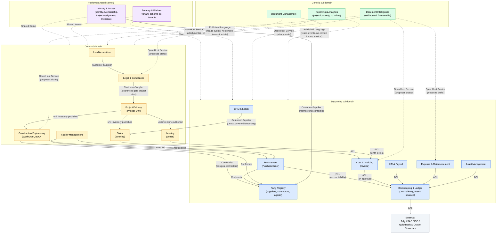

# Bounded context map

In4Suite's 16 published modules plus its Business Intelligence layer
regroup into **20 bounded contexts** for cerp. The regrouping isn't 1:1
because DDD bounded contexts are drawn around **consistency boundaries and
ubiquitous language**, not around a vendor's marketing/pricing module list -
so a few In4Suite modules split (Finance & Accounting) and a few merge (Legal
+ Liaison/Clearances) once modeled that way. Three contexts don't come from
In4Suite at all: Identity & Access and Tenancy & Platform are infrastructure
this repo already needed for multi-tenancy and auth, and Document
Intelligence is an AI capability added during architecture chat rather than
derived from the research (see `modules/generic-and-platform.md`).

## Subdomain classification

DDD splits bounded contexts into three strategic categories, and the category
should drive investment: build and refine **Core** yourself, buy or
lightly-adapt **Supporting**, and buy off-the-shelf for **Generic** wherever
possible.

### Core subdomain (the reason customers pick cerp over a generic ERP)

| Context | In4Suite module(s) | Status |
|---|---|---|
| Land Acquisition | Land Banking / Business Development | planned |
| Legal & Compliance | Legal & Court Cases + Liaison & Clearances | planned |
| Project Delivery | Projects Setup & Control | existing (as `properties`, simplified) |
| Construction Engineering | Engineering & Budget Control | existing (as the `construction` placeholder page) |
| Sales | Sales & Collections | planned |
| Leasing | Leasing & Revenue Shares | existing (as the `tenants` placeholder page) |
| Facility Management | Property/Facility Management | planned |

### Supporting subdomain (necessary, not differentiating)

| Context | In4Suite module(s) | Status |
|---|---|---|
| CRM & Leads | Leads Management | planned |
| Procurement | Purchase & Inventory | planned |
| Party Registry | (implicit: suppliers/contractors/agents referenced across modules) | partially existing (`services/partner-system` + `apps/api/src/partners`, minus the login piece - see `modules/generic-and-platform.md`'s Identity & Access entry) |
| Cost & Invoicing | Finance & Accounting (operational half) | planned |
| Bookkeeping & Ledger | Finance & Accounting (ledger half) | planned |
| HR & Payroll | HR & Payroll | deferred |
| Expense & Reimbursement | Expenses & Reimbursement + Travel Management | deferred |
| Asset Management | Asset Management | deferred |

### Generic subdomain (commodity - buy/reuse before building)

| Context | In4Suite module(s) | Status |
|---|---|---|
| Document Management | Document Management System | planned |
| Document Intelligence | (not from In4Suite - added during chat) | planned (self-hosted, fine-tunable extraction models - see `modules/generic-and-platform.md`) |
| Reporting & Analytics | Business Intelligence (Qlik) | existing (as the `dashboard` stat cards - see hydration-and-projection.md) |

### Platform (not from In4Suite - this repo's own infrastructure)

| Context | Status |
|---|---|
| Identity & Access | existing (`packages/core-api/src/auth`) |
| Tenancy & Platform | existing (`packages/core-api/src/tenancy`, `platform`) |

Why Finance & Accounting splits in two: **Cost & Invoicing** is operational,
high-volume, correctable data (a PM edits a draft invoice, fixes a typo,
re-submits) - ordinary CRUD-shaped consistency rules are fine. **Bookkeeping &
Ledger** is a real accounting ledger - it must be append-only, corrected only
via reversing entries, and fully reconstructable for an audit. Those are
different invariants and different hydration strategies (see
hydration-and-projection.md), so DDD says: different bounded context, even
though In4Suite sells them as one module.

Why Travel Management folds into Expense & Reimbursement rather than standing
alone: a travel request is, structurally, a pre-approval workflow feeding the
same `ExpenseClaim` aggregate and the same approval/ledger-posting path. It
doesn't have its own consistency boundary distinct from expenses, so giving it
a separate bounded context would be over-splitting.

## Context map

Renders as an actual graph on GitHub/VS Code/anything Mermaid-aware, not just
plain text - color grouping matches the subdomain classification tables
above (Core = amber, Supporting = blue, Generic = green, Platform = purple),
which is meant to visually reinforce the build-vs-buy investment priority
from that section: darker/warmer clusters are where cerp differentiates,
cooler ones are where off-the-shelf thinking applies.

A pre-rendered copy lives at
[`diagrams/bounded-context-map.png`](./diagrams/bounded-context-map.png) /
[`.svg`](./diagrams/bounded-context-map.svg), for viewing without a
Mermaid-aware renderer (dropping into a slide deck, sharing as an image,
etc). The Mermaid block below is the source of truth - the rendered copy is
a derived artifact and will drift out of sync if the diagram changes without
regenerating it. To regenerate after an edit:

```bash
awk '/^```mermaid$/{flag=1; next} /^```$/{flag=0} flag' docs/architecture/bounded-context-map.md > /tmp/bounded-context-map.mmd
npx -y @mermaid-js/mermaid-cli -i /tmp/bounded-context-map.mmd -o docs/architecture/diagrams/bounded-context-map.png -w 2400 -H 1800 -b white
npx -y @mermaid-js/mermaid-cli -i /tmp/bounded-context-map.mmd -o docs/architecture/diagrams/bounded-context-map.svg -b white
```



The four edges into whole subgraphs (`IAM`/`TEN` → `Core`/`Supporting`,
`DOC` → `Core`/`Supporting`, `BI` → `Core`/`Supporting`) are a deliberate
simplification - Identity & Access, Tenancy & Platform, and Document
Management are depended on by every single context in both clusters, and
Reporting & Analytics consumes every context's events. Drawing that
individually would be 20+ near-identical arrows converging on four nodes,
which obscures the more interesting, specific business-flow edges (the
land-to-lease chain, the financial posting chain) rather than clarifying
anything.

Solid arrows are direct, synchronous-feeling business relationships (a
command produces something the next context explicitly consumes). Dotted
arrows are the implicit/infrastructure ones - Shared Kernel dependencies,
Published Language event consumption, and Document Intelligence's
propose-a-draft relationship - none of which involve the upstream context
knowing the downstream one exists, unlike the solid ones.

## DDD strategic relationship patterns used above

| Pattern | Where it applies | Why |
|---|---|---|
| **Shared Kernel** | Identity & Access, Tenancy & Platform | Every other context is *literally unable to run* without a resolved tenant + authenticated principal - these aren't "integrations," they're a shared foundation, consistent with how `CoreModule.forRoot()` already wires `TenancyModule`/`AuthModule` as `global: true`. |
| **Customer-Supplier** | Land Acquisition → Legal & Compliance → Project Delivery; CRM & Leads → Sales | The upstream context's output (a cleared parcel, a qualified lead) is a precondition the downstream context depends on, but the downstream doesn't dictate the upstream's internal model. |
| **Anticorruption Layer (ACL)** | Sales/Leasing/Cost & Invoicing → Bookkeeping & Ledger; Bookkeeping & Ledger → external accounting systems | A "collection" or "invoice" concept must be translated into the ledger's strict debit/credit journal-entry concept, which has different invariants (immutability). Translating at the boundary keeps the ledger's model uncorrupted by every upstream context's looser vocabulary. Same reasoning applies outbound, translating cerp's ledger into Tally's/SAP FICO's own format. |
| **Conformist** | Procurement, Facility Management → Party Registry | These contexts don't need their own supplier/contractor model - they accept Party Registry's model as-is rather than translating, since there's no real conflict of vocabulary worth the translation cost. |
| **Open Host Service** | Document Management (attachments), Party Registry (via `services/partner-system`'s HTTP API), Document Intelligence (extraction) | A published, stable API any context can integrate against without a bespoke integration per consumer. Document Intelligence is a variant worth calling out: it hands back a *draft* command, not a fact the consumer accepts as-is - the requesting context's own aggregate still validates it, same as if a person had typed it in. |
| **Customer-Supplier** (identity) | Identity & Access → Party Registry | A `Membership` with `MembershipContext.type = 'party'` references a `Party` by id - Identity & Access depends on Party Registry's published ids for this, but owns nothing about who that party actually is; the login/role/credential concept and the business-entity concept are deliberately two different contexts, not one. |
| **Published Language** | Every context's domain events, consumed by Reporting & Analytics | Domain events are the versioned, public contract a context exposes; Reporting & Analytics (and any future consumer) depends only on that published event schema, never on another context's tables. |

## Relationship to the current codebase

`Property` (today) is a deliberately simplified stand-in that will eventually
split into `Project` + `Unit` under Project Delivery once land, phases, and
pricing plans are modeled for real. `apps/api/src/partners` +
`services/partner-system` is already exactly what the catalog calls Party
Registry for its non-login half: a separate deployable integrated through an
outbound gateway port, consumed as a Conformist by whatever context needs a
supplier/contractor/agent lookup. Its login half (`PartnerUser`) is where this
document *does* recommend a change eventually - see Identity & Access in
`modules/generic-and-platform.md` for why one shared credential across
tenant-organization and provider contexts means authentication can't stay
owned by two separate, disconnected systems. Nothing in this document
requires changing any of that code today - it's the
map for what gets built next, and where.
