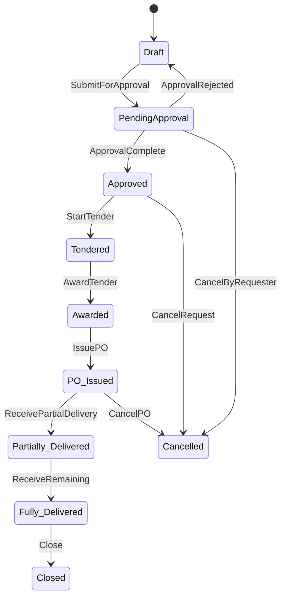
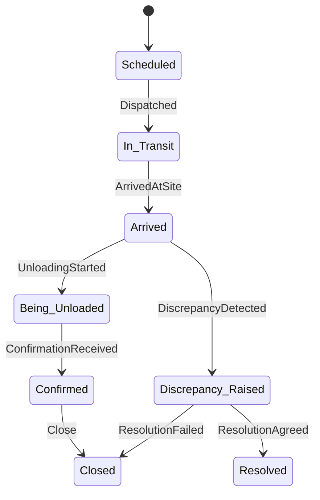
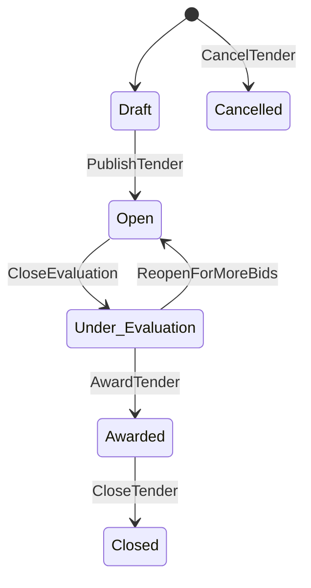
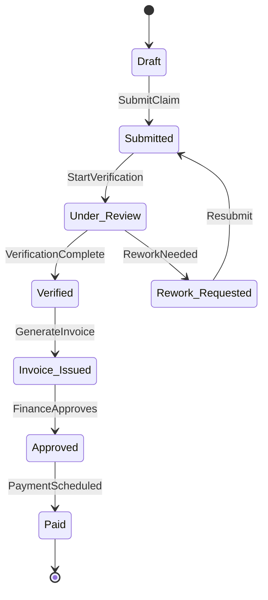

# Section 7: High-Level Business Workflows

## 7.1 Orchestration Architecture

### 7.1.1 Saga Pattern Overview

This system uses **orchestrator-based sagas** for complex cross-context workflows (Procurement, Delivery, Financials) and **event choreography** for simpler flows (User Assignment).

**Rationale:**

- Complex workflows have multiple branches, compensations, and SLA gates → orchestrator provides central visibility
- Simple flows are linear and self-contained → choreography is lighter weight
- All sagas use the **transactional outbox pattern** for event publishing

**Saga Pattern Comparison:**

```
Choreography (Event-driven):
  ServiceA → EventA → ServiceB → EventB → ServiceC
  Decentralized, harder to monitor, simpler setup

Orchestration (Command-driven):
  Orchestrator → CommandA → ServiceA → EventA → CommandB → ServiceB → EventB
  Centralized control, better visibility, easier compensation
```

**Decision:** Use orchestration for workflows with >3 branches or >5 services, choreography for simpler linear flows.

### 7.1.2 State Machine Design Principles

Each workflow aggregate has an explicit state machine:

| Aggregate          | States                                                                                                                 |
| ------------------ | ---------------------------------------------------------------------------------------------------------------------- |
| ProcurementRequest | Draft → PendingApproval → Approved → Tendered → PO_Issued → Partially_Delivered → Fully_Delivered → Closed → Cancelled |
| PurchaseOrder      | Draft → Approved → Issued → In_Fulfillment → Partially_Received → Fully_Received → Closed → Cancelled                  |
| Delivery           | Scheduled → In_Transit → Arrived → Being_Unloaded → Confirmed → Discrepancy_Raised → Resolved → Closed                 |
| Tender             | Draft → Open → Under_Evaluation → Awarded → Closed → Cancelled                                                         |
| ProgressClaim      | Draft → Submitted → Under_Review → Verified → Invoice_Issued → Approved → Paid → Rejected                              |

### 7.1.3 Command Handler Contracts

Standard command contract format for each step:

```
Command: {Aggregate}.{Action}
Handler Service: {service-name}
Permissions: {role requirement}
Validation: {preconditions}
Effects: {state changes, events emitted}
Idempotency Key: {optional}
SLA: {target response time}
```

### 7.1.4 Error Handling and Compensation Strategies

| Error Type                   | Strategy                             | Example                           |
| ---------------------------- | ------------------------------------ | --------------------------------- |
| Validation failure           | Reject with error message            | Invalid quantity, missing budget  |
| External service unavailable | Retry with backoff + circuit breaker | ERP sync fails                    |
| Business invariant violation | Compensating transaction             | PO issued but vendor not approved |
| SLA breach                   | Escalation task + notification       | Approval >48h                     |
| Manual intervention required | Dead-letter queue + operator task    | Discrepancy >5 days unresolved    |

### 7.1.5 KPI Measurement Points

Map each workflow step to Section 3 KPIs:

| Workflow Step                               | KPI Metric                         | Data Source      |
| ------------------------------------------- | ---------------------------------- | ---------------- |
| ProcurementRequestCreated → RequestApproved | Procurement Cycle Time             | Event timestamps |
| DeliveryScheduled → DeliveryConfirmed       | On-time Delivery Confirmation Rate | Event timestamps |
| TenderOpened → TenderAwarded                | Time-to-Award                      | Event timestamps |
| ProgressClaimSubmitted → MilestoneVerified  | Verification Lead Time             | Event timestamps |

### 7.1.6 Cross-Workflow Integration

Integration points between workflows:

```
Procurement Workflow ──POIssued──▶ Delivery Workflow
Procurement Workflow ──POIssued──▶ Financials (CommitmentRecorded)
Delivery Workflow ──DeliveryConfirmed──▶ Financials (InvoiceIssued)
Delivery Workflow ──DeliveryConfirmed──▶ Marketplace (CommissionAccrued)
Delivery Workflow ──DiscrepancyRaised──▶ Dispute Resolution Workflow
Progress Workflow ──MilestoneVerified──▶ Financials (InvoiceIssued)
```

---

## 7.2 Procurement → Delivery → Financials Workflow

### Purpose

End-to-end procurement lifecycle from request creation through delivery confirmation and financial settlement. Highest business impact workflow.

### Actors

| Role             | Responsibility                                  |
| ---------------- | ----------------------------------------------- |
| Project Manager  | Create requests, submit for approval, issue POs |
| Finance Approver | Review and approve procurement requests         |
| Vendor           | Dispatch goods, respond to discrepancies        |
| Site Engineer    | Confirm delivery, report discrepancies          |
| Finance Service  | Record commitments, process invoices            |

### Preconditions

- Project exists and is active
- Budget is available for requested items
- Vendor is approved in marketplace
- Materials exist in approved catalog

### Postconditions

- Materials received and inventory updated
- Invoices processed and payments scheduled
- Budget commitments recorded
- Commission accrued for marketplace transactions

### Duration

Typically 5-30 days depending on procurement value and tender requirements.

### Step-by-Step Command/Event Specification

| Step | Command                                | Handler Service     | Preconditions                                          | Events Emitted                           | Downstream Effects                     |
| ---- | -------------------------------------- | ------------------- | ------------------------------------------------------ | ---------------------------------------- | -------------------------------------- |
| 1    | `ProcurementRequest.Create`            | Procurement Service | Project exists, budget available, materials in catalog | `ProcurementRequestCreated`              | Create approval task, lock budget      |
| 2    | `ProcurementRequest.SubmitForApproval` | Procurement Service | All line items populated, evidence attached            | `ProcurementRequestSubmittedForApproval` | Create approval workflow task          |
| 3    | `ApprovalTask.Approve`                 | Workflow Service    | User has Approval role, SLA not breached               | `RequestApproved`                        | Release budget lock, create commitment |
| 4    | `ProcurementRequest.StartTender`       | Procurement Service | Request approved, requirements defined                 | `TenderOpened`                           | Create tender in Marketplace           |
| 5    | `Tender.Award`                         | Marketplace Service | Bids evaluated, winner selected                        | `TenderAwarded`                          | Link award, refund credits             |
| 6    | `ProcurementRequest.IssuePO`           | Procurement Service | Approved, vendor approved                              | `POIssued`                               | Create delivery order, notify vendor   |
| 7    | `Delivery.Dispatch`                    | Delivery Service    | PO issued, vendor dispatched                           | `ShipmentDispatched`                     | Notify site team                       |
| 8    | `Delivery.Confirm`                     | Delivery Service    | Arrived, evidence present                              | `DeliveryConfirmed`                      | Update inventory, issue invoice        |
| 9    | `Financials.ProcessInvoice`            | Financials Service  | PO match, quantity verified                            | `InvoiceApproved`                        | Schedule payment                       |
| 10   | `Marketplace.AccrueCommission`         | Marketplace Service | Delivery confirmed, cap not reached                    | `CommissionAccrued`                      | Update vendor credits                  |

### Error Scenarios and Compensation Flows

| Scenario                          | Trigger                                  | Detection                                  | Response                               | Compensation                                          |
| --------------------------------- | ---------------------------------------- | ------------------------------------------ | -------------------------------------- | ----------------------------------------------------- |
| Budget exceeded                   | Command validation fails                 | BudgetService.Check() returns insufficient | Reject with error code BUDGET_001      | None (no state change)                                |
| Approval timeout                  | SLA breach detected by scheduler         | WorkflowService.SLADetected()              | Escalate to PM, notify Finance         | None (workflow remains pending)                       |
| PO cancelled after POIssued       | `PurchaseOrder.Cancel` command           | Business rule check                        | Emit `POCancelled`                     | Release commitment, refund credits if bidding started |
| Delivery not confirmed within 48h | Scheduler checks DeliveryScheduled + 48h | NotificationService.SLADetected()          | Create discrepancy task, notify vendor | None                                                  |

### KPI Mapping

| KPI (from Section 3)   | Measurement Formula                                                | Steps Involved | Target          |
| ---------------------- | ------------------------------------------------------------------ | -------------- | --------------- |
| Procurement Cycle Time | median(POApproved.timestamp - ProcurementRequestCreated.timestamp) | Steps 1-3      | -40% by month 6 |
| On-time Delivery Rate  | count(DeliveryConfirmed within 24h of ETA) / total deliveries      | Steps 7-8      | +30% by month 6 |

### State Diagram



### Sequence Diagram

See: [@workflows:sequence-diagrams/procurement-delivery-financials.md](../sequence-diagrams/procurement-delivery-financials.md)

---

## 7.3 Material Delivery and Discrepancy Resolution Workflow

### Purpose

Handle material receipt at site and resolve any quantity or quality discrepancies with vendors.

### Actors

| Role            | Responsibility                                |
| --------------- | --------------------------------------------- |
| Vendor          | Schedule delivery, dispatch shipment          |
| Site Engineer   | Confirm receipt, report discrepancies         |
| Project Manager | Resolve discrepancies, coordinate with vendor |
| Finance         | Issue credit notes                            |

### Preconditions

- Purchase Order exists and is Issued
- Delivery is scheduled
- Site engineer is available for inspection

### Postconditions

- Materials received and inventory updated
- Discrepancies resolved (if any)
- Credit notes issued (if applicable)

### Duration

24 hours for clean delivery, up to 5 days for discrepancy resolution.

### Step-by-Step Command/Event Specification

| Step | Command                 | Handler Service    | Preconditions               | Events Emitted                             |
| ---- | ----------------------- | ------------------ | --------------------------- | ------------------------------------------ |
| 1    | `Delivery.Schedule`     | Delivery Service   | PO exists, vendor approved  | `DeliveryScheduled`                        |
| 2    | `Delivery.Dispatch`     | Delivery Service   | Status=Scheduled, eta > now | `ShipmentDispatched`                       |
| 3    | `Delivery.Confirm`      | Delivery Service   | Arrived, evidence present   | `DeliveryConfirmed` or `DiscrepancyRaised` |
| 4    | `Inventory.Update`      | Inventory Service  | Delivery confirmed          | `StockReceived`                            |
| 5    | `Financials.CreditNote` | Financials Service | Discrepancy verified        | `CreditNoteIssued`                         |

### Error Scenarios and Compensation Flows

| Scenario              | Trigger         | Detection                                | Response                              | Compensation          |
| --------------------- | --------------- | ---------------------------------------- | ------------------------------------- | --------------------- |
| ETA Exceeded          | Scheduler check | DeliveryScheduled + 48h without Dispatch | Notify vendor, create task            | None                  |
| Discrepancy Timeout   | Scheduler check | Discrepancy_Raised + 5 days              | Escalate to PM                        | None                  |
| Cancel During Transit | Command         | Manual trigger                           | Notify vendor, create return delivery | ReturnDeliveryCreated |
| Evidence Missing      | Confirm command | Validation fails                         | Reject with error EVIDENCE_001        | None                  |

### Discrepancy Types

| Type       | Description                          | Action                        |
| ---------- | ------------------------------------ | ----------------------------- |
| SHORT      | Received quantity less than ordered  | Credit note for difference    |
| OVER       | Received quantity more than ordered  | Accept extra or return excess |
| DAMAGE     | Goods damaged in transit             | Credit note + vendor claim    |
| WRONG_ITEM | Goods do not match PO specifications | Full return + reshipment      |

### State Diagram



### Sequence Diagram

See: [@workflows:sequence-diagrams/material-delivery-discrepancy.md](../sequence-diagrams/material-delivery-discrepancy.md)

---

## 7.4 Marketplace Bidding Workflow

### Purpose

Manage open and invited tender bidding processes including credit economy integration.

### Actors

| Role                 | Responsibility                         |
| -------------------- | -------------------------------------- |
| Project Manager      | Create tender, evaluate bids, award    |
| Vendor               | Submit bids, respond to clarifications |
| Evaluation Committee | Score bids for complex procurements    |

### Preconditions

- Procurement request is approved
- Tender requirements are defined
- Vendor has active account and credits

### Postconditions

- Winner selected and PO linked
- Credits refunded to non-winning bidders
- Commission tracking initialized

### Duration

7-14 days typical tender cycle.

### Step-by-Step Command/Event Specification

| Step | Command                  | Handler Service     | Preconditions                        | Events Emitted    |
| ---- | ------------------------ | ------------------- | ------------------------------------ | ----------------- |
| 1    | `Tender.Create`          | Marketplace Service | Project access, requirements defined | `TenderCreated`   |
| 2    | `Tender.Publish`         | Marketplace Service | Status=Draft, fields populated       | `TenderOpened`    |
| 3    | `Bid.Submit`             | Marketplace Service | Tender=Open, VendorApproved          | `BidSubmitted`    |
| 4    | `Tender.CloseEvaluation` | Marketplace Service | Closing date reached                 | `TenderEvaluated` |
| 5    | `Tender.Award`           | Marketplace Service | Under_Evaluation, winner selected    | `TenderAwarded`   |

### Credit Economy Impact

| Event           | Credit Action       | Recipient           |
| --------------- | ------------------- | ------------------- |
| BidSubmitted    | Debit bidCreditCost | Vendor Service      |
| TenderCancelled | Full refund         | All bidders         |
| TenderAwarded   | Refund non-winning  | Non-winning vendors |

### State Diagram



### Sequence Diagram

See: [@workflows:sequence-diagrams/marketplace-bidding.md](../sequence-diagrams/marketplace-bidding.md)

---

## 7.5 Subcontractor Progress → Payment Workflow

### Purpose

Handle progress claims from subcontractors including verification and invoice generation.

### Actors

| Role             | Responsibility                       |
| ---------------- | ------------------------------------ |
| Subcontractor PM | Submit progress claims               |
| Site Engineer    | Verify progress measurements         |
| Finance          | Generate invoices, schedule payments |

### Preconditions

- Work package assigned to subcontractor
- Rate card exists in Financials Service
- Subcontractor account is active

### Postconditions

- Progress verified by site engineer
- Invoice generated based on verified quantities and rate card
- Payment scheduled

### Duration

3 days verification + payment terms.

### Step-by-Step Command/Event Specification

| Step | Command                         | Handler Service    | Preconditions                              | Events Emitted                           |
| ---- | ------------------------------- | ------------------ | ------------------------------------------ | ---------------------------------------- |
| 1    | `ProgressClaim.Submit`          | Progress Service   | WorkPackage exists, measurements populated | `ProgressClaimSubmitted`                 |
| 2    | `ProgressClaim.Verify`          | Progress Service   | Status=Under_Review                        | `MilestoneVerified` or `ReworkRequested` |
| 3    | `ProgressClaim.GenerateInvoice` | Financials Service | Status=Verified, rate card exists          | `InvoiceIssued`                          |

### State Diagram



### Sequence Diagram

See: [@workflows:sequence-diagrams/subcontractor-progress-payment.md](../sequence-diagrams/subcontractor-progress-payment.md)

---

## 7.6 User Assignment and Access Provisioning Workflow

### Purpose

Manage user membership creation, role assignment, and access scope management.

### Actors

| Role      | Responsibility                   |
| --------- | -------------------------------- |
| Org Admin | Create memberships, assign roles |
| System    | Update authorization projections |

### Preconditions

- Organization exists
- User exists in identity store
- Admin has org-level permissions

### Postconditions

- User assigned with specified roles and scopes
- Authorization projection updated
- Session tokens refreshed with new claims

### Duration

Immediate (real-time).

### Step-by-Step Command/Event Specification

| Step | Command                 | Handler Service  | Preconditions                        | Events Emitted                      |
| ---- | ----------------------- | ---------------- | ------------------------------------ | ----------------------------------- |
| 1    | `Membership.Create`     | Identity Service | Org exists, User exists, Valid roles | `MembershipCreated`, `RoleAssigned` |
| 2    | `Workflow.CreateReview` | Workflow Service | Membership created                   | `PeriodicReviewTaskCreated`         |

### Access Model

| Level        | Scope          | Permissions                        |
| ------------ | -------------- | ---------------------------------- |
| Organization | Global         | All resources in org               |
| Project      | Project-level  | Project, subprojects, children     |
| Resource     | Resource-level | Specific project/construction site |

### Sequence Diagram

See: [@workflows:sequence-diagrams/user-assignment-access.md](../sequence-diagrams/user-assignment-access.md)

---

## 7.7 Document Lifecycle Workflow

### Purpose

Manage document creation, review, approval, and versioning across the platform.

### Actors

| Role     | Responsibility                      |
| -------- | ----------------------------------- |
| Author   | Create documents, submit for review |
| Reviewer | Approve or reject documents         |
| System   | Auto-reject stale reviews           |

### Preconditions

- Project exists
- User has project access
- Document type is valid

### Postconditions

- Document published to repository
- Version recorded
- Financial versioning updated

### Duration

Configurable review window (default: 5 business days).

### Step-by-Step Command/Event Specification

| Step | Command                 | Handler Service  | Preconditions                  | Events Emitted                           |
| ---- | ----------------------- | ---------------- | ------------------------------ | ---------------------------------------- |
| 1    | `Document.Create`       | Document Service | ValidType, ProjectExists       | `DocumentCreated`                        |
| 2    | `Document.SubmitReview` | Document Service | Status=Draft, fields populated | `DocumentSubmittedForReview`             |
| 3    | `Document.Approve`      | Document Service | Within review window           | `DocumentApproved` → `DocumentPublished` |
| 4    | `Document.Reject`       | Document Service | Within review window           | `DocumentRejected`                       |

### Versioning Rules

| Rule                    | Value                          |
| ----------------------- | ------------------------------ |
| Max Versions (default)  | 99                             |
| Max Versions (contract) | 999                            |
| New Version             | Published document + changes   |
| No Direct Editing       | Drafts only editable by author |

### Document Type Hierarchy

| Type     | Subtype     | Description                     |
| -------- | ----------- | ------------------------------- |
| Contract | Legal, Misc | Legally binding agreements      |
| Invoice  | Tax         | Financial and tax documentation |
| PO       | Purchase    | Purchase order processing       |
| Spec     | Tech, Other | Technical specifications        |

### Sequence Diagram

See: [@workflows:sequence-diagrams/document-lifecycle.md](../sequence-diagrams/document-lifecycle.md)

---

## 7.8 Additional Workflows (Phase 2+)

### 7.8.1 Vendor Onboarding → Approval → Marketplace Activation

**Flow:**

```
Vendor Registration → KYC/KYB Review → Compliance Check → Admin Approval → Vendor Approved → Marketplace Invited → First Bid Submitted
```

**Key events:** `VendorRegistered`, `KYCSubmitted`, `VendorApproved`, `VendorRejected`, `MarketplaceActivated`, `FirstBidSubmitted`

**Services:** Vendor Service, Identity Service, Marketplace Service

### 7.8.2 Dispute Resolution Workflow

**Flow:**

```
DisputeRaised → EvidenceAttached → Mediation → Resolution → Close
```

**Key events:** `DisputeRaised`, `EvidenceAttached`, `MediationScheduled`, `DisputeResolved`, `CreditNoteIssued`

**Services:** Delivery Service (source), Dispute Service (new), Financials Service

### 7.8.3 Financial Close Process

**Flow:**

```
PeriodStart → AccrualsRecorded → CommitmentsReviewed → InvoicesMatched → Reconciliation → Close
```

**Key events:** `PeriodStarted`, `AccrualRecorded`, `CommitmentReviewed`, `InvoiceMatched`, `ReconciliationComplete`, `PeriodClosed`

**Services:** Financials Service, ERP Integration

### 7.8.4 Material Request → Catalog Search → Quotation → PO

**Flow:**

```
MaterialRequestCreated → CatalogSearch → QuotationRequested → QuotationReceived → Comparison → POIssued
```

**Key events:** `MaterialRequestCreated`, `CatalogItemFound`, `QuotationRequested`, `QuotationReceived`, `POIssued`

**Services:** Procurement Service, Catalog Service, Vendor Service

---

## 7.9 Workflow Configuration Model

### 7.9.1 Template Structure

Workflow templates define the structure for dynamic workflow execution. Sample template available at: [@workflows:workflow-templates/procurement-standard.json](../workflow-templates/procurement-standard.json)

Key template components:

- **steps**: Ordered list of workflow steps with assignee roles, required fields, and SLAs
- **conditions**: Dynamic branching rules using expression language
- **compensations**: Rollback actions for event handling
- **kpis**: Measurement definitions linked to workflow steps
- **metadata**: Applicability filters (categories, regions, amounts)

### 7.9.2 Dynamic Step Insertion

- **Admin override**: PM or higher can insert steps at runtime (e.g., "Legal Review" for contracts >$100k)
- **Event-triggered**: System auto-inserts steps based on conditions
- **Audit trail**: All insertions/deletions logged as `WorkflowStepInserted` / `WorkflowStepRemoved` events

### 7.9.3 Role-Based Assignment

- Steps can target **roles** (not specific users) → Workflow Service resolves to active users at execution time
- **Delegation**: Role holder can delegate to another user (delegation logged)
- **Fallback**: If no user available within SLA, escalate to next role in hierarchy

### 7.9.4 Conditional Branching

Conditions expressed as JSON path expressions:

```json
{
  "condition": "totalAmount > 50000 AND category == 'steel'",
  "then": ["ExecutiveApproval", "LegalReview"],
  "else": ["PMApproval"]
}
```

Evaluated at runtime by Workflow Service using a lightweight expression engine.

---

## Supporting Files

### Sequence Diagrams

- [@workflows:sequence-diagrams/procurement-delivery-financials.md](./sequence-diagrams/procurement-delivery-financials.md)
- [@workflows:sequence-diagrams/material-delivery-discrepancy.md](./sequence-diagrams/material-delivery-discrepancy.md)
- [@workflows:sequence-diagrams/marketplace-bidding.md](./sequence-diagrams/marketplace-bidding.md)
- [@workflows:sequence-diagrams/subcontractor-progress-payment.md](./sequence-diagrams/subcontractor-progress-payment.md)
- [@workflows:sequence-diagrams/user-assignment-access.md](./sequence-diagrams/user-assignment-access.md)
- [@workflows:sequence-diagrams/document-lifecycle.md](./sequence-diagrams/document-lifecycle.md)

### State Machines

- [@workflows:state-machines/procurement-request.md](./state-machines/procurement-request.md)
- [@workflows:state-machines/delivery.md](./state-machines/delivery.md)
- [@workflows:state-machines/tender.md](./state-machines/tender.md)
- [@workflows:state-machines/progress-claim.md](./state-machines/progress-claim.md)

### Workflow Templates

- [@workflows:workflow-templates/procurement-standard.json](./workflow-templates/procurement-standard.json)
- [@workflows:workflow-templates/delivery-discrepancy.json](./workflow-templates/delivery-discrepancy.json)
- [@workflows:workflow-templates/bidding-workflow.json](./workflow-templates/bidding-workflow.json)
