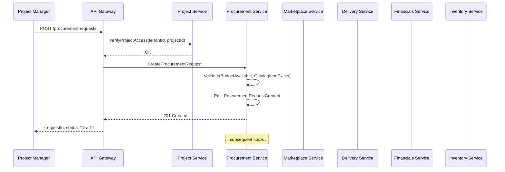
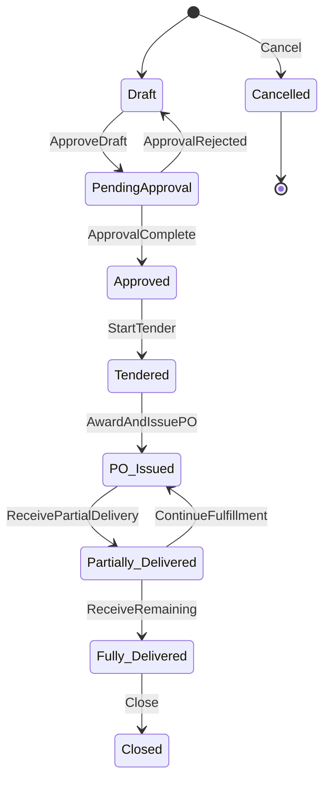

# Section 7 Enhancement Plan: High-Level Business Workflows

## Purpose

This document outlines the detailed plan for enhancing **Section 7 (High-Level Business Workflows)** of `ConstructHub_Concept_vNext.md`. The goal is to transform the current high-level workflow descriptions into implementation-ready specifications that engineers can follow to build the orchestration layer.

---

## Current State Analysis

### What Section 7 Currently Contains

The existing Section 7 has **6 workflow summaries** with basic structure:

| Workflow                                        | Actors                                        | Steps                | Events    | SLAs                           |
| ----------------------------------------------- | --------------------------------------------- | -------------------- | --------- | ------------------------------ |
| 1. Procurement → Delivery → Financials          | PM, Approvers, Vendor, Site Engineer, Finance | 9 steps              | 10 events | 48h approval, 24h confirmation |
| 2. Material Delivery and Discrepancy Resolution | Vendor, Site Engineer, PM, Finance            | 4 steps + SLAs       | 6 events  | 24h triage, 5 days resolution  |
| 3. Marketplace Bidding                          | PM, Vendors/Subcontractors                    | 4 steps              | 6 events  | 7-day evaluation               |
| 4. Subcontractor Progress → Payment             | Subcontractor PM, Site Engineer, Finance      | 3 steps              | 4 events  | 3-day verification             |
| 5. User Assignment and Access Provisioning      | Org Admin, Project Admin                      | 2 steps              | 3 events  | N/A                            |
| 6. Document Lifecycle                           | Any role, Reviewers                           | 4 steps + edge cases | 6 events  | Configurable review windows    |

### Gaps Identified

1. **No sequence diagrams** – Cross-service interactions are described textually only
2. **No state machines** – State transitions are implicit, not explicit
3. **No compensation flows** – Failure scenarios and rollbacks are mentioned but not specified
4. **No command handler specifications** – Which service handles which command is inferred but not documented
5. **No error handling strategies** – Retry, abort, manual intervention patterns missing
6. **No KPI measurement points** – Section 3 KPIs are referenced but not mapped to workflow steps
7. **No workflow configuration model** – How workflows are customized per project/tenant is absent

---

## Proposed Enhancement Structure

```
Section 7: High-Level Business Workflows

7.1  Orchestration Architecture
     7.1.1  Saga Pattern Overview (Choreography vs Orchestration)
     7.1.2  State Machine Design Principles
     7.1.3  Command Handler Contracts
     7.1.4  Error Handling and Compensation Strategies
     7.1.5  KPI Measurement Points
     7.1.6  Cross-Workflow Integration

7.2  Procurement → Delivery → Financials Workflow
     7.2.1  Sequence Diagram (Mermaid)
     7.2.2  State Machine (Mermaid)
     7.2.3  Step-by-Step Command/Event Specification
     7.2.4  Error Scenarios and Compensation Flows
     7.2.5  KPI Mapping

7.3  Material Delivery and Discrepancy Resolution Workflow
     7.3.1  Sequence Diagram
     7.3.2  State Machine
     7.3.3  Step Specification
     7.3.4  Error Scenarios and Compensations
     7.3.5  KPI Mapping

7.4  Marketplace Bidding Workflow
     7.4.1  Sequence Diagram
     7.4.2  State Machine
     7.4.3  Step Specification
     7.4.4  Error Scenarios and Compensations
     7.4.5  KPI Mapping

7.5  Subcontractor Progress → Payment Workflow
     7.5.1  Sequence Diagram
     7.5.2  State Machine
     7.5.3  Step Specification
     7.5.4  Error Scenarios and Compensations
     7.5.5  KPI Mapping

7.6  User Assignment and Access Provisioning Workflow
     7.6.1  Sequence Diagram
     7.6.2  State Machine
     7.6.3  Step Specification
     7.6.4  Error Scenarios

7.7  Document Lifecycle Workflow
     7.7.1  Sequence Diagram
     7.7.2  State Machine
     7.7.3  Step Specification
     7.7.4  Error Scenarios

7.8  Additional Workflows (Phase 2+)
     7.8.1  Vendor Onboarding → Approval → Marketplace Activation
     7.8.2  Dispute Resolution Workflow
     7.8.3  Financial Close Process
     7.8.4  Material Request → Catalog Search → Quotation → PO

7.9  Workflow Configuration Model
     7.9.1  Template Structure
     7.9.2  Dynamic Step Insertion
     7.9.3  Role-Based Assignment
     7.9.4  Conditional Branching
```

---

## Detailed Content Plan by Subsection

### 7.1 Orchestration Architecture

#### 7.1.1 Saga Pattern Overview

**Decision**: Use **orchestrator-based sagas** for complex cross-context workflows (Procurement, Delivery, Financials) and **event choreography** for simpler flows (User Assignment).

Rationale:

- Complex workflows have multiple branches, compensations, and SLA gates → orchestrator provides central visibility
- Simple flows are linear and self-contained → choreography is lighter weight
- All sagas use the **transactional outbox pattern** for event publishing

**Mermaid diagram**: Saga pattern comparison (choreography vs orchestration)

#### 7.1.2 State Machine Design Principles

Each workflow aggregate has an explicit state machine:

| Aggregate          | States                                                                                                                 |
| ------------------ | ---------------------------------------------------------------------------------------------------------------------- |
| ProcurementRequest | Draft → PendingApproval → Approved → Tendered → PO_Issued → Partially_Delivered → Fully_Delivered → Closed → Cancelled |
| PurchaseOrder      | Draft → Approved → Issued → In_Fulfillment → Partially_Received → Fully_Received → Closed → Cancelled                  |
| Delivery           | Scheduled → In_Transit → Arrived → Being_Unloaded → Confirmed → Discrepancy_Raised → Resolved → Closed                 |
| Tender             | Draft → Open → Under_Evaluation → Awarded → Closed → Cancelled                                                         |
| ProgressClaim      | Draft → Submitted → Under_Review → Verified → Invoice_Issued → Approved → Paid → Rejected                              |

#### 7.1.3 Command Handler Contracts

Standard command contract format for each step:

```
Command: {Aggregate}.{Action}
Handler Service: {service-name}
Permissions: {role requirement}
Validation: {preconditions}
Effects: {state changes, events emitted}
Idempotency Key: {optional}
SLA: {target response time}
```

#### 7.1.4 Error Handling and Compensation Strategies

| Error Type                   | Strategy                             | Example                           |
| ---------------------------- | ------------------------------------ | --------------------------------- |
| Validation failure           | Reject with error message            | Invalid quantity, missing budget  |
| External service unavailable | Retry with backoff + circuit breaker | ERP sync fails                    |
| Business invariant violation | Compensating transaction             | PO issued but vendor not approved |
| SLA breach                   | Escalation task + notification       | Approval >48h                     |
| Manual intervention required | Dead-letter queue + operator task    | Discrepancy >5 days unresolved    |

#### 7.1.5 KPI Measurement Points

Map each workflow step to Section 3 KPIs:

| Workflow Step                               | KPI Metric                         | Data Source      |
| ------------------------------------------- | ---------------------------------- | ---------------- |
| ProcurementRequestCreated → RequestApproved | Procurement Cycle Time             | Event timestamps |
| DeliveryScheduled → DeliveryConfirmed       | On-time Delivery Confirmation Rate | Event timestamps |
| TenderOpened → TenderAwarded                | Time-to-Award                      | Event timestamps |
| ProgressClaimSubmitted → MilestoneVerified  | Verification Lead Time             | Event timestamps |

#### 7.1.6 Cross-Workflow Integration

Integration points between workflows:

```
Procurement Workflow ──POIssued──▶ Delivery Workflow
Procurement Workflow ──POIssued──▶ Financials (CommitmentRecorded)
Delivery Workflow ──DeliveryConfirmed──▶ Financials (InvoiceIssued)
Delivery Workflow ──DeliveryConfirmed──▶ Marketplace (CommissionAccrued)
Delivery Workflow ──DiscrepancyRaised──▶ Dispute Resolution Workflow
Progress Workflow ──MilestoneVerified──▶ Financials (InvoiceIssued)
```

---

### 7.2–7.7 Detailed Workflow Specifications

Each workflow section follows this template:

#### [Workflow Name] Workflow

**Purpose**: One-sentence description of what this workflow achieves and why it matters.

**Actors**: List of roles involved with their responsibilities.

**Preconditions**: What must be true before the workflow can start.

**Postconditions**: What must be true when the workflow completes successfully.

**Duration**: Typical time range for end-to-end completion.

---

#### [Workflow Name] Sequence Diagram

Mermaid sequence diagram showing all services, aggregates, and message flows:



---

#### [Workflow Name] State Machine

Mermaid state diagram for the primary aggregate:



---

#### Step-by-Step Command/Event Specification

| Step # | Command                                | Handler Service     | Preconditions                                          | Events Emitted                           | Downstream Effects                     |
| ------ | -------------------------------------- | ------------------- | ------------------------------------------------------ | ---------------------------------------- | -------------------------------------- |
| 1      | `ProcurementRequest.Create`            | Procurement Service | Project exists, budget available, materials in catalog | `ProcurementRequestCreated`              | Create approval task, lock budget      |
| 2      | `ProcurementRequest.SubmitForApproval` | Procurement Service | All line items populated, evidence attached            | `ProcurementRequestSubmittedForApproval` | Create approval workflow task          |
| 3      | `ApprovalTask.Approve`                 | Workflow Service    | User has Approval role, SLA not breached               | `RequestApproved`                        | Release budget lock, create commitment |
| ...    | ...                                    | ...                 | ...                                                    | ...                                      | ...                                    |

---

#### Error Scenarios and Compensation Flows

| Scenario                          | Trigger                                  | Detection                                  | Response                               | Compensation                                          |
| --------------------------------- | ---------------------------------------- | ------------------------------------------ | -------------------------------------- | ----------------------------------------------------- |
| Budget exceeded                   | Command validation fails                 | BudgetService.Check() returns insufficient | Reject with error code BUDGET_001      | None (no state change)                                |
| Approval timeout                  | SLA breach detected by scheduler         | WorkflowService.SLADetected()              | Escalate to PM, notify Finance         | None (workflow remains pending)                       |
| PO cancelled after POIssued       | `PurchaseOrder.Cancel` command           | Business rule check                        | Emit `POCancelled`                     | Release commitment, refund credits if bidding started |
| Delivery not confirmed within 48h | Scheduler checks DeliveryScheduled + 48h | NotificationService.SLADetected()          | Create discrepancy task, notify vendor | None                                                  |

---

#### KPI Mapping

| KPI (from Section 3)   | Measurement Formula                                                | Workflow Steps Involved | Target          |
| ---------------------- | ------------------------------------------------------------------ | ----------------------- | --------------- |
| Procurement Cycle Time | median(POApproved.timestamp - ProcurementRequestCreated.timestamp) | Steps 1–3               | -40% by month 6 |
| On-time Delivery Rate  | count(DeliveryConfirmed within 24h of ETA) / total deliveries      | Steps 5–6               | +30% by month 6 |

---

### 7.8 Additional Workflows (Phase 2+)

These workflows are documented at a higher level since they are not Phase 1 priorities. They follow the same template as 7.2–7.7 but with less detail.

#### 7.8.1 Vendor Onboarding → Approval → Marketplace Activation

**Flow**:

```
Vendor Registration → KYC/KYB Review → Compliance Check → Admin Approval → Vendor Approved → Marketplace Invited → First Bid Submitted
```

**Key events**: `VendorRegistered`, `KYCSubmitted`, `VendorApproved`, `VendorRejected`, `MarketplaceActivated`, `FirstBidSubmitted`

**Services**: Vendor Service, Identity Service, Marketplace Service

#### 7.8.2 Dispute Resolution Workflow

**Flow**:

```
DisputeRaised → EvidenceAttached → Mediation → Resolution → Close
```

**Key events**: `DisputeRaised`, `EvidenceAttached`, `MediationScheduled`, `DisputeResolved`, `CreditNoteIssued`

**Services**: Delivery Service (source), Dispute Service (new), Financials Service

#### 7.8.3 Financial Close Process

**Flow**:

```
PeriodStart → AccrualsRecorded → CommitmentsReviewed → InvoicesMatched → Reconciliation → Close
```

**Key events**: `PeriodStarted`, `AccrualRecorded`, `CommitmentReviewed`, `InvoiceMatched`, `ReconciliationComplete`, `PeriodClosed`

**Services**: Financials Service, ERP Integration

#### 7.8.4 Material Request → Catalog Search → Quotation → PO

**Flow**:

```
MaterialRequestCreated → CatalogSearch → QuotationRequested → QuotationReceived → Comparison → POIssued
```

**Key events**: `MaterialRequestCreated`, `CatalogItemFound`, `QuotationRequested`, `QuotationReceived`, `POIssued`

**Services**: Procurement Service, Catalog Service, Vendor Service

---

### 7.9 Workflow Configuration Model

#### 7.9.1 Template Structure

```json
{
  "templateId": "uuid",
  "code": "PROCUREMENT_STANDARD",
  "name": "Standard Procurement Workflow",
  "description": "Default procurement flow for standard materials",
  "version": 1,
  "status": "Active",
  "steps": [
    {
      "stepId": "uuid",
      "order": 1,
      "code": "CREATE_REQUEST",
      "name": "Create Procurement Request",
      "type": "task",
      "assigneeRole": "Project Manager",
      "requiredFields": ["projectId", "materialId", "quantity", "justification"],
      "requiredEvidence": ["cost_justification"],
      "slaHours": 24,
      "nextSteps": ["SUBMIT_FOR_APPROVAL"]
    },
    {
      "stepId": "uuid",
      "order": 2,
      "code": "SUBMIT_FOR_APPROVAL",
      "name": "Submit for Approval",
      "type": "task",
      "assigneeRole": "Project Manager",
      "autoForward": true,
      "nextSteps": ["APPROVAL_REVIEW"]
    },
    {
      "stepId": "uuid",
      "order": 3,
      "code": "APPROVAL_REVIEW",
      "name": "Budget Approval Review",
      "type": "approval",
      "assigneeRole": "Finance Approver",
      "requiredFields": ["budgetCode", "costCenter"],
      "slaHours": 48,
      "onApprove": ["APPROVED", "CREATE_COMMITMENT"],
      "onReject": ["REJECTED", "RETURN_TO_REQUESTER"],
      "nextSteps": ["APPROVED", "REJECTED"]
    }
  ],
  "conditions": [
    {
      "name": "high_value_approval",
      "expression": "totalAmount > 50000",
      "then": "require_executive_approval",
      "else": "pm_approval_only"
    }
  ],
  "metadata": {
    "createdBy": "uuid",
    "createdAt": "2026-01-15T00:00:00Z",
    "updatedAt": "2026-01-15T00:00:00Z",
    "applicableCategories": ["steel", "concrete", "electrical"],
    "applicableRegions": ["EMEA", "APAC"]
  }
}
```

#### 7.9.2 Dynamic Step Insertion

- **Admin override**: PM or higher can insert steps at runtime (e.g., "Legal Review" for contracts >$100k)
- **Event-triggered**: System auto-inserts steps based on conditions (e.g., if `totalAmount > 100000`, insert `ExecutiveApproval` step)
- **Audit trail**: All insertions/deletions logged as `WorkflowStepInserted` / `WorkflowStepRemoved` events

#### 7.9.3 Role-Based Assignment

- Steps can target **roles** (not specific users) → Workflow Service resolves to active users at execution time
- **Delegation**: Role holder can delegate to another user (delegation logged)
- **Fallback**: If no user available within SLA, escalate to next role in hierarchy

#### 7.9.4 Conditional Branching

Conditions expressed as JSON path expressions:

```json
{
  "condition": "totalAmount > 50000 AND category == 'steel'",
  "then": ["ExecutiveApproval", "LegalReview"],
  "else": ["PMApproval"]
}
```

Evaluated at runtime by Workflow Service using a lightweight expression engine (e.g., Aviator, MVEL).

---

## Implementation Order (Step by Step)

Since the user requested "step by step" approach, here's the recommended implementation sequence:

### Step 1: Section 7.1 – Orchestration Architecture

- Write the foundational patterns document
- Include saga pattern, state machine principles, error handling strategies
- This is the reference section that all subsequent subsections build on

### Step 2: Section 7.2 – Procurement → Delivery → Financials

- Most critical workflow (highest business impact)
- Largest and most complex (9 steps, 10+ events)
- Serves as the template for other detailed sections

### Step 3: Section 7.3 – Material Delivery and Discrepancy Resolution

- Dependencies on Section 7.2 (shares Procurement and Delivery services)
- Adds discrepancy handling patterns

### Step 4: Section 7.4 – Marketplace Bidding

- Introduces credit economy, commission logic
- Standalone enough to be built after 7.1–7.3

### Step 5: Section 7.5 – Subcontractor Progress → Payment

- Financial linkage patterns
- Evidence-based verification

### Step 6: Sections 7.6–7.7 – User Assignment & Document Lifecycle

- Simpler workflows, quick to document
- Foundation for cross-cutting patterns

### Step 7: Section 7.8 – Additional Workflows (Phase 2+)

- Higher-level documentation for future workflows
- Can be refined later

### Step 8: Section 7.9 – Workflow Configuration Model

- Synthesizes patterns from all previous sections
- Template structure and configuration principles

---

## Output File Location

The enhanced Section 7 content will be written to:

- **Primary**: `docs/ConstructHub_Concept_vNext.md` (replacing current Section 7)
- **Supporting**: `docs/workflows/` directory for detailed diagrams and reference materials

---

## Quality Checklist

For each workflow section, verify:

- [ ] Mermaid sequence diagram is present and correctly references all services
- [ ] Mermaid state diagram covers all states and transitions
- [ ] Command/event table has complete information (service, permissions, events, effects)
- [ ] Error scenarios cover at least 4 failure modes per workflow
- [ ] KPI mapping links to Section 3 targets
- [ ] Cross-workflow integration points are documented
- [ ] SLAs are specified for each step

---

## File Structure

```
docs/
├── ConstructHub_Concept_vNext.md          (main document, enhanced Section 7)
└── workflows/
    ├── section7-enhancement-plan.md       (this file)
    ├── sequence-diagrams/                 (optional: standalone Mermaid files)
    ├── state-machines/                    (optional: standalone state diagrams)
    └── workflow-templates/                (sample JSON templates)
```
