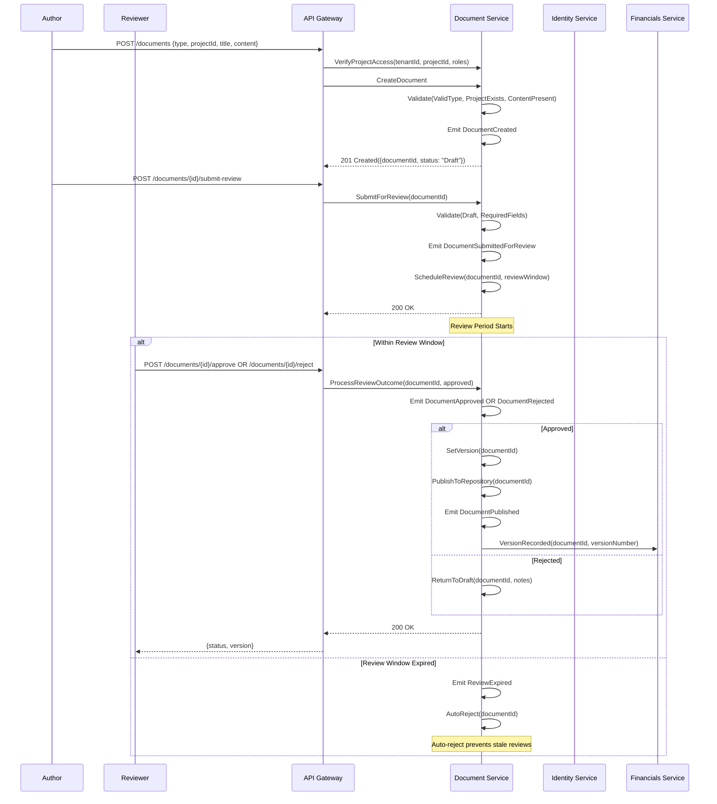

# Document Lifecycle Workflow

## Sequence Diagram



## Service Interaction Summary

| Interaction | From         | To               | Purpose                           |
| ----------- | ------------ | ---------------- | --------------------------------- |
| 1           | Author       | API Gateway      | Create document                   |
| 2           | API Gateway  | Document Service | Verify access and create document |
| 3           | Author       | API Gateway      | Submit document for review        |
| 4           | Reviewer     | API Gateway      | Approve or reject document        |
| 5           | Document Svc | Financials Svc   | Record version for versioning     |

## Document Type Hierarchy

| Type     | Subtype     | Description                     |
| -------- | ----------- | ------------------------------- |
| Contract | Legal, Misc | Legally binding agreements      |
| Invoice  | Tax         | Financial and tax documentation |
| PO       | Purchase    | Purchase order processing       |
| Spec     | Tech, Other | Technical specifications        |

## Versioning Rules

| Rule                    | Value                              |
| ----------------------- | ---------------------------------- |
| Max Versions (default)  | 99                                 |
| Max Versions (contract) | 999                                |
| New Version             | Published document + changes       |
| No Direct Editing       | Drafts only editable by author     |
| Rollback                | Reverts to prior published version |

## Event Propagation Chain

```
DocumentCreated
    → DocumentSubmittedForReview
        → ReviewExpired (if timeout)
        → DocumentApproved
        → DocumentRejected
        → DocumentPublished
            → VersionRecorded (Financials Service)
```

## File Information

- **Workflow**: Document Lifecycle
- **Complexity**: Medium (4 steps, 6 events, 4 services)
- **Phase Priority**: Phase 2
- **Related Workflows**: Project Management, Financial Close
