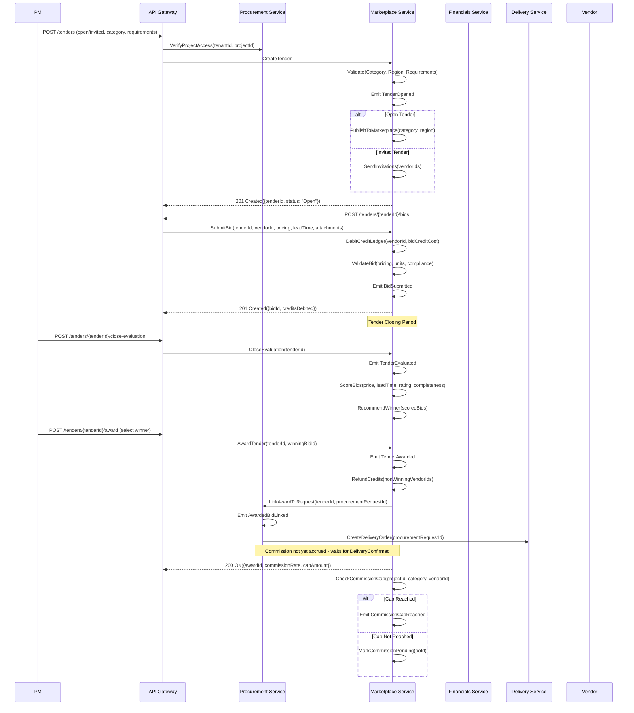

# Marketplace Bidding Workflow

## Sequence Diagram



## Service Interaction Summary

| Interaction | From                | To                  | Purpose                           |
| ----------- | ------------------- | ------------------- | --------------------------------- |
| 1           | PM                  | API Gateway         | Create tender                     |
| 2           | API Gateway         | Marketplace Service | Create and publish tender         |
| 3           | Vendor              | API Gateway         | Submit bid                        |
| 4           | Marketplace Service | Marketplace Service | Debit credit ledger               |
| 5           | PM                  | API Gateway         | Close evaluation                  |
| 6           | PM                  | API Gateway         | Award tender                      |
| 7           | Marketplace Service | Procurement Service | Link award to procurement request |
| 8           | Procurement Service | Delivery Service    | Create delivery order             |
| 9           | Marketplace Service | Marketplace Service | Check and apply commission cap    |

## Credit Economy Rules

| Event                          | Credit Action                                    |
| ------------------------------ | ------------------------------------------------ |
| BidSubmitted                   | Debit bidCreditCost from vendor                  |
| TenderCancelled (system)       | Full refund to all bidders                       |
| TenderAwarded                  | Refund non-winning bids                          |
| Winning bid delivery confirmed | No credit effect (commission handled separately) |
| GoldenBid purchase             | Debit premium placement credit cost              |

## Commission Lifecycle

```
TenderAwarded → CommissionMarkedPending
    → DeliveryConfirmed → CommissionAccrued
    → CommissionCapReached (if cap reached for project/category)
```

## Evaluation Scoring Model

| Factor          | Weight | Data Source          |
| --------------- | ------ | -------------------- |
| Price           | 40%    | Bid.pricing          |
| Lead Time       | 25%    | Bid.leadTime         |
| Supplier Rating | 20%    | Vendor reputation    |
| Completeness    | 15%    | Bid compliance check |

## File Information

- **Workflow**: Marketplace Bidding
- **Complexity**: High (5 steps, 10 events, 5 services)
- **Phase Priority**: Phase 2-3
- **Related Workflows**: Procurement → Delivery → Financials, Commission Tracking
