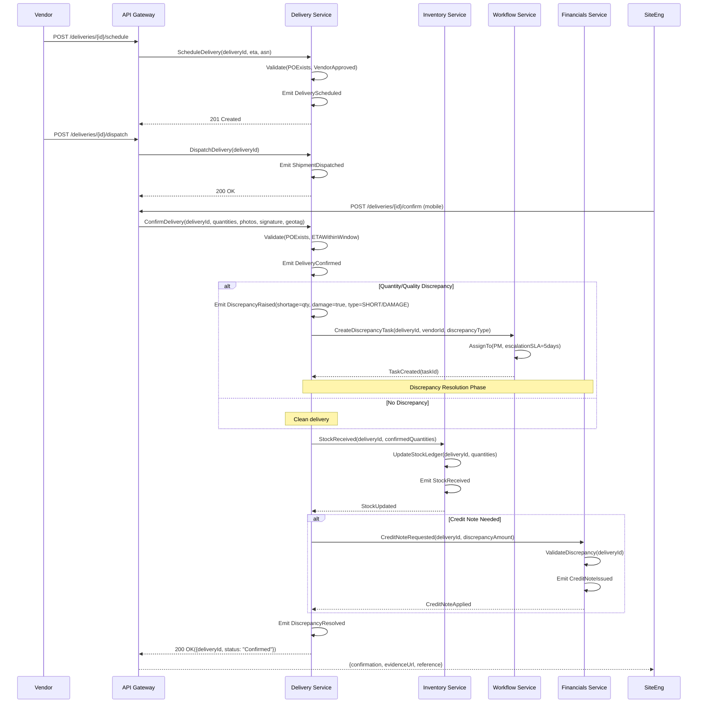

# Material Delivery and Discrepancy Resolution Workflow

## Sequence Diagram



## Service Interaction Summary

| Interaction | From               | To                 | Purpose                                 |
| ----------- | ------------------ | ------------------ | --------------------------------------- |
| 1           | Vendor             | API Gateway        | Schedule delivery                       |
| 2           | Vendor             | API Gateway        | Dispatch shipment                       |
| 3           | Site Engineer      | API Gateway        | Confirm delivery (mobile with evidence) |
| 4           | Delivery Service   | Workflow Service   | Create discrepancy task                 |
| 5           | Delivery Service   | Inventory Service  | Update stock ledger                     |
| 6           | Delivery Service   | Financials Service | Request credit note                     |
| 7           | Financials Service | Delivery Service   | Issue and apply credit note             |

## Discrepancy Types

| Type       | Description                                  | Action                        |
| ---------- | -------------------------------------------- | ----------------------------- |
| SHORT      | Received quantity less than ordered quantity | Credit note for difference    |
| OVER       | Received quantity more than ordered quantity | Accept extra or return excess |
| DAMAGE     | Goods damaged in transit                     | Credit note + vendor claim    |
| WRONG_ITEM | Goods do not match PO specifications         | Full return + reshipment      |

## Discrepancy Resolution SLAs

| Phase             | SLA             | Responsible   |
| ----------------- | --------------- | ------------- |
| Triage            | 24 hours        | Site Engineer |
| Investigation     | 3 business days | PM            |
| Resolution        | 5 business days | PM/Vendor     |
| Credit Note Issue | 2 business days | Finance       |

## Event Propagation Chain

```
DeliveryScheduled
    → ShipmentDispatched
        → DeliveryConfirmed
            → DiscrepancyRaised (if issues)
                → DiscrepancyResolved
                    → StockReceived
                    → CreditNoteIssued (if applicable)
```

## File Information

- **Workflow**: Material Delivery and Discrepancy Resolution
- **Complexity**: Medium (5 steps, 8 events, 5 services)
- **Phase Priority**: Phase 2
- **Related Workflows**: Procurement → Delivery → Financials, Dispute Resolution
