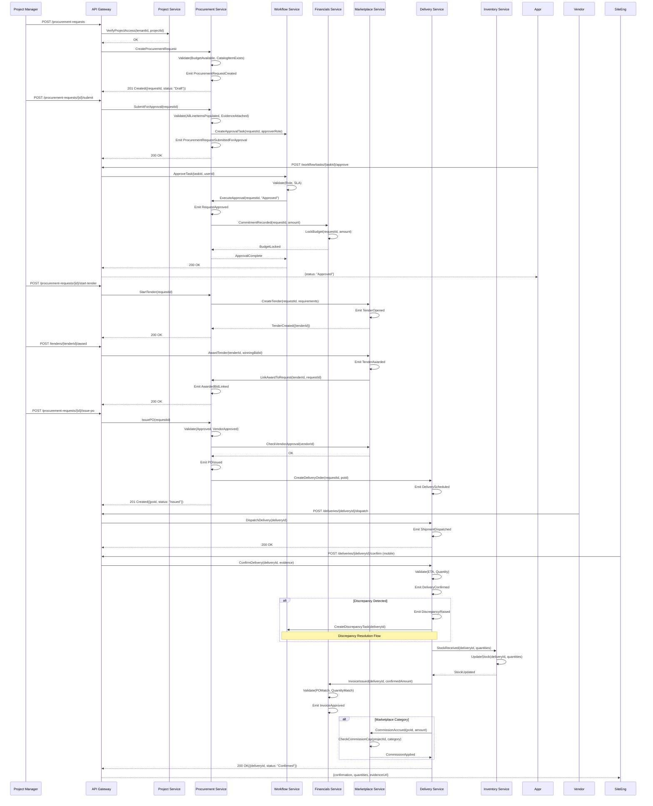

# Procurement → Delivery → Financials Workflow

## Sequence Diagram

This is the standalone Mermaid sequence diagram for the end-to-end procurement lifecycle.



## Service Interaction Summary

| Interaction | From                | To                  | Purpose                 |
| ----------- | ------------------- | ------------------- | ----------------------- |
| 1           | PM Client           | API Gateway         | Verify project access   |
| 2           | API Gateway         | Procurement Service | Create request          |
| 3           | Procurement Service | Workflow Service    | Create approval task    |
| 4           | Workflow Service    | Financials Service  | Record commitment       |
| 5           | Procurement Service | Marketplace Service | Check vendor approval   |
| 6           | Procurement Service | Delivery Service    | Create delivery order   |
| 7           | Delivery Service    | Inventory Service   | Update stock            |
| 8           | Delivery Service    | Financials Service  | Issue invoice           |
| 9           | Delivery Service    | Marketplace Service | Accrue commission       |
| 10          | Delivery Service    | Workflow Service    | Create discrepancy task |

## Event Propagation Chain

```
ProcurementRequestCreated
    → ApprovalTaskCreated (Workflow Service)
    → RequestApproved
        → CommitmentRecorded (Financials Service)
        → BudgetLocked (Financials Service)
    → POIssued
        → DeliveryScheduled (Delivery Service)
    → ShipmentDispatched
        → DeliveryConfirmed (Delivery Service)
            → StockReceived (Inventory Service)
            → InvoiceIssued (Financials Service)
            → CommissionAccrued (Marketplace Service)
```

## File Information

- **Workflow**: Procurement → Delivery → Financials
- **Complexity**: Highest (10 steps, 15+ events, 9 services)
- **Phase Priority**: Phase 2 (highest business impact)
- **Related Workflows**: Material Delivery, Marketplace Bidding, Financial Close
