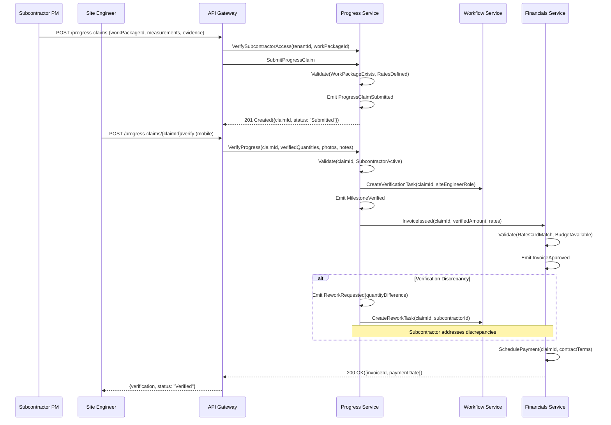

# Subcontractor Progress → Payment Workflow

## Sequence Diagram



## Service Interaction Summary

| Interaction | From               | To                 | Purpose                             |
| ----------- | ------------------ | ------------------ | ----------------------------------- |
| 1           | Subcontractor PM   | API Gateway        | Submit progress claim               |
| 2           | API Gateway        | Progress Service   | Verify access and submit claim      |
| 3           | Site Engineer      | API Gateway        | Verify progress (mobile)            |
| 4           | Progress Service   | Workflow Service   | Create verification task            |
| 5           | Progress Service   | Financials Service | Issue invoice based on verification |
| 6           | Financials Service | Financials Service | Validate rate card and budget       |
| 7           | Financials Service | Financials Service | Schedule payment                    |

## Rate Card Integration

| Element           | Source                      | Description                          |
| ----------------- | --------------------------- | ------------------------------------ |
| Rate Card         | Financials Service          | Pre-agreed rates per work unit       |
| Verified Quantity | Progress Claim verification | Site Engineer confirmed measurements |
| Invoice Amount    | Calculated                  | verifiedQuantity × agreedRate        |
| Budget Check      | Financials Service          | Validates against project budget     |

## Progress Claim Status Flow

```
Draft → Submitted → Under_Review → Verified → Invoice_Issued → Approved → Paid
                            ↓
                      Rework_Requested → Submitted (resubmit)
                            ↓
                        Rejected
```

## File Information

- **Workflow**: Subcontractor Progress → Payment
- **Complexity**: Medium (3 steps, 7 events, 5 services)
- **Phase Priority**: Phase 3
- **Related Workflows**: Procurement → Delivery → Financials
