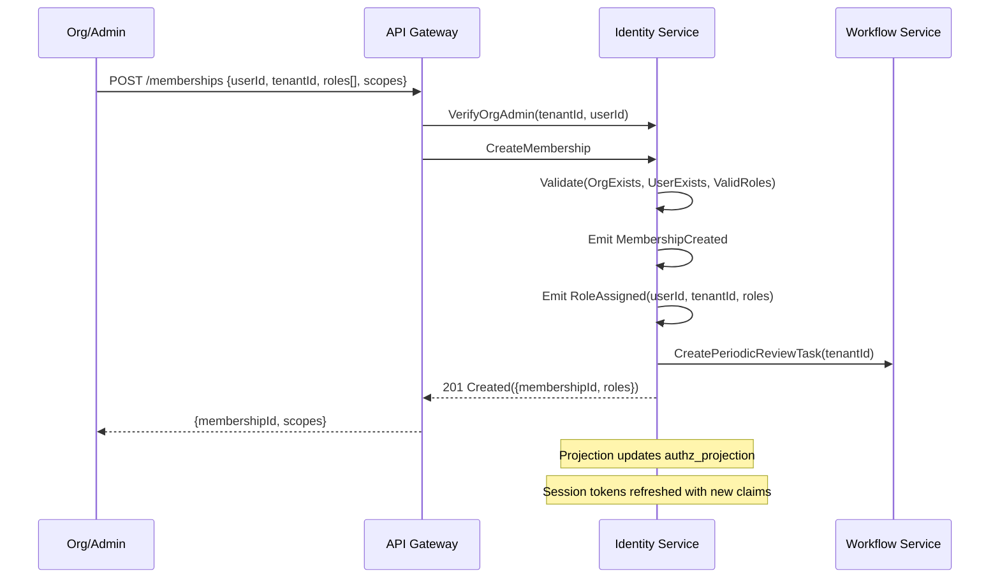

# User Assignment and Access Provisioning Workflow

## Sequence Diagram



## Service Interaction Summary

| Interaction | From         | To               | Purpose                     |
| ----------- | ------------ | ---------------- | --------------------------- |
| 1           | Admin        | API Gateway      | Create membership           |
| 2           | API Gateway  | Identity Service | Verify admin authorization  |
| 3           | Identity Svc | Identity Service | Validate prerequisites      |
| 4           | Identity Svc | Identity Service | Emit domain events          |
| 5           | Identity Svc | Workflow Service | Create periodic review task |

## Access Model

| Level        | Scope          | Permissions                        |
| ------------ | -------------- | ---------------------------------- |
| Organization | Global         | All resources in org               |
| Project      | Project-level  | Project, subprojects, and children |
| Resource     | Resource-level | Specific project/construction site |

## Permission Hierarchy

```
Tenant Admin/Manager > Resource Owner > Resource Manager > Resource Member > Resource Viewer
```

## Event Propagation Chain

```
MembershipCreated
    → RoleAssigned
        → authz_projection updated
        → Session tokens refreshed
        → PeriodicReviewTask created (Workflow Service)
```

## File Information

- **Workflow**: User Assignment and Access Provisioning
- **Complexity**: Low (2 steps, 3 events, 3 services)
- **Phase Priority**: Phase 1
- **Related Workflows**: Resource-level access control
