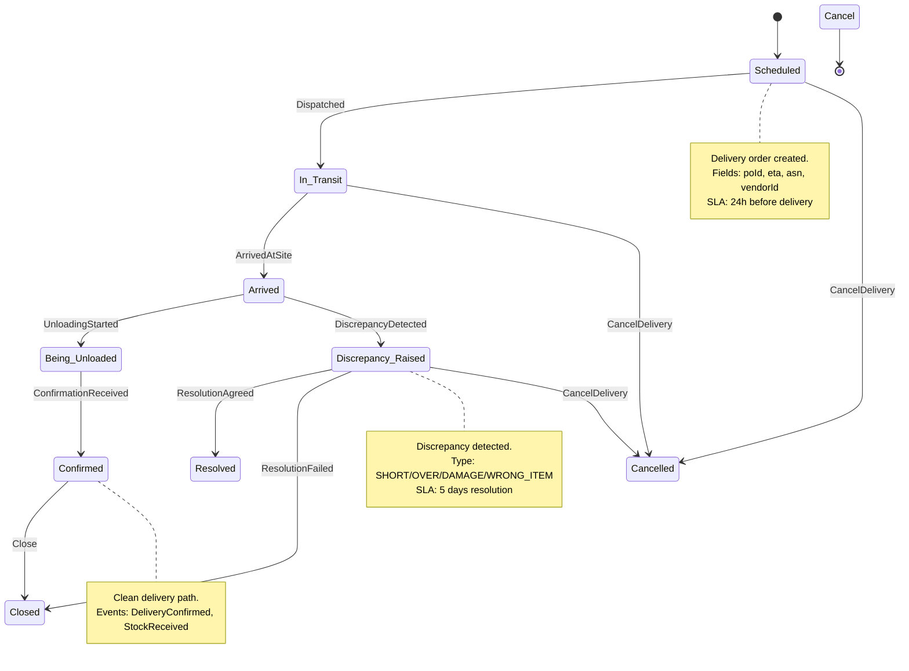

# Delivery State Machine

## State Diagram



## Command Handler Contracts

### Delivery.Schedule

```
Command: Delivery.Schedule
Handler: Delivery Service
Permissions: Procurement Service (internal), Project Manager
Validation: PO exists, status=PO_Issued, vendor approved
Effects: Creates aggregate in Scheduled state, emits DeliveryScheduled
Idempotency Key: poId (one delivery per PO)
SLA: 500ms
```

### Delivery.Dispatch

```
Command: Delivery.Dispatch
Handler: Delivery Service
Permissions: Vendor, System (auto-dispatch on status change)
Validation: Status=Scheduled, eta > now
Effects: Transitions to In_Transit, emits ShipmentDispatched
Idempotency Key: deliveryId + dispatchToken
SLA: 200ms
```

### Delivery.Confirm

```
Command: Delivery.Confirm
Handler: Delivery Service
Permissions: Site Engineer
Validation: Status=Arrived or Being_Unloaded, evidence present
Effects: Transitions to Confirmed or Discrepancy_Raised, emits DeliveryConfirmed or DiscrepancyRaised
Idempotency Key: deliveryId + confirmTimestamp
SLA: 1s (mobile)
```

## Error Scenarios and Compensations

| Error                 | Trigger         | Detection                                | Response                              | Compensation          |
| --------------------- | --------------- | ---------------------------------------- | ------------------------------------- | --------------------- |
| ETA Exceeded          | Scheduler check | DeliveryScheduled + 48h without Dispatch | Notify vendor, create task            | None                  |
| Discrepancy Timeout   | Scheduler check | Discrepancy_Raised + 5 days              | Escalate to PM                        | None                  |
| Cancel During Transit | Command         | Manual trigger                           | Notify vendor, create return delivery | ReturnDeliveryCreated |
| Evidence Missing      | Confirm command | Validation fails                         | Reject with error EVIDENCE_001        | None                  |

## State Transition Table

| From State         | Command              | To State           | Preconditions                          | Events                           |
| ------------------ | -------------------- | ------------------ | -------------------------------------- | -------------------------------- |
| Scheduled          | Dispatch             | In_Transit         | PO issued, vendor dispatched           | ShipmentDispatched               |
| In_Transit         | ArrivedAtSite        | Arrived            | Geo-fence match, time within window    | DeliveryArrived                  |
| Arrived            | UnloadingStarted     | Being_Unloaded     | Site engineer present                  | UnloadingStarted                 |
| Being_Unloaded     | ConfirmationReceived | Confirmed          | Quantities verified, evidence uploaded | DeliveryConfirmed, StockReceived |
| Being_Unloaded     | DiscrepancyDetected  | Discrepancy_Raised | Quantity/quality mismatch detected     | DiscrepancyRaised                |
| Discrepancy_Raised | ResolutionAgreed     | Resolved           | Vendor agreed, credit note issued      | DiscrepancyResolved              |
| Discrepancy_Raised | ResolutionFailed     | Closed             | No resolution possible                 | DiscrepancyClosed                |
| Confirmed          | Close                | Closed             | No outstanding actions                 | DeliveryClosed                   |
| Any                | CancelDelivery       | Cancelled          | User has permission                    | DeliveryCancelled                |

## Discrepancy Resolution Flow

```
DiscrepancyRaised
    → PM Notified (5 min)
    → Vendor Notified (1 hour)
    → Investigation (3 business days)
    → ResolutionAgreed
        → CreditNoteIssued
        → DiscrepancyResolved
    OR ResolutionFailed
        → DiscrepancyClosed
        → DisputeEscalated (if vendor disagrees)
```

## File Information

- **Aggregate**: Delivery
- **States**: 9 (Scheduled, In_Transit, Arrived, Being_Unloaded, Confirmed, Discrepancy_Raised, Resolved, Closed, Cancelled)
- **Commands**: 7 (Schedule, Dispatch, ArrivedAtSite, UnloadingStarted, Confirm, RaiseDiscrepancy, Cancel)
- **Related Aggregates**: PurchaseOrder, PurchaseOrderLineItem
- **Cross-Workflow Integration**: Links to Procurement (POIssued → DeliveryScheduled), Inventory (DeliveryConfirmed → StockReceived), Financials (DeliveryConfirmed → InvoiceIssued)
