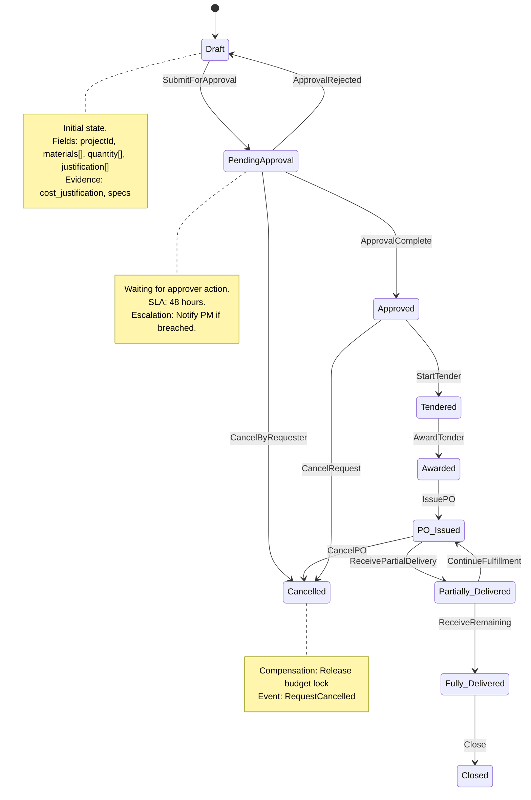

# Procurement Request State Machine

## State Diagram



## Command Handler Contracts

### ProcurementRequest.Create

```
Command: ProcurementRequest.Create
Handler: Procurement Service
Permissions: Project Manager (any project)
Validation: Project exists, budget available, materials in catalog
Effects: Creates aggregate in Draft state, emits ProcurementRequestCreated
Idempotency Key: Optional (prevents duplicate submissions)
SLA: 500ms
```

### ProcurementRequest.SubmitForApproval

```
Command: ProcurementRequest.SubmitForApproval
Handler: Procurement Service
Permissions: Project Manager (own request)
Validation: Status=Draft, all line items populated, evidence attached
Effects: Transitions to PendingApproval, emits ProcurementRequestSubmittedForApproval
Idempotency Key: None
SLA: 500ms
```

### ApprovalTask.Approve

```
Command: ApprovalTask.Approve
Handler: Workflow Service
Permissions: Finance Approver (for the project)
Validation: Task exists, status=Pending, SLA not breached
Effects: Emits ApprovalComplete, triggers downstream effects
Idempotency Key: taskId + userId
SLA: 200ms
```

## Downstream Effects on Approval

| Event           | Service             | Action                         |
| --------------- | ------------------- | ------------------------------ |
| RequestApproved | Financials Service  | CommitmentRecorded, LockBudget |
| RequestApproved | Procurement Service | CreateCommitmentRecord         |
| RequestApproved | Workflow Service    | Clear approval task            |

## State Transition Table

| From State          | Command                | To State            | Preconditions                           | Events                                 |
| ------------------- | ---------------------- | ------------------- | --------------------------------------- | -------------------------------------- |
| Draft               | SubmitForApproval      | PendingApproval     | Line items populated, evidence attached | ProcurementRequestSubmittedForApproval |
| PendingApproval     | ApprovalComplete       | Approved            | Valid approver, SLA met                 | RequestApproved                        |
| PendingApproval     | ApprovalRejected       | Draft               | Valid approver                          | RequestRejected                        |
| PendingApproval     | CancelByRequester      | Cancelled           | Requester is originator                 | RequestCancelled                       |
| Approved            | StartTender            | Tendered            | Approved status, requirements defined   | TenderOpened                           |
| Approved            | CancelRequest          | Cancelled           | Requester is originator                 | RequestCancelled                       |
| Tendered            | AwardTender            | Awarded             | Bids evaluated, winner selected         | TenderAwarded                          |
| Awarded             | IssuePO                | PO_Issued           | Vendor approved, budget locked          | POIssued                               |
| PO_Issued           | ReceivePartialDelivery | Partially_Delivered | Delivery scheduled, partial receipt     | DeliveryScheduled                      |
| Partially_Delivered | ReceiveRemaining       | Fully_Delivered     | All items received                      | DeliveryConfirmed                      |
| Fully_Delivered     | Close                  | Closed              | No outstanding actions                  | RequestClosed                          |
| Any                 | Cancel                 | Cancelled           | User has cancel permission              | RequestCancelled                       |

## File Information

- **Aggregate**: ProcurementRequest
- **States**: 10 (Draft, PendingApproval, Approved, Tendered, PO_Issued, Partially_Delivered, Fully_Delivered, Closed, Cancelled, Awarded)
- **Commands**: 8 (Create, SubmitForApproval, ApprovalComplete, ApprovalRejected, CancelByRequester, StartTender, AwardTender, IssuePO)
- **Related Aggregates**: PurchaseOrder, Tender, Delivery
