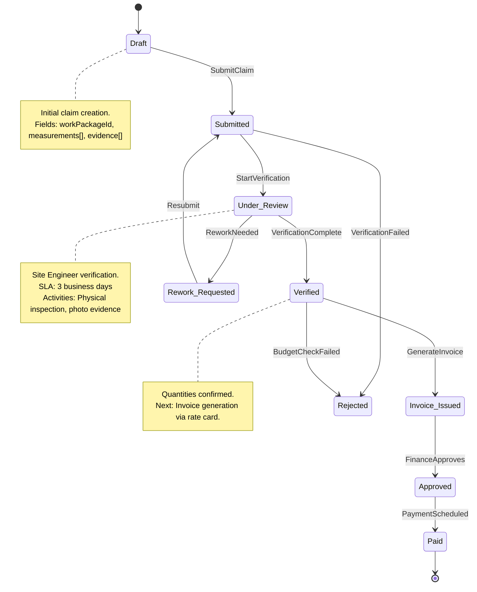

# Progress Claim State Machine

## State Diagram



## Command Handler Contracts

### ProgressClaim.Submit

```
Command: ProgressClaim.Submit
Handler: Progress Service
Permissions: Subcontractor (for assigned work packages)
Validation: WorkPackage exists, measurements populated, evidence attached
Effects: Transitions to Submitted, emits ProgressClaimSubmitted
Idempotency Key: claimId + submitToken
SLA: 1s
```

### ProgressClaim.Verify

```
Command: ProgressClaim.Verify
Handler: Progress Service
Permissions: Site Engineer
Validation: Status=Under_Review, claim belongs to active subcontractor
Effects: Transitions to Verified or Rework_Requested, emits MilestoneVerified or ReworkRequested
Idempotency Key: claimId + verifyTimestamp
SLA: 1s (mobile)
```

### ProgressClaim.GenerateInvoice

```
Command: ProgressClaim.GenerateInvoice
Handler: Financials Service
Permissions: Progress Service (internal)
Validation: Status=Verified, rate card exists for work package
Effects: Creates invoice record, emits InvoiceIssued
Idempotency Key: claimId (one invoice per verified claim)
SLA: 500ms
```

## Rate Card Integration

| Element           | Source                           | Description                      |
| ----------------- | -------------------------------- | -------------------------------- |
| Rate Card         | Financials Service               | Pre-agreed rates per work unit   |
| Verified Quantity | ProgressClaim.verifiedQuantities | Site Engineer confirmed          |
| Invoice Amount    | Calculated                       | verifiedQuantity × agreedRate    |
| Budget Check      | Financials Service               | Validates against project budget |

## Error Scenarios and Compensations

| Error               | Trigger           | Detection                 | Response                     | Compensation |
| ------------------- | ----------------- | ------------------------- | ---------------------------- | ------------ |
| Budget Check Failed | GenerateInvoice   | Insufficient budget       | Reject with BUDGET_001       | None         |
| Verification Failed | Verify command    | Substandard work          | Reject with Rework_Requested | None         |
| Rework Timeout      | Scheduler check   | Rework_Requested + 7 days | Escalate to PM               | None         |
| Payment Failed      | Payment scheduler | Bank transfer fails       | Retry 3x, notify Finance     | None         |

## State Transition Table

| From State       | Command              | To State         | Preconditions                             | Events                   |
| ---------------- | -------------------- | ---------------- | ----------------------------------------- | ------------------------ |
| Draft            | SubmitClaim          | Submitted        | Measurements populated, evidence attached | ProgressClaimSubmitted   |
| Submitted        | StartVerification    | Under_Review     | Valid claim, subcontractor active         | VerificationStarted      |
| Under_Review     | VerificationComplete | Verified         | Site inspection passed                    | MilestoneVerified        |
| Under_Review     | ReworkNeeded         | Rework_Requested | Quantities/quality mismatch               | ReworkRequested          |
| Rework_Requested | Resubmit             | Submitted        | Subcontractor corrected work              | ProgressClaimResubmitted |
| Verified         | GenerateInvoice      | Invoice_Issued   | Rate card matched, budget available       | InvoiceIssued            |
| Invoice_Issued   | FinanceApproves      | Approved         | Finance review complete                   | InvoiceApproved          |
| Approved         | PaymentScheduled     | Paid             | Payment processed                         | PaymentScheduled         |
| Any              | Reject               | Rejected         | User has reject permission                | ClaimRejected            |

## File Information

- **Aggregate**: ProgressClaim
- **States**: 9 (Draft, Submitted, Under_Review, Verified, Rework_Requested, Invoice_Issued, Approved, Paid, Rejected)
- **Commands**: 6 (Submit, Verify, ReworkNeeded, GenerateInvoice, FinanceApproves, Reject)
- **Related Aggregates**: WorkPackage, Invoice, Contract
- **Cross-Workflow Integration**: Links to Financials (InvoiceIssued), Workflow Service (VerificationTask)
