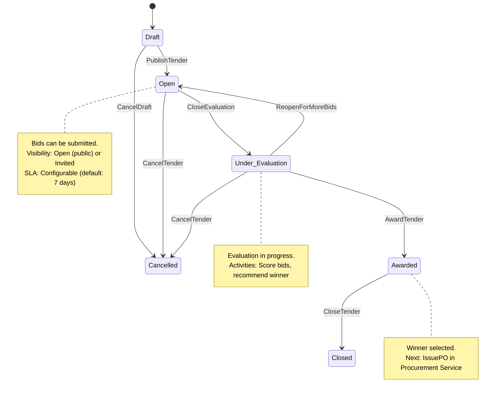

# Tender State Machine

## State Diagram



## Command Handler Contracts

### Tender.Publish

```
Command: Tender.Publish
Handler: Marketplace Service
Permissions: Project Manager
Validation: Status=Draft, all required fields populated
Effects: Transitions to Open, emits TenderOpened
Idempotency Key: tenderId + publishToken
SLA: 500ms
```

### Tender.SubmitBid

```
Command: Bid.Submit
Handler: Marketplace Service
Permissions: Approved Vendor
Validation: Tender=Open, VendorApproved, CreditAvailable
Effects: Creates bid in Submitted state, emits BidSubmitted, debits credit ledger
Idempotency Key: tenderId + vendorId
SLA: 500ms
```

### Tender.Award

```
Command: Tender.Award
Handler: Marketplace Service
Permissions: Project Manager
Validation: Status=Under_Evaluation, winner selected, bids scored
Effects: Transitions to Awarded, emits TenderAwarded, refunds non-winning credits
Idempotency Key: tenderId + awardToken
SLA: 1s
```

## Evaluation Flow

```
CloseEvaluation
    → ScoreBids (price 40%, leadTime 25%, rating 20%, completeness 15%)
    → RecommendWinner
    → Under_Evaluation
        → AwardTender
            → TenderAwarded
            → LinkAwardToRequest (Procurement Service)
        → OR ReopenForMoreBids → Open
```

## Credit Economy Impact

| Event                 | Credit Action       | Recipient           |
| --------------------- | ------------------- | ------------------- |
| BidSubmitted          | Debit bidCreditCost | Vendor Service      |
| TenderCancelled       | Full refund         | All bidders         |
| TenderAwarded         | Refund non-winning  | Non-winning vendors |
| Winning bid fulfilled | No credit effect    | N/A                 |

## State Transition Table

| From State       | Command         | To State         | Preconditions                        | Events          |
| ---------------- | --------------- | ---------------- | ------------------------------------ | --------------- |
| Draft            | PublishTender   | Open             | Required fields populated            | TenderOpened    |
| Open             | CloseEvaluation | Under_Evaluation | All bids received or deadline passed | TenderEvaluated |
| Under_Evaluation | AwardTender     | Awarded          | Winner selected, scores calculated   | TenderAwarded   |
| Awarded          | CloseTender     | Closed           | PO issued, no outstanding actions    | TenderClosed    |
| Any              | CancelTender    | Cancelled        | User has cancel permission           | TenderCancelled |

## File Information

- **Aggregate**: Tender
- **States**: 6 (Draft, Open, Under_Evaluation, Awarded, Closed, Cancelled)
- **Commands**: 5 (PublishTender, CloseEvaluation, AwardTender, ReopenForMoreBids, CancelTender)
- **Related Aggregates**: Bid, ProcurementRequest, PurchaseOrder
- **Cross-Workflow Integration**: Links to Procurement (LinkAwardToRequest), Delivery (CreateDeliveryOrder), Financials (CommitmentRecorded)
